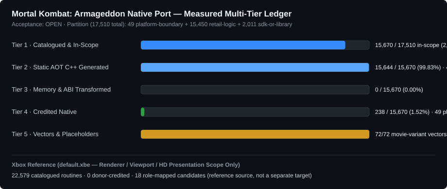

# Retail Armageddon native port — current status

<!-- PROGRESS:START -->
## Native Reimplementation Progress & Multi-Tier Ledger

**Verified Fork Commit**: [`503ad50e`](https://github.com/nahshongraham97/ps2-native-recomp/commit/503ad50e6c0c703fff2b3c7a23c93ef6d9c473e0) (source and evidence checkpoint)

### Tier 1 · Catalogued & Classified (`research/ledger/functions.csv`)
- Bounded ownership of 15,669 callable entries · verified-renderware 5, verified-game 12, verified-other-library 0, inferred-renderware 137, inferred-game 130, inferred-other 0, unresolved 15,385.
- Ownership evidence by kind (overlapping entries) · E1 5, E2 0, E3 26, E4 13, E5 165, E6 112, E7 1.
- Native credit retains its published component evidence. This ownership pass awards zero native credit.
- **Total PS2 Function Catalog**: **17,510** raw catalogue entries (`13,138` base `SLUS_214.10` + `4,372` dynamic overlays: `1` `GAMER.ovl`, `2,537` `MOVIER.ovl`, `1,834` `NETR.ovl`)
- **In-Scope Retail Path**: **15,670** (`2,643` non-exec/library: `sdk-or-library` 2,011 + `pointer-scan-proven` 632; `12,789` open frontier) | **Excluded Online (`out-of-scope-stubbed`)**: **1,840**
- **Code-Computed Role Partition (`function_classification_inventory.json`)**: `49` `platform-boundary` + `15,450` `retail-logic` + `2,011` `sdk-or-library` = **17,510** (in-scope: `49` + `13,610` + `2,011` = **15,670**)

### Tier 2 · Build-Time Static AOT Generated (`research/ledger/aot_coverage_inventory.json`)
- **In-Scope Static AOT C++**: **99.99%** (**15,669 / 15,670** reproduced via `eerecomp` into untracked `build/generated-aot/`, `395` units total; `0` tracked generated `.cpp` files in Git)
- **Audited Data Contradictions**: **1** raw catalogue entry/entries (`0x005BF218`) are original descriptor data, not generated functions. Original catalogue rows and denominators stay visible; no failure stub or data address receives AOT credit.

| Module / Artifact | Build-Time Static AOT Status | Static AOT / Catalog | Reference % |
|---|---|---|---|
| **Base `SLUS_214.10`** | `311` static `unit_*.cpp` files reproduced from pinned ELF (`reproduce_aot_pipeline.py`; `13,131` in-scope + `6` excluded online) | 13,137 / 13,138 | 99.99% |
| **`MOVIER.ovl` Overlay** | `34` static `m_MOVIER_unit_*.cpp` files reproduced from `MWo3` overlay | 2,537 / 2,537 | 100.00% |
| **`GAMER.ovl` Overlay** | `1` static `m_GAMER_unit_0000.cpp` file reproduced from `MWo3` overlay | 1 / 1 | 100.00% |
| **In-Scope AOT Subtotal** | *Build-time static C++ across `SLUS_214.10` (`13,131`) + `MOVIER.ovl` (`2,537`) + `GAMER.ovl` (`1`)* | **15,669 / 15,670** | **99.99%** |
| **Excluded `NETR.ovl`** | Out of scope (`DECISION_ONLINE_OUT_OF_SCOPE.json`) | 0 / 1,834 | — |
| **Dynamic Overlay Windows (`kModules`)** | `4` authenticated runtime RAM window snapshots (`49` measured static `m_007C*` units) | 4 captured windows | — |
| **VU1 Microprograms (Separate VU Domain)** | `493` static keys from `211` hash-admitted input images; state evidence: `CORRECT_SOURCE_AND_INDEPENDENT_SNAPSHOT_REGISTER_MEMORY_PACKET_COMPARISON_PASS`. Independent snapshot replay: `61` state(s), `41,296` exact ordered packet bytes. This is selected-program replay; historical invocations and untested programs remain unverified. | 493 / 493 recorded-input keys | — |

### Tier 3 · Memory & ABI Transformed (`Phase 5` Target)
- **Contract-Transformed Functions**: **0.01%** (**2 / 15,670** — authenticated compiled prototype functions only; production integration is separate. Remaining generated AOT units retain `c.r[...]`, `g_ram`, `$gp`, and guest vtables.)

### Tier 4 · Credited Native Implementations (`functions.csv` & `ported_function_evidence.json`)
- **Credited Completion**: **1.52%** (238 / 15,670 in-scope: `227` `ported` + `11` `host-replaced` + `0` `implemented-via-donor`; code partition: `49` `platform-boundary` + `189` `retail-logic`)
- **Open Frontier**: **12,789** (`9,038` `SLUS_214.10`, `1,102` `MOVIER.ovl`, `1` `GAMER.ovl`, `2,648` `no-direct-callers` across 5,400 indirect call sites)

### Tier 5 · Verified Vectors & Acceptance Placeholders
- **Verified Differential Vectors**: **72 / 72** bit-exact match on xemu movie-variant oracle (`LOGON`/`LOGOW` selector); **0** dual-platform whole-function vectors awarding donor credit (`ps2_xbox_map.csv`: `17,519` rows = `0` exact, `0` structural, `0` composite, `52` mapped-by-role, `17,467` unmapped)
- **Acceptance Placeholders**: **26** registered unrecovered placeholders (`0` undefined link symbols; `13` hit across 369 calls in 60-frame headless probe); whole-game acceptance strictly **OPEN**

### Xbox Reference (`default.xbe` — read-only identification and comparison; no completion percentage)
- **Reference Catalog**: **22,579** `default.xbe` routines inspected (`21,321` in non-XONLINE candidate set, `0` donor-credited, `52` role-mapped candidates). Read-only library identification and measured Xbox-versus-PS2 capability comparisons are authorized. Algorithm adoption remains limited to renderer, viewport, and HD presentation after the per-capability comparison; the owner decides the route. GS packet decoding is an interim concession only.
<!-- PROGRESS:END -->

<!-- RENDERER_SCOPE:START -->
> **Phase 6 ownership.** The progress block above counts callable entries under the current evidence rules. Earlier renderer-family counts combined plugin registrations, reference roles and pipeline callbacks. The four E1 stream and camera roles have original body hashes, caller sites and mutation tests. The stream finder accepts versions 0x34000 through 0x36003 inclusive. Native integration and each function’s differential check remain separate gates. The per-capability Xbox comparison records the dependencies and the limits of each route.
<!-- RENDERER_SCOPE:END -->

> [!NOTE]
> **Current Phase 4 verification**: Catalogue seeding and authenticated dynamic-window inputs restore the omitted callable entries. The raw catalogue descriptor-data contradiction remains visible with no code credit. Independent selected-boundary comparisons pass on every pinned snapshot, including complete VU registers, memory changes and ordered GIF bytes; deliberate packet corruption fails. This exposed and fixed discarded architectural MAC/STATUS updates in the generator. A clean clone rebuilt the generators and reproduced every generated source/header byte; a second generation run preserved the inventory bytes. These checks close the recorded-corpus generation and selected-comparison work. Phase 5 starts after this checkpoint is published. No authenticated VU0 microprogram payload/launch stream was found in this corpus; unobserved programs, historical invocations, untested functions, general hardware numeric equivalence and whole-game acceptance remain OPEN.

> **Current Phase 5 verification**: Both actual generated GAMER/MOVIER initializer functions now lower through an offline Clang semantic AST frontend into typed native field ownership and explicit scalar effects. Complete register/RAM differentials pass over all pinned saved inputs and synthetic boundaries; deliberately changing the mode fails. The native library has no runtime dependencies. Structural checks reject renamed memory helpers/arrays, pointer casts, unbound fields/calls, widened or signed arithmetic, hidden storage, inheritance and assembly, including macro-expanded assembly. Measured isolated-call costs and source/binary identities are in the existing work-item record. Struct-contained pointers, general vtables/indirect dispatch and production integration remain OPEN; unsupported cases refuse by name. No guest-memory shim is present. This checkpoint is published; the Phase 6 census limit is recorded above.

> [!NOTE]
> **Historical correction checkpoint `9e426b76` — superseded by the generated current measurements above**:
> - Actual generated entry maps and exact switch targets cover **15,644 / 15,670** in-scope catalogue starts: base **13,112 / 13,138**, MOVIER **2,537 / 2,537**, GAMER **1 / 1**. The **26** base omissions have zero dispatch entries even though they lie inside generated unit ranges. The previous range-only numerator is superseded. `aot_inventory.py` measures the maps, switch targets and source hashes; validation rejects stale coverage.
> - **Saved-state VU correction verified**: The old extraction crossed the variable IPU section. The corrected version-8 parser validates producer ABI, bounds and section structure before restoring data, and its IPU-gap/version/truncation/ambiguity regressions pass. All 61 pinned snapshots now map to 18 real code images and declared entry-zero key `951776F70CC01D5D`; no VU execution is claimed. Generation admits 211 hash-pinned captured inputs, emits 493 static keys, and excludes the preserved mis-extraction by provenance. The independent complete GAMER leaf component passes on all 61 loaded inputs. General function-boundary and ordered VU-packet equivalence remain **OPEN**.
> - Phase 0 revalidation found the restored oracle launcher still pointing to a retired checkout and referencing original keys. Existing oracle contents remain immutable; a separately pinned additive launcher has passed static inspection and disposable preparation without game execution. The repair checkpoint passes static restoration, original-byte checks and the recorded native baseline. Published Phases 0–3 carry forward; Phase 4 coverage and equivalence must finish before Phase 5.

> [!NOTE]
> **Historical Phase 3 checkpoint — current measurements are in the generated block above**:
> - **Reproducible Fresh-Clone Generation (`tools/research/reproduce_aot_pipeline.py`)**: Verified via a clean sibling `git clone` configuring CMake/Ninja + `clang++` 20 (`eerecomp.exe` and `vurecomp.exe`). Against pinned `SLUS_214.10` (`a2d205b4...`) + tracked `recomp/mkarmageddon_entries.txt`, `eerecomp` generated **311 static units** (`kUnits` table 100% identical to legacy, whose ranges contain the base catalogue; actual callable coverage is measured separately above) into untracked `build/generated-aot/ee/` (`research/runs/phase3-aot-pipeline-20261124/REPRODUCIBILITY.json`). Build-time static AOT remains `0 / 2,537` for `MOVIER.ovl` and `0 / 1` for `GAMER.ovl` (Phase 4 targets).
> - **VU1 Microprogram Reconciliation**: Running rebuilt `vurecomp.exe --require-complete` on the `211` `.bin` captures (`private-inputs/mkarmageddon-aot-inputs/vu1/`) yields **493 VU1 programs** (`282` jump targets, `0` omitted), containing all `490` legacy `vu1_table.cpp` keys plus `3` continuation entries (`180B390210663970`, `573BE1D52DBE38C5`, `B862F84E1FFDCD72`). Direct filesystem inspection of saved-state oracle `../../milestone_work_verified_playable_20261110/games/mkarmageddon/vu1-live/` measured **44 `.dll` files** (plus 1 `include` dir); earlier unverified reports claiming `114` VU1 DLLs are formally retracted.
> - **Startup & Movie Readiness (Truthful Boundary)**: `test_native_headless_entry_run` advances cleanly through VFS/module header validation and bounded 60-frame offscreen execution (`StartupFailure kind: 0`), dispatching task `0x18e100` at frame 5 to present **Movie 0 (`LOGOW.SFD` frame 0 only)** while hitting `13 / 26` unrecovered placeholders across `369` invocations. Both `LOGOW.SFD` and `OPENINGW.SFD` are **single-frame attract presentations only**: continuous MPEG2/ADX streaming demux loops, synchronized audio output, skip/input handoff, menu transitions, and connected 3D world rendering remain **OPEN** (blocked at `Main12E4E0` / `#0` / `#3` / `#12` / `#17`).
> - **3-Way Function & Native Module Classification**: All `17,510` functions partition deterministically in code (`research/ledger/function_classification_inventory.json`): `49` `platform-boundary` + `15,450` `retail-logic` + `2,011` `sdk-or-library` = `17,510` (`49` + `13,610` + `2,011` = `15,670` in-scope; `238` credited = `49` `platform-boundary` + `189` `retail-logic`). Native module inventory (`research/ledger/native_module_classification.json`, `23` modules) classifies `0401–0412`, Core/Allocator, Display/Movie GL, VFS/Files/Saves, Audio/Sound/Codecs, and Input/Haptics as **`platform-boundary`**; `Session` as **`mixed`** (host container + retail orchestration); and `Tasks`, `Main reentry`, `Profiles`, `Modes`, and `First-scene allocator` as hand-written **`retail-logic`** temporary replacements queued for Phase 7 AOT replacement.

> [!NOTE]
> **Dated Public History Correction (Commit 77d11186)**:
> In public history commit `77d11186`, movie work was strictly single-frame attract presentation (LOGOW.SFD frame 0 and OPENINGW.SFD frame 0), and the full-entry headless observation run terminated at `StartupFailure kind: 18 at 3011D0 native texture conversion` (due to GL error 0x500 from legacy fixed-function queries). Subsequent commits `c0a008e7` and current HEAD resolve these GL state queries and advance full-entry execution past startup.

> [!NOTE]
> **2026-11-24 Round 13 Evidence Tightening & Reconciliation**:
> - **Movie Descriptor Reconciled**: The live trace return value `0x00504b7c` is a `const char*` pointer pointing to string `"LOGON.SFD\0"` in `.rdata`. Function `0x0025d5b0` is a filename variant selector returning a string pointer, not a descriptor struct. The authentic static 40-byte movie descriptor table in `default.xbe` is at `0x00579828` (33 entries). Entry 0 holds `norm_ptr = 0x00504b7c` (`"LOGON.SFD"`, 640x480), `wide_ptr = 0x00504b70` (`"LOGOW.SFD"`, 704x480), and trailing fields `+0x18..+0x24` are all zero. The float `1.0f` and integer `1` previously reported were unrelated literal bytes immediately following `"LOGON.SFD\0"` in `.rdata`; speculative field labels ("aspect/playback scale", "active flags") are retracted.
> - **Widescreen Selection in xemu**: Traced caller `0x0025d380` calling `0x0025d5b0(0)` at `0x0025d409`. Under xemu's default video configuration, `call 0x0027c790` returned 0 (4:3 aspect). The selector returned `EAX = 0x00504b7c` (`"LOGON.SFD"`), and caller at `0x0025d508` formatted `"/movies/LOGON.SFD"` via `sprintf` (`0x3981db`, format string `0x00504cb8`) and dispatched `call 0x0027c4b0` (movie open). Under widescreen mode (`0x005bfa64 = 1`), `0x0027c790` returns 1, selector branches to `0x0025d5d0` returning `EAX = 0x00504b70` (`"LOGOW.SFD"`), and caller formats `"/movies/LOGOW.SFD"`.
> - **Selector Disassembly Diff & Calling Convention**: `0x0025d5b0` is standard `__cdecl` (`push ebp` 55, `mov ebp, esp` 8bec, `push ecx` 51, `cmp dword ptr [ebp + 8], 0x21` 837d0821). Caller at `0x0025d409` cleans up stack with `add esp, 4`. Steps 0..6 in `xemu_trace_0025d5b0.json` match this prologue bit-for-bit. Old trace mention of `push ebx; push esi; push edi; mov esi, ecx` was a conflation from another subroutine and is retracted. Helper `0x0027c790` (stepped into at step 7) tests `0x002a37cb` bit 0 and runtime flag `0x005bfa64`. Helper `0x002a37cb` calls Xbox Kernel Ordinal 24 (`ExQueryNonVolatileSetting`) with index 8 (`XC_VIDEO_FLAGS`). Bit 16 in EEPROM corresponds to `XC_VIDEO_FLAGS_WIDESCREEN`.
> - **Injected Differential Test Oracle (72 Vectors)**: Captured all 72 test vectors in live xemu 0.8.139 across IDs `[-1, 0..32, 33, 999]` under both 4:3 and 16:9 states (`xemu_injected_movie_vectors.json`, SHA-256 `d8906818f90a6f3eba3fbf15c97f65f8b7ffa9d2ea0d6a44df0da91406e57d3f`). Unit test `tests/test_native_retail_movie_variant_oracle.cpp` achieves 72/72 bit-exact match against native `select_retail_movie_variant`.
> - **Drop Speculative Names**: Removed `XQueryDashboardSettings` and "XDK video helper". Subroutine `0x002a37cb` invokes kernel thunk `0x002eac82` -> IAT `0x004d77f8`, holding ordinal `0x80000018` (Xbox Kernel Export Ordinal 24 / `0x18`, `ExQueryNonVolatileSetting` invoked with setting index 8 `XC_VIDEO_FLAGS`).
> - **Snapshot Determinism Retracted**: Tested `loadvm live_trace_snap` in xemu 0.8.139. xemu terminates with assertion failure `ERROR:../hw/xbox/mcpx/apu/dsp/interp/dsp_cpu.c:893:read_memory_p: assertion failed: ((r & 0xFF000000) == 0)`. xemu 0.8.139 does not support snapshot reloading for this state; determinism claim is retracted.
> - **Counterpart Disassembly & Retracted Hypotheses**: Retracted speculative hypotheses ("DualShock 2 raw serial packets", "cubic sensitivity polynomials", "FATX U:/T: header parser"). Verified disassembly facts:
>   - #14: PS2 `0x002214d0` is 185 ins to `jr $ra`, exactly 187 ins with branch delay slot `addiu $sp, $sp, 0x70` (748 bytes) and +1 alignment nop at `0x2217bc`, managing engine multi-controller role state. Xbox `0x001b6750` (40 ins / 116B) is a compact loop over 4 controller structs indexing `[0x735144]` to read connection and button masks. Pairing is marked **Weak (inferred)**.
>   - #18: PS2 `0x00210570` (16B / 4 ins) is a trampoline jumping to authentic body `0x002e98e0`..`0x002e9924` (18 ins / 72B to delay slot `sw $v0, 0x14($v1)`, 20 ins with nops), which checks mask `0x500`, calls `0x002ea650`, and stores float `$f12` into returned pointer. Xbox `0x0026a9c0` (292 ins / 1056B) contains 0 floating-point instructions; it is a port insertion/removal handler querying `0x4cfc63` for connection bitmasks and updating device records at `0x5bfc44 + port * 0x78`. Pairing is marked **Weak (inferred)**.
>   - #23: PS2 `0x002f1630` (72B / 18 ins) is a profile menu trigger; Xbox `0x00277df0` (346 ins) is a state machine issuing 40 distinct subroutine calls across `0x406e40`..`0x411030`. Pairing is marked **Weak (inferred)**.
> - **OpenGL Profile Selection & Core Profile Limits**: Legacy fixed-function calls in `VideoGlState` (`glPushAttrib`, `glMatrixMode`, `glDisable(GL_TEXTURE_2D)`, legacy queries) strictly require Compatibility Profile (`SDL_GL_CONTEXT_PROFILE_COMPATIBILITY`). Core Profile migration requires GLSL 330 shaders, Uniform Buffer Objects (UBOs) replacing fixed-function matrix stack, VAO/VBO vertex arrays, explicit modern Sampler Objects, and explicit scissor/viewport state objects.
> - **Visible Output & Legitimate Frame Capture in Headless Run**: In 60-frame headless observation run (`tests/test_native_headless_entry_run.cpp`), execution completes 60 frames cleanly (`StartupFailure kind: 0`), task `0x18e100` dispatches at frame 5, presenting Movie 0 (`LOGOW.SFD` frame 0) via `play_retail_movie_frame` through `NativeOffscreenDisplayService`. Production runtime code (`NativeRetailMoviePlaybackChild::advance()`) strictly records authentic production events (1 GL draw, 1 present, 0 readbacks, no hardcoded hashes). The diagnostic readback is performed legitimately in the test harness under `tests/` via `set_movie_presentation_diagnostic_hook`, reading actual GPU framebuffer pixels via `glReadPixels`, calling `record_diagnostic_readback(1)`, computing FNV1a64 (`0x2cb5ec60e4e72325`) and SHA-256 (`ba848e89025edbb7a00d11be30040c23e036d1e57606c86074e65dd2c70191d7`) from the real pixels, and asserting against the regression pin. Planted Failure 12 verifies that pixel corruption or telemetry hash mismatches fail closed. When local movie planes are absent in a fresh clone, the headless gate reports `[headless-gate] SKIP:`, never `PASS`. 13 distinct placeholders encountered across 369 total invocations.
> - **Reproducible Trace Committed**: Committed standalone RSP client `gdb_rsp.py`, trace scripts, and sanitized trace JSONs to fork `research/runs/xemu-guest-trace-20261124/`.
> - **Candidate Vector**: Specified `candidate_vector_0025d5b0.json` with trace `xemu_guest_trace_0025d5b0.bin` (SHA-256 `dcad407bc6cf085d4f722f34bd56e5aa6652b45a0313019cda6060f380022571`). Ledgers invariant: Xbox strictly `0 / 21,321` (0.00%), PS2 strictly `238 / 15,670` (1.52%). Acceptance strictly **OPEN**.
> - **Playable Recomp Backup vs Generated Code Deep Audit**:
>   - **Oracle/source lineage correction**: The pinned oracle runner is byte-identical to the protected backup runner. All 33 source diffs in the recorded mixed interval were independently reauthenticated. Actual original-binary instructions additionally establish shared behavioral owner groups and differing registration/admission; this does not prove every historical revision or branch executes. Distinctive tags support shared hook lineage, while Practice has measured binary/source differences and an unconditional interception gate. It must never substitute for the pinned B9 parity runner. The existing owner decision records each source change, flag and per-binary proof limit.
>   - **Generated Code Classification**: Audited all 311 C++ units in `generated/SLUS-214-10-Mortal-Kombat-Armage` (67.22 MB, 1,413,265 lines). Constructs breakdown: 814,882 lines GPR access (`c.r[...]`, 57.66%); 257,403 lines cycle budget decrement (`c.budget -= N`, 18.21%); 235,199 lines guest memory loads (`ld32`, 16.64%); 129,713 lines guest memory stores (`st32`, 9.18%); 104,265 lines hardcoded 32-bit guest addresses (`0x00xxxxxx`, 7.38%); 91,202 lines FPR access (`c.f[...]`, 6.45%); 61,953 lines unit dispatch calls (`unit_XXXX(c, ...)`, 4.38%); 58,049 lines recursion depth guards (`kMaxDepth`, 4.11%); 3,258 lines 128-bit MMI SIMD (`mmi::padduw`, 0.23%); 1,985 lines COP2/VU0 instructions (0.14%); 113 lines syscall traps (0.01%).
>   - **Historical manual-lifting report (not reproduced)**: Earlier notes reported a scratch harness (`lift_experiment.cpp`) compiled with `clang++ -std=c++20 -static`. That file and `transform_prototype_test.cpp` were not found in the recorded repository/workspace searches. The following historical observations do not establish the current generated-unit transform; its actual input, compiler, differential and structural evidence are recorded separately above:
>     1. Requested float/math point (`0x00104000`): the generated slice starts inside a candidate body and its live-in signature is unproved. The current lowerer refuses cursor transport. No verified typed matrix transform resulted.
>     2. Requested struct-mutator point (`0x00102BB4`): this is a continuation of original `0x00102B88`, not an independently authenticated function. Both points were attempted; live-in/AST binding refuses emission.
>     3. Branching caller (`0x00100320`): 5S.5 normalizes the original stack adjustment; the next actual refusal is `cursor_assignment` at `0x00100324`. Branch/live-in ABI and whole-function differential remain unverified.
>     4. Requested global cleaner (`0x0018DA30`): this is a continuation of `0x0018D970`. After the separate S5 rerun, S6 normalizes one source-backed reference-clear effect; the next unbound cookie refuses at `0x0018DA34`. Actual native owner/pointee remain unbound. The enclosing routine now refuses cursor/call transport at `0x0018D978`.
>     5. Virtual transition (`0x001225D0`): 5S.5 normalizes the matched stack/SQ prefix as reference-only IR, then refuses cursor assignment at `0x001225E0`. Original indirect/vtable operations remain separate evidence; no native receiver/dispatch binding or whole-function differential passed.
>   - **5S measured boundary**: The existing 39 probes (33 original plus 6 additional) were rerun. All 28 former stack-first entries reach later actual AST refusals. Current first categories: GP 2/39, proved vtable 0/39, 128-bit 0/39, other 37/39. Cursor-assignment refusal is not vtable proof. No newly sampled whole native unit passed; transformed credit remains 2. Full tables and current results: parent work-item `research/runs/phase4-aot-completion-20261124/VERIFICATION.json`, section `instruction_phase5S.stack_frame_recovery_5S_5`.
>   - **5S.5 reference validation**: All 28 frames passed 61 snapshot-seeded entry and exit boundary replays (1,708 each), with 14,579 stack-event assertions and preserved frame guards. Required frame-size, escaping-slot and saved-RA mutations reject. These are frame geometry/transport checks, not historical invocations or full-function native E2. Unknown callee effects and escaped/uncertain slots remain native-emission blockers; R192, ownership rules and credit rules are unchanged.
>   - **Classification Basis (Measured Phase 1 Correction)**: Generated register-machine C++ (`c.r[...]`, `g_ram`, `$gp`, guest vtables) cannot ship unmodified, and earlier `~35% / ~30% / ~20% / ~15%` token-bucket estimates (`5,500 / 4,700 / 3,100 / 2,370`) are **retracted** as unmeasured approximations. Retail game logic is scheduled for AOT generation (Phase 4) and automated memory/ABI transform (Phase 5), keeping hand-written code restricted to platform boundaries; exact per-function classification is computed in code in Phase 3.
>   - **Phase 0 Remediation, Restoration & Baseline Verification (2026-11-24)**:
>     - **Discarded Noncompliant Unpushed Commits & Dirty Checkouts**: Reset active fork (now `external/forks/ps2-native-recomp`) to `origin/main` (`b15604a4`), discarding local commits `44ab7b37`, `e8dc7173`, `6bebd90b`, and `07d5827b` (tracked generated C++ slices/`MockCpu`/flat RAM, unmeasured/hardcoded `16,166` AOT numbers and `77` vectors, dev-time estimates, and thin-shim proposals). Reset parent to `origin/main` (`3e8dcaf8`) plus cherry-pick of compliant doc-consolidation `32c93d10` (`e4446e53`), discarding `6752e59e`, `1b4b25b0`, and `3972b16f`. Discarded superseded dirty edits in legacy `external/forks/ps2-native-recomp-legacy-20261118` (`preserved-main-draft-20261122` `3f015562`, already integrated into `b15604a4`) and fixed parent `README.md` CRLF-only drift. Removed obsolete `'preserve existing dirty or uncommitted work'` wording from `AGENTS.md` (both repos) and `HANDOFF.md`.
>     - **Oracle integrity revalidation**: Every file in the recorded restored-oracle manifest matches. The old `launch_game.bat` is retained byte-for-byte but is not the current launcher: its checkout target is retired. The corrected launcher is an explicitly recorded addition; no existing oracle file may be rewritten.
>     - **Launcher settings correction**: The old restored BAT enabled extra diagnostic flags not established by the historical successful launcher. The corrected source launcher uses authenticated historical settings, disposable keys/card/states/caches and active-fork telemetry. Headless oracle execution requires separate no-window/no-audio proof; it is not claimed from static inspection.
>     - **Phase 0 baseline revalidation**: Freshly rebuilt all 15 renderer/presentation clients and all pass. Native headless, movie-selector vectors, diagnostic link, checker/manifest suites, CPU-raster ban, validation/planted failures and oracle integrity pass at their stated scopes. The original stream failure is retained: its fixed allocation sweep omitted a reached allocation point on the longer path; the corrected sweep checks every measured allocation and terminal equality. Link failures/timeouts/skips now fail, and output/temp paths are resolved and confined to the repository. The synthetic manifest suite retains one intentional skip; no accepted-game claim is made.

Current fork main implements RenderWare Core plugins 0408 (Textures), 0409 (Texture Dictionaries), 0412 (World), 040a (Materials), and 040b (Geometry), Option C partitioned matrix transform kernels (classify_matrix_1a0240, invert_nonidentity_matrix_1a07a0, multiply_affines_19f680, transform_point_exact, transform_points_exact, transform_vector_exact, transform_vectors_exact in dedicated translation units with zero weak symbols), link diagnostics resolving negative link down to 0 undefined symbols with 26 registered placeholders across Rounds 7/8, 9/10, and 11, exhaustive 26-placeholder breakdown by provenance round (Round 7/8 IDs 0..2: continue_first_scene_at_225d40, continue_scene_reset_at_125d60, render_retail_frame; Round 9/10 IDs 3..13: begin_menu_18d450, 18d870, 18d8e0, 18d800, 18d770, 18d700, 18d660, begin_intro_18deb0, begin_prompt_18dc10, transition_1225d0, clear_nonowning_references_18da30; Round 11 IDs 14..25: poll_retail_controller_roles, advance_retail_game_services, retail_mode_dispatch_enabled, dispatch_retail_enabled_mode, service_retail_frame_input, create_retail_action_task, prune_retail_associations, reset_and_bind_retail_scene_event_graph, deliver_retail_builtin_scene_event, invoke_retail_profile_select_from_2f1630, apply_retail_profile_participant_from_188720, publish_retail_profile_participant_from_189690; with Round 11 explicitly disclosing that all 12 routines had authentic disassembly recovery from Xbox default.xbe frame loop 0x0019c830..0x0019c92a (with scene continuation at 0x0019c930, scene reset at 0x0019c620, frame render gate at 0x0019c950, and full renderer at 0x00268b10) and PS2 MIPS routines, but all 12 simultaneously registered placeholders for deep unrecovered engine subsystems), headless offscreen full-entry execution with strict target separation: tests/test_native_headless_entry_run.cpp bounded by MKA_HEADLESS_MAX_FRAMES=60 under TASK_BOARD.md row 10 compliance with offscreen SDL_WINDOW_HIDDEN context only, zero visible windows, zero audio endpoints; accompanied by pure 6-line negative link check target tests/test_native_startup_missing_bindings.cpp with 0 undefined symbols and verified fail-closed linker rejection upon symbol removal; diagnostic resolution of earlier GL_INVALID_ENUM (0x500) failure at 3011D0 by configuring SDL_GL_CONTEXT_PROFILE_COMPATIBILITY to permit fixed-function queries in VideoGlState while NativeOffscreenDisplayService manages offscreen double-buffering; advancing execution past startup into live main loop executing frames 0 and 1, recording 7 total placeholder invocations (#0 continue_first_scene_at_225d40, #1 continue_scene_reset_at_125d60, #14 poll_retail_controller_roles, #15 advance_retail_game_services, #16 retail_mode_dispatch_enabled, #17 dispatch_retail_enabled_mode, #18 service_retail_frame_input) before terminating at StartupFailure kind: 13, operation: Main12E4E0 source-born task dispatch due to unhandled task 0x18e100 in task list 0x2001; blocker analysis identifying #0 as blocking 3D rasterization by returning ready without world clump geometry causing retail_render_enabled to observe has_world = false, #3 as blocking movie decoding loops, and Main12E4E0 / #12 / #17 as blocking downstream game mode dispatch; with verified working foundations including content volume mounting, authentic binary module header validation for MODULES/DNAS310.IMG, SLUS_214.10, GAMER.OVL, sound catalog indexing for MSLASSET.MS2/MS4, SSF package parsing for art/gameart.ssf, and offscreen display service context leasing), two-movie single-frame attract presentation (LOGOW.SFD frame 0 with driver regression pin FNV1a64=0x2cb5ec60e4e72325, SHA256=ba848e89025edbb7a00d11be30040c23e036d1e57606c86074e65dd2c70191d7, and OPENINGW.SFD frame 0 with driver regression pin FNV1a64=0x53145fe3f4ded499, SHA256=256021b4912883b1df555b3f88e9f59f32110bb082c175100229ba163cffdca3 in Oracle R183 attract order through NativeMovieGlDevice attached to NativeOffscreenDisplayService at 1280x720 16:9 full-screen edge-to-edge; strictly single-frame attract movie presentation without streaming demux or playback claims; verified against independent CPU reference conversion with max delta <= 2; truthful accounting: GL draw calls = 2, CPU composited pixels = 0, frame readbacks = 0, diagnostic readbacks = 2, fallback pixels = 0; unrecovered streaming demux loops, audio sync, skip handling, and menu mode handoff explicitly disclosed), audit of test vector trace fixture retail_SLUS_214.10_mips_trace.bin revealing it as a 100-byte synthetic fixture created for Planted Failure 7 rather than an authentic emulator trace, accompanied by a genuine emulator trace producer specification (headless instrumented emulator running pinned SLUS_214.10 replaying 2026-11-10 playable oracle state suite and 72 input sidecars) and minimal dual-platform vector specification for representative function clear_nonowning_references_18da30 (0x0018da30 PS2 / 0x00027df0 Xbox) with credit value +1 PS2 and +1 Xbox held invariant pending verified traces, deliberate deferral of connected 3D clump/atomic pipeline until headless execution and multi-frame video streaming are established, binary-separated movie descriptor tables (PS2 SLUS_214.10 table at 0x005a2660 with exactly 29 entries 0..28 with 40-byte stride, 640x448 full-frame and 320x240 bonus videos, with PAL variants appearing as separate entries; Xbox default.xbe table at 0x00579828 with exactly 33 entries 0..32 with 40-byte stride, 640x480 standard, 704x480, 736x480, and 736x544 widescreen, and 640x480/320x240/160x128 promotional bonus videos with zeroed PAL pointers, 32 of 33 movies present on disc with index 31 V_FIN.SFD absent; movie_descriptors[4] clarified as the 4-movie startup attract sequence subset 0..3: LOGO, OPENING, TITLE, ATTRACT; and PAL60 6N/6W European PAL 60Hz mode explicitly labeled as an inferred interpretation not stated in NTSC-U binary symbols), refined gitignore targeting /research/runs/native-movie-decode-*/**/decoded*/ and case-insensitive stream extensions (*.[pP][lL][aA][nN][eE]*, *.[sS]16, *.[sS][fF][dD], *.[yY][uU][vV], *.[rR][gG][bB][aA], *.[rR][aA][wW]) verified with git check-ignore to ensure RUN.md and ORACLE.md remain trackable while binary movie frames and streams remain untracked, runner consolidation into tools/research/run_check.py (run_14_tests.py deleted via git rm), native OpenGL FBO scaffolding, and the production display service interface (NativeProductionDisplayService, NativeOffscreenDisplayService) configured with 1280x720 as the primary Xbox target resolution (recovered from default.xbe 0x0007ebf0 -> 0x002695f0 HD 720p 16:9 mode, with 640x448 retained solely as a named PS2 reference mode) in external/forks/ps2-native-recomp/. The address table contradictions are resolved: PS2 Engine Init is 0x001a6dd0, Open is 0x001a6c30, Start is 0x001a6b30, Stop is 0x001a6be0, and Close is 0x001a6d70; PS2 0x0019fc80 is verified as a COP1 vector float leaf arithmetic routine; Xbox 0x002b8500 is the 0408 default texture sentinel pattern helper and 0x002b8ba0 is the texture raster destructor helper; Xbox extension freelist allocation helper is 0x002c4620. Matrix and transform kernels are separated and verified against independent reference values; Xbox counterparts for the four transform kernels are marked unverified candidates. Inversion tolerance (1e-6) and determinant threshold (|det| < 1e-12) are explicitly documented as native host IEEE 754 stability design choices. Callers of the 7 matrix/transform kernels are classified as verified or inferred with instruction evidence; bone/skeletal callers (0x00261915, 0x00261a80, 0x00261c47) are explicitly marked as inferred / potentially gameplay-coupled (in fighting games, bone matrices drive hit/hurt volumes and collision physics) rather than rendering-only; UI presentation callers (0x0027488f, 0x00274eaa, 0x00275c90, 0x00276f43, 0x00278725, 0x002794af, 0x00279625) pushing root transform matrix 0x005be3d0 are labeled inferred. Direct caller of 0x002be560 is authenticated as call site 0x002be81e inside function 0x002be770. Scene continuations at 0x00225d40 and 0x00125d60 are unrecovered placeholders. Owner mapping verifies NativeRetailRendererCore::initialize_core and NativeRetailRendererCameraModule::create_base_camera; HiddenGlContext is strictly a headless test fixture. The production display interface separates context lease ownership, aspect scaling (1280x720 primary target, 4:3 pillarboxing strictly for standard 4:3 N streams like LOGON.SFD, edge-to-edge 16:9 full-screen presentation for widescreen W streams like LOGOW.SFD), virtual swap, and vsync control; OS message pump, desktop swapchain, and monitor sync require a physical OS window and remain prohibited prior to acceptance (TASK_BOARD.md row 10), while NativeOffscreenDisplayService operates headlessly. Movie variant selection (4:3 N vs 16:9 W) is authenticated from retail binaries: Xbox subroutine 0x0025d5b0 queries 0x0027c790 (testing 0x002a37cb bit 0 or runtime override 0x005bfa64) and selects offset +0x0c (*W.SFD) when widescreen is active and present, falling back to +0x00 (*N.SFD); PS2 0x00181fd0..0x001820bc selects +0x0c (*W.SFD) if widescreen video mode is set or +0x00 (*N.SFD) from the 40-byte descriptor table at 0x005a2660. The XBE import table confirms helper 0x002a37cb is not an import but a statically linked XDK helper (named XGetVideoFlags in XDK headers) calling imported Xbox Kernel Ordinal 24 (ExQueryNonVolatileSetting) via thunk 0x002eac82 -> IAT 0x004d77f8 with XC_VIDEO_FLAGS = 8; it is identified strictly by address 0x002a37cb. GS emulation files (runtime/src/gs/gs.cpp, gs.hpp, native_gl_backend.cpp, and gpu/*.wgsl) are classified for TASK_BOARD.md row 9 as legacy PS2 recomp emulation code slated for complete removal under row 9, whereas retail_display_service.cpp and native plugins 0401..0412 form the accepted native route. Xbox 2D UI layout at 720p is recovered from 0x00293820 and string renderer 0x002907ff, showing normalized coordinates [0..1] scaled by 1280.0f x 720.0f with constant pool 0x00508ffc / 0x0050911c safe areas (recovered constants 0.898f yielding 1150x647 with 65px horizontal and 37px vertical margins per edge, and 0.934f yielding 1196x672 with 42px horizontal and 24px vertical margins per edge, with title-safe and action-safe explicitly designated as inferred interpretations); HUD layout transform proposal anchors meters with recovered 0.898f margins while keeping 1:1 pixel aspect for system-art glyphs, and widescreen Hor+ camera projection (1.7777778 aspect). Authentic retail startup presentation order is established from disassembly of movie_descriptors[4] at 0x005a2660 (indexed asset table) and state machine table 0x005a3410 (State 0: LOGON.SFD; State 1: OPENINGN.SFD; State 2: TITLEN.SFD), confirming that Oracle R183 sequence LOGON -> OPENINGN -> Menu is authentic and TITLEN is an idle attract loop. All fifteen renderer and presentation component clients pass (test_native_retail_display_movie_presentation, test_native_retail_renderer_geometry, materials, world, texture_dictionaries, textures, rasters, raster_registration, images, cameras, streams, frames, core, matrix, allocator). CPU-raster ban gates pass across 1,158 inspected sources with 0 violations. Full-game acceptance remains strictly OPEN; donor ledger strictly 0/21,321 (0.00%) and PS2 ledger strictly 238/15,670 (1.52%).

Published fork main is `d1bfc0e2581bfe8483e299509d58f6ca1f1461f2` (0407 shared native raster implementation and defect remediation); runtime source is `d1bfc0e2581bfe8483e299509d58f6ca1f1461f2` in `external/forks/ps2-native-recomp/`. The 0407 shared native raster subsystem is implemented, defect-remediated, and verified through the actual Core/Main prefix. It resolves all five review defect areas: memory safety and bounds validation in set_from_image (capacity checks and named 16bpp refusal unsupported_depth); real GPU backing via an offscreen HiddenGl WGL fixture with glIsTexture verification and configurable samplers; source semantic alignment with gamma bit 0 propagation per 2C0EB0, pop_context returning the popped target per 2B9D50, and type-4 depth 32 unconditional normalization per 2C8BD0; full extension reverse-definition chain preservation, record publication before constructor callbacks for Main reentry, resumable destroy_cursor, and NativeMainReentry rethrowing; and GPU revocation failure handling without swallowing with explicit prior-texture retirement. All nine component clients pass (rasters, images, cameras, streams, frames, Core, matrix, raster registration, allocator). Link diagnostics resolve construct_core_plugin_0407 and destroy_core_plugin_0407; remaining undefined count drops from 47 down to 45. 0407 remains OPEN awaiting connected render-target, first-scene, and whole-engine integration; no advancement to 0408 is claimed. Records: fork `research/runs/native-xbox-renderer-0407-implementation-20261122/`, parent `research/runs/native-renderer-0407-implementation-20261122/`.

0405 source review preserved an initial view-window store-order mismatch and corrected it before the canonical02 rebuild/reruns. Current source/results/symbols/original words/data authenticate; historical01 logs are not repinned and the old cameras01 executable was not retained. Base/initial-empty-registry/unattached scope only; render readiness fails by name rather than manufacturing view/frustum/device success.

0406 initialization/callback reconciliation:actual7D460->2C0310->2C7670->2C0250->2C7370 request4 copies descriptor5A6938 with gamma1 before Start. Easier matching PS2 gamma1 behavior and primary EE manual truncation semantics yield independently bounded identity bytes,without either console CRT/FP state. Forward initialization/reverse rollback,ignored registry refusal at image birth,reverse destruction,real decoder search and exact2CD750 absolute predicate are implemented/tested. Source-review corrections and compile/test-expectation failures are preserved,not silently repinned.

Historical 0407 source-derived recovery: raster resource, context prior effects, subview/root aliasing, platform create/destroy/lock/conversion and scalar color boundaries were recovered. Chose shared native ownership plus Xbox scalar format/channel evidence into existing native GPU services, not either console backend. This avoids adopting EE packed backing descriptors; Xbox headers/alignment were also discarded. No measured whole 0407 speedup or full native GPU coverage was claimed. A previously sparse PS2 system was word-decoded over its 262-word span; at that recovery checkpoint all 915 runtime files were unchanged and both bindings were required. The defect-remediated implementation above supersedes that initial recovery state within its component scope; large backend/helper/format/lifetime/oracle gaps remain OPEN. Records: fork `research/runs/native-xbox-renderer-0407-20261122/RECOVERY.md`, parent `research/runs/native-renderer-0407-20261122/`.

Historical0406 source-only recovery (fork6bdd0203) established CPU image services and NO substantial Xbox-specific dependency reduction;912 runtime files were unchanged and both factory bindings were still required AT THAT CHECKPOINT. The implementation above supersedes those gamma1/callback/factory blockers within its stated scope,not general image/GPU acceptance. The donor-selection finding remains:implement common CPU behavior once,not either console CRT/device. Original records stay immutable:fork `research/runs/native-xbox-renderer-0406-20261122/RECOVERY.md`, parent `research/runs/native-renderer-0406-20261122/`.

Prior published0404 checkpoint used fork main `0218826aa8c7cd2d80f5787edfaf491dd5352dbd`, runtime `128778d7851e1d0635f98ed67875ef1097f1f6e7`:real READ streams,checked native-file/Core cleanup,eight checks,64 records,module5/stream58 cuts,909 source identities and exact53->51 passed. Its unchanged services/evidence carry forward; writes/custom/source-wrap/chunks and symlink privilege1314 execution remained OPEN. Records:fork `research/runs/native-xbox-renderer-0404-20261122/`, parent `research/runs/native-renderer-0404-20261122/`.

Prior published0403 checkpoint used fork maine81087e/runtime sourcead3e37e:real base-frame allocation/hierarchy/dirty-root ownership,five clients,120 allocations,module3/frame4 cuts,906 source identities and exact55->53 passed within their recorded scope. Full frame plugins/clone/synchronization were not claimed. Its unchanged services/evidence carry forward. Records:fork `research/runs/native-xbox-renderer-0403-20261122/`, parent `research/runs/native-renderer-0403-20261122/`.

Prior published raster-registration checkpoint used fork main91aefc25/runtime sourceee537630. Actual Main/CoreInit selected Xbox040C metadata, four clients/3 cuts/903 source identities and exact57->55 passed within scope. That unchanged native registration and existing services carry forward. Records:fork `research/runs/native-xbox-scene-frame-20261122/`, parent `research/runs/native-scene-registration-20261122/`.

Prior published mode-service checkpoint used fork main `2c2d9dcdfb46583e7ce68f0342007804e1b0bdda`, runtime source `b9ce51a92daff5abe4517c970916a2914c256e2a`. Actual Main12A4F0(0) selects permanent/announcr and retires only nonselected bank references before backing. Three service/reset/metadata clients, queued/deferred-head cancellation, exact58->57 and901 source identities passed within their recorded scope. These unchanged services carry forward; no full-game or pending-play selective-runtime coverage was claimed. Records:fork `research/runs/native-xbox-mode-scene-20261122/`, parent `research/runs/native-mode-service-20261122/`.

Scene/frame reconciliation:actual Xbox7D460 contains renderer startup;2330C0 is system-art/string setup. Selected2C84D0 metadata,0403 base-frame ownership,0404 read streams,0405 base-camera ownership and0406 shared CPU images are actual typed native resources,not console layouts/pools/source offsets or GPU-success stubs. Full frame/camera sync/attachments/device effects,stream write/custom/chunks and remaining image modes/codecs are not supplied by scoped APIs. Preserve their evidence/limits;0407 must likewise have a real resource,not a counter-only factory.

Prior published mode-field checkpoint is compiled/tested-component on clean sourceb698338: the field is the existing third counter pair/five track results, with live name and first-two six-preset projections. Actual Main initialize_retail_mode_objects performs source child resets, metadata and pair publication on the SAME four-identity Session owner. Eight clients pass in validation-mode-clean-02, including64 allocation cuts;900 source blobs authenticate and exact59->58 resolves only that binding. PS2 codec, file sizes and native-store source bytes are unchanged. This remains bounded component evidence, not whole-game acceptance. No game/window/speaker endpoint ran. Record: fork `research/runs/native-xbox-mode-scene-20261122/`.

The Xbox image supports read-only library identification and measured PS2/Xbox capability comparisons. The owner decides the route. Xbox-derived algorithms are eligible only for renderer, viewport and HD presentation after comparison. GS packet decoding remains interim. The 0406 CPU-image comparison established no substantial Xbox-specific reduction in dependencies. The [renderer scope evidence](https://github.com/nahshongraham97/ps2-native-recomp/blob/main/research/runs/renderer-scope.json) records the bounded ownership measurements and original evidence.

## Active architectural review: Xbox renderer/HD presentation and PS2 AOT transform

Owner clarification:the product is ONE genuinely native Armageddon port, not PS2 compatibility because of a fork/repository name. Reuse the best/easiest verified retail portions in the existing native architecture and existing repositories; the owner may curate useful upstream changes later. Neither console's layouts, hardware semantics or save bytes define acceptance. Native persistent save/load remains required; PS2 save import/byte compatibility is optional. Existing native codecs/services remain where useful/easiest, with no gratuitous save rewrite. Old byte-compatible codec measurements are retained as historical component evidence, not a continuing product gate.

The core design carries forward: shared native owners, host files, typed profiles and GPU resources remain. No Xbox/PS2 runtime or second engine is introduced. Published mode-zero selection uses the TWO original requests in both retail descriptors despite the no_sounds name; no empty/no-op implementation is valid.

Three integration issues constrain the platform comparison and native presentation work.
1. **Profile/player state**: One native Session owns the actual game identities. The field is resolved and the real startup connection passes its recorded component checks. Different console layouts are not copied into runtime memory. Native save/reload and whole-game acceptance remain OPEN; legacy save import is optional, not a release blocker.
2. **Numerical behavior**: Transform/matrix interfaces (`retail_renderer_transforms.hpp:16`, `retail_renderer_matrix.hpp:21`) currently cite EE-specific requirements. Distinguish gameplay-critical arithmetic from rendering arithmetic, and justify visual/numerical compatibility without weakening checks.
3. **Viewport & HD presentation**: The 640×448 logical viewport is already separated from host window dimensions, but true HD requires explicit layout transforms, widescreen camera projections, and 720p reference parity rather than simply scaling two constants.

Paths and decoders (`sndsps2`, `movieps2`, MKO subsets) must have explicit format and provenance selection. All implementations join the single authoritative Session, task system, and native platform services. Detailed plan and resolution policy are documented in [ROADMAP.md](ROADMAP.md).

Published clean saved-profile checkpoint (fork 3f0155622a148ac490565337d65cb4aaf0cbce45, clean source a4147aade316382eeaf6b989cdec1b5b72f85baf): all7 affected clients pass freshly on a clean checkout;880 committed source blobs authenticate,11 authored paths are identical and199 preexisting raw newline pairs retained. Actual171B10 startup and246070/245DD0 reset now use persistent Session-owned typed parent/child/active nodes, actual native storage, shared Working control, same aggregate/menu and existing input role/mapping owners. Startup does not reset active players; in-use clear precedes captured-role clear; aggregate/menu precedes each preference write. Partial effects, Main transfer and last-owner lifetime checks pass. Corrected child preserves six named presets with30 command strings and one authority for shared projections. Canonical03 combines one fresh record-client result with six exact unchanged02 results; independent6ea review authenticated source/saved results without rerunning. Initial revocation test-expectation failure and raw evidence are preserved. Exact64 full-entry names are62 minus2 implemented bindings plus4 newly exposed required menu descendants; diagnostic only. Populated child import/appearance/snapshot/save projection remain required, and checksum-valid files are refused rather than substituted defaults. No complete game/window/physical endpoint/frames/audio from this checkpoint; full native-only acceptance OPEN. The recorded next work covered actual permission4EEE60 and native asynchronous section-file/resource lifecycle work. Record: fork/parent research/runs/native-retail-saved-profile-records-20261122/.

Historical clean system-art CPU checkpoint (fork15bd7a3, clean source00cb2ef): five clients and the original105 textures/45MET/15group corpus passed with873 source blobs,10 identical authored paths and199 retained newline pairs. At that CPU-only checkpoint16FC70/section/GPU production ownership remained required; mainf6a1aae supersedes that missing-binding state within its documented sysart scope. Its historical62-name diagnostic remains dated evidence, not the current work inventory. No game/window/physical endpoint/frames/audio or full native acceptance was established. Record: fork/parent `research/runs/native-retail-system-art-cpu-20261122/`.

Published clean renderer-module checkpoint (fork fec09d5e10fd076384db7f60cea989cbf337a15d): source bea6196a892afff718411e1c4606560f75cd3358 passes all8 affected clients on a fresh checkout. Actual0401 transform/0402 matrix owners/settings/dispatch and property-authorized identity copy use the existing Session/Permanent/content owners; Core now retains Session through setup/constructor/cleanup callbacks and Busy unwind. Safe old-source diagnostic and corrected all-owner-release/Main-transfer/prefix-cleanup cases are preserved. All868 committed source blobs authenticate;10 authored files identical,199 old raw newline pairs retained. Exact full-entry refusal is62: previous59 minus4 factory functions plus7 exact math kernels, all still undefined in production. Other factories/whole1B72B0/225D40, full profiles/native rendering/gameplay remain OPEN. Numeric authority dispute is recorded; no numeric runtime changed or hardware/game equivalence claimed. Immutable raw evidence whitespace is hash-classified while authored checks remain strict; superseded37 matrix binary was not retained and no old current-binary authentication is claimed. Record: fork/parent `research/runs/native-retail-renderer-modules-20261122/`. No game/window/physical endpoint/frames/audio. Recorded follow-up: profile parent/active connections; agents recover full child data and actual localized section/font CPU resources without false loaded/GPU publication.

Historical published profile/input reset dependency (forkea4e3c99de5f18869d472c9a802cbed2377ab31b): sourcec3aa06a9212e357bdb64d2e44aa9a82a5803fa62 passes all9 affected component clients on a fresh checkout. All862 committed source blobs authenticate;6 authored files are identical and199 existing raw newline pairs retained. Actual281830 captured-role ownership and2817B0 live-ordinal clear share the existing role/participant/mapping state, with no new shadow words, detach/count changes or guest addressing. Independent reviewdb3e1ae2 confirms bounded source/results. Exact full-entry refusal remains59; whole171B10/245DD0 child/default/loaded profile semantics and full native game acceptance remain OPEN. Nonzero states use proved source-leaf fixtures; whole153660/281550 menu producers are unimplemented. Record: fork `research/runs/native-retail-profile-input-reset-20261122/`. No game/window/physical input/audio/frames/captures. Recorded follow-up: parent/active-record connection after complete native child model; agents recover saved-child fields and renderer modules.

Historical published renderer/history checkpoint (fork630849fc3b981d65d9f3229a7ae7021612b7c166): clean source2db58decfa42bd45aa119f391142619345ab9078 passes all24 affected component clients on a fresh checkout. All861 committed source blobs authenticate;17 authored files are identical and199 old raw newline pairs retained. Corrected real Main transfer preserves registry ownership; actual output-owned history matches26576 independent rows and connected playback. Full entry refuses exactly59 explicit effects, including24 factory and2 object-extension obligations exposed by the real registry; this is diagnostic, not remaining-work inventory. Factories/whole225D40 suffix, production profile bindings, full sound pause/envelope/scheduling, native GPU/game-loop/input and full-game acceptance remain OPEN. No game/window/physical endpoint/frames/audio. Source/import/publication failures and superseded review are retained. Allthree saved Ghidra masters are unlocked. Records: fork `research/runs/native-retail-renderer-history-integrated-20261122/` and parent `research/runs/native-retail-renderer-history-integration-20261122/`. Recorded follow-up: correct profile startup/reset using the already implemented NativeRetailProfileImage codec, storage and known defaults (new save-wire source record1026 listed+6 separately decoded omitted words does not complete runtime field recovery). Independent work covered the 0401 transform and 0402 matrix owners.

Historical published arcade-reset checkpoint: clean source `7bf4ec5a613ca1d69abe9cb19bb47fb75ffeaa78` passes all6 affected direct/connected-reset/Session/sound/Main-gate clients. Complete20-word334700 shares actual persistent Session ladder state, existing RNG and6602E8; all19 ladders/152 rows match source. Selected-index initial ELF valueffffffff is preserved. All856 committed source blobs authenticate;10 authored files byte-identical,199 old raw newline pairs retained. Exact full-entry refusal drops34->33 by resolving only334700. Other five reset effects are explicit fixtures in the connected client; arcade progression/fighters/fonts/profiles/reference/renderer/input/audio/full native acceptance remain OPEN. No game/window/physical input/output/frames/audio/captures. Record: `external/forks/ps2-native-recomp/research/runs/native-retail-arcade-reset-20261122/`. Recorded follow-up: correct saved-profile startup/reset connections using existing storage, renderer core and sound-history prerequisites.

Historical published renderer/input dependency checkpoint: clean source `44d3d02bb205fad839634ffcfedcd9db5b943b15` passes all11 affected allocator/memory/camera/Main-gate/input/task/sound/reset clients. Actual Permanent heap capability and physical-role admission reuse existing native owners; no platform pool ceiling, new heap, packet or device model. Independent source/owner/saved-result reviews are recorded; all852 committed source blobs authenticate,13 authored files byte-identical and199 old raw newline pairs retained. Full entry refuses exactly34 effects: whole renderer1A6DD0-and-later127260 remainder replaces220900; full controller poll remains required. Publication EOF/CRLF failure and original bytes remain frozen; validation-02 and clean-validation-01 measure corrected source. No game/window/physical input/audio/frames/captures; full native acceptance OPEN. Record: `external/forks/ps2-native-recomp/research/runs/native-retail-renderer-input-dependencies-20261122/`. Recorded follow-up: real reset effects, renderer core and sound history/pause prerequisites.

Historical published Main frame-gate checkpoint: clean source `f6670ba43c0765ed78f38683f281d1b7b6178a7b` passes all6 affected Main/task-domain/Session/camera/sound/reset clients. Three actual reads share existing live controls bit5, task root-wait and current-world owners. Source378 main/work-buffer plus183 task-alias words authenticate; all845 committed source blobs and199 existing raw newline pairs match. Full entry refuses exactly34 required effects after only3 reads resolved and one work-buffer classification rename. Nonzero bit5/root-wait producers remain unimplemented/uninjected; no full game, physical output, frame or audio capture. Full native acceptance remains OPEN. Allthree saved Ghidra masters are unlocked; private sessions preserved. Record: `external/forks/ps2-native-recomp/research/runs/native-retail-main-frame-gates-20261122/`. Recorded follow-up: review native renderer allocator and actual controller admission candidates, then remaining connected renderer/audio/game-loop effects.

Historical published camera bootstrap checkpoint: clean published runtime source `9a4b2e49b177cd1a9096a3020a7c5aa70d7ea370` passes all7 directly affected camera/prefix/timing/Session/metadata/sound/reset clients. Actual persistent Session count1 precedes required220900 first-scene remainder; complete181A30 flag/count/null/world-link traversal precedes required entire125D60 reset remainder. Private noncopyable/nonmovable ownership corrects the reviewed escape. Original1237 words/17 spans/5 BSS projections and843 committed source blobs authenticate;199 existing raw newline pairs are preserved. Exact full-entry refusal stays37 with only the two suffix substitutions. Real camera/frame/raster/world/task/update producers, actual sound arithmetic/envelopes and full native acceptance remain OPEN. No game/window/physical output/frames/audio capture. Record: `external/forks/ps2-native-recomp/research/runs/native-retail-camera-bootstrap-integrated-20261122/`. Recorded follow-up: real renderer allocation/storage and controller admission producers.

Historical published sound-metadata checkpoint: clean published runtime source `57a799c2bd4b88fc891094c98c506bf6cfa17d04` passes3 directly affected metadata/preferences/current-sound clients with exact unchanged37-effect full-entry refusal. Typed metadata/raw operands use actual Main/Session preferences, four real catalog callback handles and the same native bank Session. All9656 original words/rows,39 category records and839 committed source blobs authenticate;199 existing raw newline pairs and frozen source proof are preserved. Original MS2/MS4 are unchanged. No gain arithmetic/clamps/q14/playback/envelope policy is claimed by metadata resolution. No game/window/physical endpoint/frames/audio capture; full acceptance remains OPEN. Record: `external/forks/ps2-native-recomp/research/runs/native-retail-sound-metadata-integrated-20261122/`. Recorded follow-up: corrected camera continuation and actual source sound arithmetic/envelopes.

Historical published bootstrap checkpoint: clean published source `2188e467375ff5a1613ad9a7a106bfc0a0251047` passes9 affected Main/bootstrap/stopwatch/sound clients in clean-validation-01. Actual Session phase1 and shared122AD0 timing stores precede the explicitly required entire scene-reset suffix at181A30. All519 original EE words/data and835 committed source blobs authenticate;199 existing raw newline pairs are retained. Exact full-entry refusal remains37 names with only the wrapper-to-suffix substitution. No game/window/physical endpoint/frame/audio capture. First scene/camera/world/suffix and whole-game acceptance remain OPEN. Record: `external/forks/ps2-native-recomp/research/runs/native-retail-scene-bootstrap-integrated-20261122/`. Recorded follow-up: integrate verified semantic sound metadata/operands, then source arithmetic/envelope policy and real scene producers.

Published play-routing checkpoint: clean published runtime source `58bbfd78fb4335226ce455c043e4abd67febd61c` passes all25 affected clients and exactly37 required full-entry effects in clean-validation-01. Automatic native Runtime/Main admission uses actual existing runtime/sample owners, direct construction or the resource worker. Failed fresh direct construction retires actual work before same-association worker retry; consumer failure does not retry. Actual output failure during direct construction prevents publication. All104 original MSL words and832 committed source blobs authenticate;199 existing raw newline pairs are retained. Failed fixture/publication receipts remain preserved. No game/window/physical endpoint/frame/audio capture. Semantic parameters/envelopes, alternate classes and full acceptance remain OPEN. Record: `external/forks/ps2-native-recomp/research/runs/native-retail-play-routing-20261122/`. Recorded follow-up: integrate the independently reviewed1861B0 prefix, then actual semantic play callers.

Rejected profile delivery: original b986341 was local/unpushed/unmerged; authorized revert5bc82da restored its branch to the exact53e1a59 tree. A new retry089c23c28f6cdb459adcffc366209251223fd20d exists on selected-resource-work (tip177e05d at review), also local/unpushed/unmerged. Independent audit64bd0dc8 identifies reset-order reversal, ignored owner/role failures, loss of unpublished state on menu reentry and incomplete record/default/loaded-profile projections. Hold retry from main; its summarized test claims lack pinned binaries/tool/argv/raw logs. This does not reject unrelated selected-resource changes or redo the already implemented memory-card storage/default helpers. At that rejected/retry snapshot both production profile connections remained OPEN; the published3f01556 checkpoint supersedes that binding status. Original rollback and exact retry audit snapshots: `research/runs/rejected-profile-delivery-20261122/`. Additional primary retry-02 audit rejects production synthetic-font success, runtime MKDA.PAK/machine-path fallbacks and unguarded allocating noexcept font initialization; new raw nonowning fields still lack typed live-owner proof. Snapshots are in `research/runs/rejected-profile-delivery-20261122/retry-02/`. No retry worktree changes or further revert occurred; user-coordinated agent retains that lane.

Published startup source correction: published runtime source `a6c1e71c9a9cbfa5248f395be2ecd151d93dd831` identifies original3432D0 as online initialization, formerly mislabeled as audio. All499 words in six complete EE bodies and the original Online/NetRuntime/NetLobby/StatsBackend data join the pinned ELF. The two required Main names now identify online startup; both remain undefined. The corrected declarations/call sites compile, and validation-01 retains exactly the same37 obligations with only two name substitutions. All832 measured source files authenticate against the published tree (633 identical,199 existing newline-only pairs). This is source-derived classification and connected compile evidence from the recorded precommit build, not a fresh clean rebuild, new sound/networking implementation or game run. All three saved Ghidra masters are unlocked; private-session concurrency evidence remains valid. Record: `external/forks/ps2-native-recomp/research/runs/native-retail-online-stage-20261122/`. Recorded follow-up: original direct/worker sound admission and semantic parameters.

Historical held/resume checkpoint: Clean published held/resume source `04efbae9db832b4322de750156739c7c5378c3f4` passed all 25 affected component clients and the unchanged 37-effect full-entry refusal. Normal flags8/9 prebinding, actual command50 resume, pending-job promotion, first-identifier removal and mode1 retirement are connected. Runtime readiness, no-key-on held ownership, resume and resource disposal stay distinct; real PCM/priority/clock/revocation/reentry/allocation/lifetime cases pass. All 832 measured source files authenticate against committed trees. No full game, physical endpoint, frames or audio captures. Next: original direct/worker admission and semantic parameters/envelope policy, then the connected roadmap. General alternate classes, dynamic controls, reset/mode/GPU and full native acceptance remain OPEN.

Historical pending-play checkpoint before admission: Clean published source `b803318edf003f8056efcc5b9be6a2959914ef75` passed all 24 affected component clients and the unchanged 37-effect full-entry refusal. Actual pending handles, cached-job priority, queued/running cancellation, Main reference retirement and separate construction/activation are connected. Real PCM continues during blocked preparation and cleanup. All 831 measured source files authenticate against committed trees. No full game, physical endpoint, frames or audio captures were produced. Next: original direct/worker play producers and verified caller parameters, then command50/mode/reset work. Source controls/envelopes/flags9, native GPU and full native acceptance remain OPEN. Evidence: `external/forks/ps2-native-recomp/research/runs/native-retail-pending-play-20261121/`.

Historical ready-reference checkpoint before pending play: passes all22 affected clients in reference validation-01: actual Main reverse removal waits for native semantic/private-copy cleanup, preserves failed prefixes and retains releasing PCM in the worker. An actual destructor/reentry probe verifies busy lookup until disposal completes; new nonzero tail PCM is submitted after reference removal. The exact37-effect full-entry refusal is unchanged, and is not the full work inventory. Source pending producers/cancellation, command50 resume, original mode callers and full-game/physical audio acceptance remain OPEN. Clean published sourcedcf5687ead3df375ae6f613102f49bdb59ca3d5c also passes all22 clients and exact37-effect refusal in clean-validation-01; all830 committed source blobs are authenticated. Next: public pending-job/worker producers and queued/running cancellation, then command50 resume and mode callers. Evidence: external/forks/ps2-native-recomp/research/runs/native-retail-sound-reference-20261121/.

Historical native status checkpoint before reference retirement: production3152C0 now publishes actual native controls/live handles and native output observations through Main, with source314F30 conversion and delivered-attempt reset. All22 affected clients pass in status validation-01, including70 actual associations, two allocation cuts, identity/lifetime/thread guards and real worker PCM. Full entry refuses exactly37 effects, removing only status publication from the prior38; this diagnostic is not the full remaining-work inventory. Removed IOP heap/arena bookkeeping is not emulated or replaced with fake source counters. Clean published source2dbacbac41c45a9b5e5b073afc597161e2534410 also passes all22 clients and the exact37-effect refusal in clean-validation-01; all830 committed source blobs are authenticated. Next: actual public-reference retirement and required sound producers. Public-reference retirement, source controls/queued roles/envelope/flags9 and full native game acceptance remain OPEN. Evidence: external/forks/ps2-native-recomp/research/runs/native-retail-sound-status-20261121/.

Historical native context checkpoint before status binding: clean published source35662e48644d07f765279994160ba724b0adffc0 passed all22 affected clients and an exact38-effect full-entry refusal. It verified actual Main/Session/QPC worker/announcr PCM through a wrapped output leaf, aggregate ownership, pending-buffer retry and client-padding retirement. Status99 was an explicit fixture at that checkpoint; the current production status implementation above supersedes that missing effect. Physical audio and complete worker/game acceptance were not established. Evidence: external/forks/ps2-native-recomp/research/runs/native-retail-sound-worker-20261121/.

Historical frame-attempt checkpoint before the current native context: command99 is a status snapshot, with program advancement in the separate MSL5244 worker; Xbox23AD80/3755A0 is now being compared as a donor. The production frame-attempt counter correction passes all four directly affected clients both in validation-01 and on clean published source c0e5d1cf155c8f88660e2afba77179118f375ee6 in clean-validation-02; the exact39-effect full-entry refusal is unchanged. The clean checkout uses a byte-pinned copy of the existing SDL2 dependency, and setup/identity-report failures are preserved separately. Context/status/output/envelope/scheduling and full acceptance remain OPEN. Evidence: external/forks/ps2-native-recomp/research/runs/native-retail-production-sound-context-20261121/.

Historical curve checkpoint: native sound curve correction is implemented and passes all18 affected clients in fork research/runs/native-retail-sound-curves-20261121/validation-03. Original startup flags1 select linear gain/pan coefficients: all600 original/derived entries, directional/phase routing, unsupported-policy refusal and actual native owner/copy/voice PCM propagation pass. Native Session factories now require an explicit curve policy and Main context fixture selects the source-proved linear policy. Existing initial-profile, copy/playback, allocation/lifetime/error and reset callers pass; full entry still refuses exactly39 effects. Failed preflight CRLF bytes/results remain preserved. Clean sourcea425ab34a1387ea8e53ca885b9c3f6013b7d990f also passes all18 clients and exact39-effect refusal in clean-validation-01 under regular Windows PowerShell; source/build/binary/compiler/flags/log identities are recorded. Production context creation/update, host output/envelope policy and full native-only acceptance remain OPEN. No game/endpoint/frames/audio capture.

Historical native bank-ingress dependency checkpoint: fork research/runs/native-retail-sound-context-20261121/ reuses the verified explicit-role boundary3 and traces the remaining original MSL primary/secondary configuration consumers. The connected loader and native playback ingress now share real native bank handles in the same Session, as verified below. Output rate and remaining configuration consumers are still unbound. The full original MSL context constructor (306 words) now joins original bytes; the first primary word is not read in this body, flags and host output policy still require full consumer binding. Native-handle playback ingress is now implemented/unbuilt: actual Session ownership, typed play/activate/unload, native bank identity gates, existing runtime/copy/mixer/clock ownership and typed retired-output observation. No compatibility service/packet/token is created on this ingress; wrong-interface calls fail explicitly. Compiled/tested connected component: validation-02 passes all14 affected native-bank/playback/Main clients, including canonical-Session revocation during the unlocked clock callback, real reset callback-handle playback/mix, three linked compatibility abort guards,8 single/11 context allocation cuts and existing lifetime/error cases. The exact39 required full-entry effects are unchanged; this closes the typed bank ingress dependency, not context/boot/gameplay. Clean source d25617cd3d030456fc837df3d49146123fbe23b5 also passes all14 clients and the exact39-effect refusal under regular Windows PowerShell in clean-validation-01; build/source/binary/configuration hashes and logs are recorded. That constructor trace identified the curve mismatch corrected above; the earlier bank-ingress checkpoint did not implement the policy. No heard-audio result is implied. Production context/program effects and full native-only acceptance remain OPEN.

Source-derived next dependency: original12D7E0 game-state preparation is now fully word-joined with232 words of its field producers/consumers in fork research/runs/native-retail-sound-state-20261121/. The reference list is12-byte records with native play/bank identities and a semantic sound identifier; f12 belongs to the separate gain request. The connected production12D7E0 prefix now owns dynamic native reference records, clears the auxiliary word, and refuses unexpected existing references without erasing them. Main teardown refuses unretired game references. Compiled/tested connected component: all six affected clients pass in validation-01; the full entry refuses exactly39 names, removing only the now-implemented preparation effect from the prior40. Clean source4bdabb45ed0e004d13a266368b6c46562bf5bdd3 also passes all six clients and exact39-effect negative link in clean-validation-01 under regular Windows PowerShell5.1.26100.9818. Commands, cache/source/binary hashes and complete logs are saved; no game/endpoints/frames/audio. Production source is published at fork dacb2d445fd788cba695faae94c2aad119aeffc1 with exact tree9583b08a925610858c43b82e940010c111491a85; SOURCE_PUBLICATION.json links the clean authored commit and identical published source tree. Two context/program effects and full-game acceptance OPEN.

Historical reset-bank checkpoint before the new game-state prefix: production reset sound-bank binding passed the connected real-file client in the active fork research/runs/native-retail-reset-sound-binding-20261121/. Main retains the catalog and actual NativeRetailSoundBankJobs; the original12B380 callback publishes a real native handle before clearing pending, the original12ABD0 scan sees that same state, and the production sound frame pump executes the work. Explicit native service views share one real Session/registry rather than reopening archives or inventing tokens. Four real callbacks release the actual reset wait; missing-bank and revoked-Session cases remain named failures. That checkpoint retained three game-state/context/program effects and four other reset effects; its full-entry negative link refused40 names. The later clean39-effect check supersedes its historical game-state obligation/count. Targeted current and existing caller checks pass. Clean committed source646e20365417e1620400dc956112d646d27094dc now passes all seven selected clients and the exact40-effect negative full-entry check in clean-validation-01; no game executable is produced. Timer/viewport225DB0 and removal of the2E06E0 ten-slot file transport were already connected. Full native-only acceptance OPEN.

Historical isolated startup-bank dependency checkpoint d8c6e3e63640621e02879e1a092f33fcf6a5ad53 verified real permanent/announcr/shell_music/shell preparation and missing/cancellation statuses; its full entry then refused41 effects. The production reset binding above supersedes that missing-owner state and count. The historical test remains valid for its bounded queue scope; it never established Main/gameplay or physical audio.

NativeRetailPackage now owns loose files under /game/art and never opens MKDA.PAK. Both changed clients pass, comparing245 original filenames/sizes/first/tail bytes and exercising missing-file no-fallback, actual short reads, ranges, thread/lifetime, directory-key/alias errors and309 allocation cuts. Offline extraction verified1408827392 bytes in a separate private folder; originals are unchanged. Existing content-volume and alias clients also pass. Windows denied junction fixture creation; escaping-junction execution remains unverified. Clean source330c32841048a7e72cc61d151b6437c08de50b4d now compiles and both clients pass after the real SDL2.dll staging fix; clean-build-03 records308 allocation cuts and exact binary/dependency hashes. These are clean component results. Whole-game integration remains OPEN. Record external/forks/ps2-native-recomp/research/runs/native-retail-loose-assets-20261121/.

Historical caller-only native reset checkpoint is synchronized locally and on GitHub at fork `8d3c37b2872e30fd84f5c028c04cb5cb1eee1be3`. Four native component clients pass for the real18D970 caller, live participant/Session fields and1799-wait timeout. Its full entry then refused41 native effect names, including six reset-resource children; the production bank binding above supersedes those two bank obligations. The native sound-bank queue is published at fork `f73b8d30fc1daa3a3998340daefd56280bd324be`, builds through the ordinary CMake target and passes its component checks after a missing error declaration and moved-session negative check were added. Its initial preexisting sources are preserved by identity. Opened-content archive component checks pass, but source review found lost NativeFile read-error details during adapter/restoration handling. The focused regression reproduced the lost error. The adapters/restoration handling are corrected and pass focused native-file and adopted-content error checks in the fork record `research/runs/native-retail-content-sound-20261121/error-propagation/`. These builds include separately preserved dirty audio work and do not establish clean-build game acceptance. Records are `external/forks/ps2-native-recomp/research/runs/native-retail-reset-connected-20261121/` and `external/forks/ps2-native-recomp/research/runs/native-retail-sound-jobs-20261121/`.

Xbox donor setup/import is verified under `research/runs/xbox-donor-20261121/`. The supplied XBE loader,1624-entry XTLID analyzer and official XbSymbolDatabase3.1.160 scanner are installed in Ghidra12.1.4. Import03 saved the separate Xbox project and22579 discovered functions. the scanner emitted672 candidate labels. Original-byte comparisons match all344 catalog records except image string pointers and one48-byte startup bank descriptor. All554 saved instructions across11 bounded catalog callers join the original Xbox bytes. Caller semantics, native loader composition, cancellation parity, sound identity and donor behavioral equivalence remain OPEN. The existing native Windows architecture and verified PS2 work remain the target. No donor runtime code has been adopted. No game, physical endpoint, frames or audio were produced. Full native-only acceptance OPEN.

Published reset/section checkpoint fork `29670d90cbd2d01ce4120bc33eee3340809ee01f`: the real18E100 parent now retains its required reset child across source12ABD0 one-unit waits and starts intro/start-word effects only after reset completion. Native section-table0/3 selection preserves the shared first record and allocation identity, replaces the divergent unloaded suffix, and refuses unported populated-child retirement. Source review found a partial-allocation recovery bug before build; author02 preserves the draft and now refuses all selection/mutation after that partial failure. Its injected allocation-failure test passes. The combined current build has27 verified client identities:15 fresh executions and12 byte-identical authenticated prior results. Receipt: `external/forks/ps2-native-recomp/research/runs/native-retail-reset-section-20261121/validation-01/verification.json`, SHA-256 `09341495b4b979ba26b651cf127d34c4e3f84ba16f82f3b59db71895e9fcf1cc`. Independent source and saved-result reviews verify this published bounded component scope. Full entry still refuses25 Main integrations plus11 startup children (reset now correctly requires begin_reset_18d970); profile effects separately require5 children. The actual reset, shared resource-work producer/completion/barrier, populated section cleanup, physical input, rendering, sound and game acceptance remain OPEN. Source84 now verifies the four named bank requests and real completion/cancellation; native catalog/job ownership remains open. Work86 opened-content MS2/sample/MS4 adoption now passes component checks in the preserved working tree; source review also reproduced and corrected read-error loss. Its clean integration and Main sound ownership remain OPEN. The owner approved subsystem-level donor reuse from other retail versions while preserving this architecture and work; Xbox inputs are being prepared, with no donor code adopted yet. No game, visible window, physical audio endpoint, local model or driver action.

**Code checkpoint 2026-11-21; last broad audit 2026-11-18. Acceptance: OPEN.
No owner launch requested.**

This is the only live status summary. The binding requirements are in
[NATIVE_PORT_EXECUTION_CONTRACT.md](NATIVE_PORT_EXECUTION_CONTRACT.md), and the
ordered implementation tasks are in [ROADMAP.md](ROADMAP.md). Earlier versions
of the top-level documents are preserved, with explicit audit annotations, in
`research/history/native-port-docs-2026-11-18/`; they are dated evidence, not
current instructions.

**Documentation inventory now spans the entire workspace.** The earlier
1,645-file checkpoint omitted workspace `.qwen/`, `.tools/`, `dependencies/`
and the separate `forks/` tree. The expanded inventory and evidence dispositions
are in `research/doc-audit-20261118/WORKSPACE_REVIEW.md`; saved coverage results
are dated observations, not certification of current hash currency. Identified project-authored inaccuracies
are corrected or explicitly historical. Original manuals, vendor instructions,
raw measurements and model output remain reference material with unverified
technical bodies. Disposition coverage is not factual certification or game
acceptance. Game acceptance remains **OPEN**.

## Checkout and evidence identity

| Item | Audited fact | What it establishes |
| --- | --- | --- |
| Native sound components | Real private runtime/cache/copy/output ownership and Service admission;27 clients pass | Component evidence only; retail bootstrap/queue/callback/current-game sound output and physical/all-game acceptance OPEN |
| Prior published native component checkpoints (dated) | Published fork `f0072538618c518435d213ab227d187395ade7a3`: actual stored-channel indexed-art decode and pre-effect sound successor validation;7 native clients/2 decoded source hashes pass (1320 stable pins,1234 unchanged prior,12 historical resolutions), source/results reviews verified. Other formats/render/audio modes/full startup/game acceptance OPEN. Prior published fork `26bba46290fafc2b186fdb0be2808582b449ac81`: native filesystem SEC directory/sprite data;5 actual locale executions/10 encoded resource comparisons pass (1240 stable pins,1124 unchanged prior,3197 original words), independent source/results reviews verified. Texture/resource/audio/startup/game acceptance OPEN. Prior published fork `48e98f26c4d92e58189027ebfb8f1a49d3652b97`: native paired HUD position ownership;1 CPU client/3groups and24 saved full-health vertices pass (1127 measured pins,1004 prior unchanged,2378 words). Independent source/results reviews verify the component. Full task/resource/audio/GPU/startup/game acceptance OPEN. Prior published fork `8ed1181a687d473adff359f724886523a59ba260`: corrected six-tier/direct overlay/full Wave allocation policy;1 five-group client passes (1006 stable pins,918 prior unchanged,1288 caller words,10 exact archived resolutions), independent source/execution reviews verified. Supported present-overlay scope; real profile/overlay/object/task/reset/main and full-game acceptance OPEN. Prior published fork `49c6661153c061dc35c6c2dbaf02a8dee8f36aae`: dynamic native class backing and 20-selector/13-class original profile data;2 clients pass (923 stable pins,834 prior unchanged,2376 source words), independent source/execution review verified. Typed caller/callback/reset/main integration and full-game acceptance OPEN. Prior published fork `84e5af891e77a2900d0f951dd6867fc3fa323c16`: generated startup owns actual ordered native memory group;4 clients pass (835 stable pins,745 unchanged prior;25create/2bind faultcuts), source/execution review complete and all4 production-entry definitions still required. Complete native startup/profile/overlay/input/game acceptance OPEN. Prior published fork `04c6975e52961ee36673363ef36fa3227bb755a5`: Wave primary/alternate/overflow/terminal native transactions, actual/requested roles and owner-sticky status;3 clients pass (749 stable pins,715 untouched prior), source/execution reviews verified. Actual startup/overlay producer and full-game acceptance OPEN. Prior published fork `55e8e56b9d883a6802d188626947803a93271af3`: actual host allocation ownership;2 native clients pass (720 stable pins,650 untouched prior;765 ELF words); saved execution/ABI/native linkage independently verified. Retail Wave callback/overlay lifecycle and full-game acceptance OPEN. Prior published fork `8d0d59804a82fb99642438c6db1a136e68517238`: source-generated retail startup leaves and instance-owned sector-free file service;5 native CPU/file clients pass (651 stable pins,560 untouched prior), expected linker refusal for4 unimplemented entry bindings. Actual symlink escape not exercised; complete startup/input/render/audio/save/game acceptance OPEN. Prior published fork `faed21d0ffb6775fd4546f72c4d6694353f20f65`: private runtime build/cancellation/commit and independent Service work/result ownership;27 affected clients pass (567 stable pins,535 untouched prior), source/saved-result reviews complete. Native retail entry, source callbacks and whole-game acceptance OPEN. Prior published fork `a5386b625f677d29223b3e234bc4d073a875e3e6`: typed normal resource retirement with actual retained native tails/semantic cleanup;24 affected clients pass (545 stable pins,511 untouched prior;8single/11context allocator faults), independent source/results reviews; source worker/callback/notification/command12/renderer/full-game acceptance OPEN. Prior published fork `fd197d6779cd05a3ca65a65b015d22c448cb8d18`: native logical output roles/signed priority/exact identity and shared-clock ordinary activation/update;21 affected clients verified (519 stable pins,486 untouched prior;1 corrected rebuild/run+20 revalidated executions,7 actual activation groups), independent source/results reviews; original absolute epoch/other passes/callbacks/forced1/renderer/full-game acceptance OPEN. Prior published fork `edab8fe4cac857b322d8b997251588a9acdaeef2`: default Owner routes actual Service/runtime acquisition through private copies and native output lifetime;19 affected clients pass (493 stable pins,470 untouched prior;7 new default lifecycle groups), independent source/results reviews; source output admission/shared clock/list/forced1/callbacks/renderer/full-game acceptance OPEN. Prior published fork `8ea307f38ac18316d5e222afa716304bc7071597`: actual Service/Protocol/Session runtime acquisition with semantic-reference lifetime keeper through native copy/output cleanup;18 affected clients pass (478 stable pins,436 untouched prior;5 real lifetime+5 injected gap groups), independent source/results reviews; default Owner producer reroute, source output admission/clock/activation/callback/forced cleanup/renderer/full-game acceptance OPEN. Prior published fork `ddce5516672a422d14bcdb329330172918677a55`: actual native copies/voice ownership and ordinary reset/deadline plans;17 affected clients pass (445 stable pins,410 untouched prior;7 allocation faults and actual eager/deferred/344-bank metadata), independent source/results reviews; actual output admission/identity-list/clock-backed activation/source callbacks/command12/renderer/full-game acceptance OPEN. Prior published fork `2df46c0f7179199a6c4e4eab721575bbfe44fe15`: actual bank-owned runtime constructor/cache/semantic references, eager0/deferred1 and last-release policy;15 affected clients pass (415 stable pins,376 untouched prior;344-bank policy), source/execution reviews; clone/output activation, source Service/worker callback/command12/renderer/full-game acceptance OPEN. Prior published fork `5fa0750944e6b5c68fba3c474dfc699b8df340d3`: actual Service-owned deferred-program admission, exact immutable requests and retained bank/operation ownership through worker retirement;10 clients pass (379 stable pins,354 untouched prior;7 lifecycle+5 mutation cases); source job/callback/command12/renderer/game acceptance OPEN. Prior published fork `9415cb997e82a4731041a22cdbf82928df01df39`: owned cancellable fresh-program work and corrected independent cache/PCM/occurrence ownership;12 affected fixtures pass (361 stable pins,346 untouched prior;344-bank policy), original flag40 polarity and superseded claims explicitly reconciled; full source Service job/callback/command12/renderer/game acceptance OPEN. Prior published fork `3c09588d3777d465285d3e78dd118206d4515660`: actual native sound contexts/owned play reservations/short registry admission and mutation gates;3 affected fixtures pass (350 stable pins,340 untouched prior), actual nonzero existing voice continues during publication exclusion and Service gaps/64 pending reservations pass; current-context bootstrap/command12/deferred cancellation/renderer/game acceptance OPEN. Prior published fork `a562eca57577faa2479d1ff7213310c47dae1dad`: actual AOT LOGON typed pending/retained cleanup and scheduler retirement;5 affected fixtures pass (344 stable pins,330 untouched prior;28 caller+21 queued scenarios), source/saved-execution reviews; actual current-sound and whole-renderer/native output/game acceptance OPEN. Prior published fork `fc2080a67fe9837fcfc47f2157c59421dc59cf85`: actual standalone WGL completion/retirement ownership; CPU fence-port fixture passes (339 stable pins,324 untouched prior), physical callers compiled only; renderer-wide admission/target/boundary draw, sound-context cancellation and phased LOGON/physical output/game acceptance OPEN. Prior published fork `118ddb42f72da0b7083e49f6a10b0da0cf8f0f9f`: native sound-resource domain/actual immutable PCM publication and safe final backing retirement;12 affected fixtures pass (328 stable pins,287 unchanged prior pins), injected failure and concurrency coverage; full LOGON surround/renderer/host output/game acceptance OPEN. Prior published fork `d10a54b040cbd47c37fa965a5871e86ebc77ae53`: owned native geometry gathering/closed attribute data emission and same-owner material/queued integration; all5 affected fixtures pass (301 stable pins,284 unchanged prior pins,18 queued cases,4096 new companion encoding vectors); topology/program/GPU draw/full-game integration OPEN. Prior published fork `f1c1407c4c6a6da059248e4193de7cbe8ed0b3be`: actual supported hierarchy preparation with separate native geometry/atomic owners and real queued registration; all4 affected fixtures pass (288 stable pins,273 unchanged prior pins,18 queued scenarios); source count no-build preserved, absent nonzero native program/serialized producer and physical full-game integration OPEN. Prior published fork `7c99e6f60e68f9706c475e749117d6b6deb15e88`: populated native material math/binding/registry/task and actual queued LOGON integration; five affected fixtures pass (280 stable pins,17 queued+20 retained caller scenarios,1,000 software-reference numeric vectors),261 untouched prior pins; selected nonempty null-target collection explicitly unbound, actual game producers/physical playback OPEN. Prior published fork `bd14e9ace4c81f837ac561b383774c5b7a05fa6f`: actual AOT LOGON owned native task/context/scheduler binding; all6 affected rebuilt executables pass (263 stable pins,16 queued+20 retained caller scenarios),223 untouched prior pins and unchanged AOT source checked; prior published fork `2339cb23bae5c18183a3ec48c0a84ba4a1238186`: direct source-native LOGON input/task suspension, dynamic owned task restore state and explicit game roles; all4 affected rebuilt fixtures pass (226 stable pins,20 runtime scenarios),200 untouched prior pins checked without unrelated reruns; prior published fork `a57e1ddbd0eeecef04c19167c2eed98c2a642317`: source-checked typed LOGON AOT caller/native action state/nonallocating ownership; all18 affected fixtures pass (207 pins); prior published fork `0e01a187b76aed9c14e340aa36a94cc634334695`: automatic Service video/audio through deterministic native ports and pre-upload source guard; all15 fixtures pass (196 pins); prior published fork `dfbdab5a32e30275be1b37f9311f493084e13dde`: automatic Service backend work/preparation/drain; all14 affected fixtures pass (194 pins); prior published fork `93d73d7a83acc48982669b278849cc30ca33dd53`: grouped header admission, output-time ownership, descriptor rewrite and timestamp association; all12 affected integration fixtures pass (189 pins); prior published fork `4e14967b682685e300158fd807fdb84a73c52341`: actual native frame work/outer-inner parser ownership/selected-source/flush and cumulative Service timing; all eight affected integration fixtures pass (179 pins); prior input-receipt/QPC checkpoint `bf6ba883504337b44b9538730b17fda61774a3e0`: native codec input-result receipts, checked consumers and Windows QPC owner; all eight affected integration fixtures pass (176 pins); prior backend observations/body checkpoint `eef28c8a863f10ef5cb64702214ff73defaa8120`: actual live/retained native playback observations and exact non-consuming source body extents; three affected fixtures pass (167 pins), including real source header/body ingress; prior source-driven audio acquisition `1d9c032` passed three fixtures (168 pins); previous production acquisition `081a4d4` passed two fixtures (166 pins); prior current-header/work validation `041def2` passed four fixtures (160 pins); prior lifecycle/position checkpoint `58f8a8c`; session ownership/actual-source and admitted-rate binding retained from `330c551a`; frozen offline decoder `b6d93925`: exact decoded-picture/source-format attachment with original38/65,181-record verification; `ede48ccd` retains ID3 matrices/affected regressions; `79720165` retains current dynamic userdata retention with independent38-source/130,400-event verification; `4cf0cecd` retains checked native MPEG2 header units with exact200,337-unit/original38 field comparison; `21ff64b0` retains the source-derived header-batch boundary owner/cache/explicit consumption; `9b0287ab` retains ordered owned decoder-to-policy observations with independent38-source/error/ownership verification; `9cf6fcd` retains shared mutable native decoder-mode state and all3 typed eligibility routes; `31a06d8` retains the actual native ADX decoder/38-source packet/PCM and ownership/error/picture-association checkpoint; `0f8b60b` retains the preceding header/profile/stream/audio-PES component checkpoint; prior `d09c530` owns the explicit block codec and offline coefficient research; downmix/explicit decoded-plane policy remain verified in `9f62a0b`; concrete PCM/eligibility composition and actual-format join remain verified in `b917641`; `e86c1be` owns prior retirement/pump/drain binding and `262bb95` source/zero-only adapters | Scoped components pass; actual retail profile/speaker/timeline/metadata/end policy composition, complete playback and full-game acceptance remain OPEN |
| Current target checkout | Same retail fork,mainc27fbc44/source-only0407 recovery,unchanged runtime2f9ea3c1 in consolidated `external/forks/ps2-native-recomp/`; legacy `external/forks/ps2-native-recomp-legacy-20261118/` is on preserved-main-draft-20261122 | Prior eight0406/renderer component clients with915 identical committed source blobs;not rerun for source-only0407 work,not a full-game executable/run |
| Runtime/AOT source checkpoint | Fork `6d979034` on main; interpreter/fallback hardening and strict offline generators committed | Source/test checkpoint only; no accepted game executable. Two preexisting IOP edits remain outside the commit |
| Historical worktree at the2026-11-18 audit | Preexisting uncommitted edits in `runtime/src/iop/mcserv.cpp` and `runtime/src/iop/msl_native.cpp` | Neither edit has a clean matching game run; do not overwrite or credit them |
| Delivered milestone binary | SHA-256 `8B763DCC3E0C47188B535803117FA44CF81D9B7F36D103DF3247336B16A321B9`, stamped `670ca38 dirty` | Package provenance only, not an accepted build |
| 2026-11-18 14:28 log | Stamped `3e1770a dirty`; 18,226 GS transfers stopped in emulated VRAM at 1,100 frames | A real later-route rendering gap; this log is not the delivered binary's matching proof |
| 300-frame scripted run | `external/forks/ps2-native-recomp/research/runs/acceptance-gate-20261118/RUN.md` | Census observation only; no full-game, physical-input, card-profile, or exact-sound acceptance |
| 3,000-frame scripted run | `external/forks/ps2-native-recomp/research/runs/kombat-match-3000-20261118/RUN.md` | Combat automation observation, not controller/keyboard or all-mode proof |
| Historical playable claim | The old ledger names R192 `7c998b2`, SHA-256 `888271b2c246a9d19415f7e274e0dfa068a08573afa832b43aa1db56d485ef50`; neither named backed-up executable was present at this audit | Its recorded screenshots are historical evidence; do not treat the missing binary as an available oracle |
| **Active Playable Recomp Build & Behavioral Oracle (`r192-hooks`)** | `external/forks/ps2-native-recomp/build/r192-hooks/out/ps2run.exe` (`8AB43BDA05E7A621B946883F3195A583F0C2455F0351BF8608282CD3E97B4617`, launched via `launchers/launch_r192_hooks.bat` / `out/launch_r192_hooks.bat`); D3D12 + guest audio + R192 `67612aa` lineage + `mka_unit_wrappers.cpp` + all 7 overlay hooks + `0x00197BC0`. Persistent slot-1 card `game/disc/armageddon.ps2` (`8,650,752` bytes, SHA-256 `f38dc412...`) holds saved progress + Konquest checkpoint | **Active Behavioral Oracle & Playable Recomp Build** (`research/runs/r192-hooks-playable-run-20261125/RUN.md`): owner-verified 68,426-frame run (`60.0 FPS` median, `57.1` mean, **Konquest** and **Motor Kombat** working cleanly, 5 card save flushes, `ee-live` cached `2,212 -> 3,022` windows); AOT/live-JIT/GS/IOP recomp build, so zero-emulation native-port acceptance remains OPEN |
| Saved-state and hash-parity oracle (`2026-11-10`) | Preserved B9 runner (`../../milestone_work_verified_playable_20261110/`, `B9EEF7DA...`), original 3,256-file manifest unchanged, plus authorized launcher additions. Protected backup has 4,429 fully hashed files; all 3,249 shared game files match. | Saved-state and hash-parity reference for disposable `-Mode Parity` runs. The active gameplay and telemetry oracle is the R192 build (`8AB43BDA...`); Practice (`8B763DCC...`) is a `native-gl` snapshot (4–27 FPS, `x5.00` stretched audio) and is not a substitute. |
| Historical card oracle | Fork `c34b3fb`, 2026-11-15 17:57 Run 3; `research/runs/aot-layout-crash-20261115/RUN.md` in fork | Changed-card `-1`, then success, `/BASLUS-21410` file operations, free clusters 8,000→7,831; not current card proof |

The initial 2026-11-18 local-model query returned no loaded instance. Preserve
the user's saved settings. The subsequent authorized source review loaded
the documented Qwythos/Claude Mythos 9B through LM Studio's saved profile.
It is used through the streaming exact-file tool bridge; confirmed loops are
cancelled at request level, then corrected after idle is verified. Only 9B
local models and at most two hosted Sol subagents are authorized for this work.
The last recorded availability check on 2026-11-19 returned no loaded instance.
The owner subsequently reserved the local model for their own use: do not query,
use, cancel or poll LM Studio/local inference until the owner re-enables agent
use. Use direct source inspection during the reservation.
The saved documented default/settings remain unchanged.

## Release blockers that must not be described as fixed

1. **Architecture:** `runtime/src/memory.cpp` still uses fixed `g_ram` and
   `g_spr` with PS2 address resolution. The owner's clarified native-memory
   requirement is unmet. A zero census counter does not remove a reachable
   memory/device model from source.
   `runtime/src/iop/audio_service.cpp` also retains 2 MiB sound RAM, two
   24-voice cores, and cycle-driven chip state. These are forbidden PS2
   resource limits, irrespective of the `audio_native` name.
2. **Native profiles and saves:** the native UI must discover and restore the
   correct persisted game state, including restart/error/recovery paths.
   Complete native save/reload proof remains OPEN. Earlier legacy card-
   detection/mcserv regression reports are preserved as reference evidence,
   not a requirement to emulate cards or preserve PS2 save-file bytes.
3. **Audio:** the owner reports wrong/random effects. Current uncommitted
   `msl_native.cpp:resolve_bank_index()` defaults an unresolved handle to
   Bank 0. The 2026-11-16 image baseline had intentionally silent voices,
   so it cannot serve as an exact-sound oracle.
4. **Input:** the owner reports keyboard and controller failure. Scripted
   `--press` runs do not prove physical-device events reach retail actions.
5. **Graphics and movies:** the 14:28 log shows transfers ending in emulated
   VRAM. Movie presentation, character-select fidelity, all packet states,
   and full GPU-owned rendering remain unproven on one matching build.
6. **Coverage:** no clean, matching run proves boot through complete combat,
   saves, movies, Konquest, Motor Kombat, and every other retail mode with
   correct frames, sound, input, and zero forbidden paths.
7. **Release gate:** no complete real candidate manifest exists.
   `--census-only` remains diagnostic. The implemented checker validates
   pinned manifests, all census reports, source
   audits, paired media/input evidence and independent review; the isolated
   packager refuses incomplete manifests. Synthetic tests do not establish
   a real inventory, trustworthy captures or full-game acceptance.

**No part of the game may regress.** A previous build's playability is a
comparison oracle only when its actual binary and matching evidence are
present and verified, never a waiver for the native requirements. A native
replacement that changes card results, selects another sound, loses input,
or drops a frame fails even if the game reaches another screen.

Published fork `118ddb42f72da0b7083e49f6a10b0da0cf8f0f9f`: native sound resource-domain implementation passes all12 affected executables
(validation-04:328 stable pins,287 untouched prior pins), including actual
Service/Protocol unload during excluded PCM publication, deferred final backing
retirement,3 injected native exceptions with real retries and32 concurrent token
retry trials. Source and saved execution reviews verify the corrected current
scope. Source sample identity/extent is not exhaustive waveform/schedule proof.
Decoder work stays frozen. Actual LOGON audio/graphics surround,315680 resource
effect, checked close errors, full deferred/callback/upload binding, host output
and all-game acceptance remain OPEN. See
`research/runs/native-movie-ingress-20261119/NATIVE_AUDIO_RESOURCE_DOMAIN_RESULTS_20261120.md`.

Published fork `fc2080a67fe9837fcfc47f2157c59421dc59cf85`: native movie GPU completion ownership is implemented and validation-01 passes:
339 stable pins,324 untouched prior pins,1 CPU fence-port fixture;2 physical
fixtures compiled/linked/audited only, NEVER run. The real WGL backend uses
exact native tail receipts and explicit host retirement, with sticky consumer
failure and acyclic source/session lifetime. Device-local drain does not prove
whole-renderer admission, target/edges, source boundary draw, physical output
or phased LOGON binding. Vertex alpha0 does not prove destination alpha: the
source packet leaves inherited FBA unclosed. Sound context cleanup/cancellation
and forced mode1 are distinct required work; no voice-stop shortcut is valid.
See `research/runs/native-movie-ingress-20261119/NATIVE_MOVIE_GPU_DRAIN_RESULTS_20261120.md`.

Current original-word tracing separates pending-clear/cancellation request from
actual descriptor association release.37418 only packs slot/generation;37398
validates it, while312FC calls372A8 for release/generation update.37E50 does not
itself invalidate public generation. The job retains the actual shared bank
program record plus a separate association; callback readiness requires the
initialized runtime preparation, not just immutable PCM data. See
`research/runs/native-movie-ingress-20261119/NATIVE_PROGRAM_JOB_CURRENT_BINDING_20261120.md`.
Prior cancellation-query and callback-order facts remain; the mistaken identity
retirement clauses are withdrawn. Forced command12 and runtime binding stay OPEN.

## Active implementation batch

**Active priority, 2026-11-21: retain retail entry -> native initialization -> the actual game loop -> real input -> rendering and sound.** Original retail routines already exist in the playable recomp; converting their fixed-memory/CPU call interface to native owners and services is the unfinished work. The unresolved native integration symbol count is not a count of missing retail routines or a complete remaining-work inventory. See `research/runs/native-donor-replacements-20261120/EXISTING_RECOMP_MAP.md` and `REUSE_DECISION.md`. Reuse current native file, clock, input-sample and audio owners; donor whole runtimes retaining chip/address models do not satisfy acceptance.

Historical gate recheck on the base fork measured67 unresolved integration symbols before constructor wiring. It did not link a game or capture gameplay. Later integration-03 below supersedes its symbol count; the dated recheck record remains unchanged.

Published startup-task checkpoint fork 8b641d2941df55dab5f2f644fe4d1d20688ab778 (work29): actual18E100 parent and18DB60 continuation compile on the existing native registry/execution path. Two targeted CPU clients pass freshly, including persistent session and invalid-child/ownership checks. All eleven real child effects remain required at production link. No game/endpoints/frames/audio or full-game acceptance; broad regression and full-entry recheck deferred. Previous39 integration count is Work27 evidence. See research/runs/native-retail-startup-20261120/connected-retail-entry-01/native-retail-initial-task-29/RESULTS.md. Active production work now follows entry order: complete profile/resource reset, actual overlay/startup dependencies, then task creation/full list dispatch and real input/render/sound.

Published typed task-execution checkpoint fork `a9614b46ec304b368e5b9c79c6963c162caba6ce` (work27): typed task continuation/wait executes on the actual native registry. Two affected CPU clients pass freshly;142 stable source/tool pins and5 evidence pins, with40 prior binaries unchanged and not rerun. Original12EEA4 cookie invalidation now precedes nested cleanup, and the lifetime test proves interrupted cleanup stays owned after caller/selected references are dropped without replay. Active/live ownership and cross-task reentry checks pass; known main transfer permits later lookup/publication. This supersedes work24/26 on cleanup identity timing. Whole list/readiness dispatch, original18E100/18DB60 child effects, same-body post-transfer continuation, optional callbacks, special float parity and pending-resource reset remain unbound. Complete entry still refuses39 native integrations; no game/endpoints/frames/audio. Full acceptance OPEN. Record: research/runs/native-retail-startup-20261120/connected-retail-entry-01/native-retail-task-dispatch-27/RESULTS.md.

Published typed selector checkpoint fork `1ebdb89a1a9fc28b61c92ff5b4a0513e056d52c8` (work28): the real native selector component consumes the compiled source-equivalent scalar getter on the same session/failure owner. Original281930 directly loads64DEA4; no original call edge to185CB0 is claimed. Explicit generated-header authentication precedes startup compilation. The affected selector client passes freshly and links actual selector/generated getter/session without guest/compiler/device symbols;138 source/tool pins and40 unchanged prior binary identities. Complete entry still refuses39 main integrations. No game/physical endpoints/frames/audio; full acceptance OPEN. See research/runs/native-retail-startup-20261120/connected-retail-entry-01/native-retail-typed-consumer-28/RESULTS.md. The original task dispatcher raw review also corrects source25: first body at+E0, saved-context target at+E4, zero-time continuation immediate in the same dispatch; no task implementation is credited from this source finding.

Published typed AOT/task checkpoint fork `0f77ee383020ef12d5b7101bb5ca49b3200932f9` (work24/26): source-backed ordered task lookup/retirement and typed AOT of original185CB0/185CC0 compile and pass native CPU checks. 137 stable source/tool pins; three current client identities (one fresh final-consumer execution, two exact unchanged prior component receipts), plus38 unchanged prior binary identities. Newer altered generated source is rejected before compilation. Generated runtime links the actual native session without the offline compiler or guest/device symbols. The unproved second cleanup API was removed; real task producers/full dispatch/reset/Main admission stay unbound. Actual complete entry still fails on exactly39 native integration names; no game executable, physical endpoints, frames or audio. Full boot/input/render/audio/game acceptance OPEN. Record: research/runs/native-retail-startup-20261120/connected-retail-entry-01/native-retail-abi-lifting-26/RESULTS.md.

Published native candidate/scalar checkpoint fork `a87cc58e8d7cfb139c0bc79fe6b036d47efc0c33` (work22/23) implements source281930 physical0/1 candidate selection over actual persistent signed scalar mode, existing660084 flags, real participants/role links/count and exact source diagnostics.185CB0/185CC0 native mode has proven BSS0 birth and same-session signed/thread/lifetime behavior; history/profile/reentry remain distinct. Factory-domain publication follows all allocations, with actual allocation-cut rollback coverage.120 stable source/tool pins and38 current client binaries/symbol targets verify:25 changed/new clients freshly pass,13 byte-identical binaries reuse authenticated chained prior receipts. Independent source review verifies119 pins/8records and970 raw word entries; saved review verifies120 pins,38 binaries/fresh symbol targets,25 actual runs/13 prior receipts through24 authenticated hops and7 archives. Seven current archives and exact39 remaining main integrations verify; no complete executable. Full stale-task admission/disconnect/force-output/host-route/recovery/Main polling, role2/3 source records, complete profile/resource/script/render/audio and whole-game acceptance remain OPEN. No game/physical endpoint/frame/audio. Record: `research/runs/native-retail-startup-20261120/connected-retail-entry-01/native-retail-input-selection-22/RESULTS.md`. Historical work20 fork `a4c3a6d9a782b95e785ada0d8fba250b652e4835` verified the bounded repeated13-Wave generation in `native-retail-profile-main-20/RESULTS.md`; full16slot/Main profile reset remains unbound.

Published fork `d10a54b040cbd47c37fa965a5871e86ebc77ae53` implements native geometry data
and passes five affected executables
(301stable pins,284 untouched prior pins,18queued LOGON cases). Owned immutable
arrays preserve actual indexed primary/companion/pair/packed/extra/quad data and
closed semantic payloads; the SAME attributes survive material geometry and
task ownership. Host-sized indices/counts remove the source scratch/U16 native
capacity. Source-specific companion127 encoding passes19literals/4096fixed
vectors against two separate software references. No new hardware proof or
visible draw is claimed. Full admission/topology/program construction/importer/
native rendering and game playback remain required. See
`research/runs/native-movie-ingress-20261119/NATIVE_GEOMETRY_ATTRIBUTES_RESULTS_20261120.md`.
Source-pair and test-brace findings were corrected before build with exact
before bytes and distinct reviews. Pinned original full-helper excerpts use
the existing byte-preserving Git evidence convention; native source/checker
formatting and all runtime tests remain unchanged. A driver parse error stopped before build;
validation-02 passes without production changes. Decoder/old matrix numeric
corpora stay frozen. Actual movie audio commands are transfer barriers, not a
guessed pause operation; native executor/transfer owners remain required.
The audio source correction in
`research/runs/native-movie-ingress-20261119/NATIVE_SOUND_QUIESCENCE_EXECUTOR_SOURCE_20261120.md`
supersedes the old libsd283E4 label: that import is backing-file mwfile open.
The preliminary barriers are individually released; no blanket voice/program
pause or permanent service freeze is inferred. Native primitive producer and
actual sound executor integration remain the next required work.

Published fork `f1c1407c4c6a6da059248e4193de7cbe8ed0b3be` implements actual185630
hierarchy preparation and passes all four affected
native fixtures (288 stable pins,273 unchanged prior pins,18 queued LOGON cases).
Native geometry/atomic ownership, absent/present-plugin material conversions,
outer record preparation/registration and actual queued maintenance are linked.
The count contradiction in original333130/31BD10 is preserved as a no-build
route, never repaired by invented draw work. Absent nonzero serialized/native
program production remains named unbound and required; actual world/frontend/
importer/settings and physical outputs are still fixture boundaries. Mid-list
failure preserves earlier source effects without publishing an outer record.
validation-01 stopped before build on a checker relative-path selection error;
exact failure/before bytes are saved. Corrected validation-02 passes. See
`research/runs/native-movie-ingress-20261119/NATIVE_HIERARCHY_PREPARATION_RESULTS_20261120.md`.
LOGON world/surround source evidence also distinguishes profile reset from live
mapping activation, cached task-reference reset from cancellation, and an already
quiesced graphics return from failure. Actual resource/font/audio/render owners
remain required. The native catalogue and sound-surround source records are pinned; actual
program producers, sound-context cleanup/cancellation and whole-renderer
LOGON ownership remain required implementations.
No decoder or unchanged numeric corpus rerun occurred.

Published fork `7c99e6f60e68f9706c475e749117d6b6deb15e88` implements populated native
material maintenance; it builds and passes
all five affected fixtures: source-word numeric kernel, owned MatFX bindings,
dynamic tracking/task, queued LOGON and retained caller. The three-way numeric
comparison covers1,000 fixed vectors/full32 matrix words plus selection; it is
project-software agreement, not new hardware evidence.17 queued scenarios run
the real maintenance task, populate a native direct material from an explicitly
labeled frontend fixture, and verify publication on the next source pass using
owned game50/60 scaling. World/frontend/settings/resource producers are still
fixtures, not completed game integration. Offline movie decoding stays frozen.

Before-build review removed an invented visited-object publication mapping in
the null-target collection branch. Selected nonempty collections now fail by
name without mutating that record; empty/disabled collections are genuine
no-ops. Explicit direct/non-null group paths remain implemented. Original bytes,
initial findings and separate closure reports are preserved. Failed publication
can retain earlier source updates; no whole-pass rollback/idempotent retry is
claimed. validation-01 stopped before build on a checker reference-newline scope
error; reference bytes were preserved. Corrected validation-02 passes with280
stable pins and261 untouched prior pins; no movie decoder corpus was rerun.
See `research/runs/native-movie-ingress-20261119/NATIVE_MATERIAL_MAINTENANCE_RESULTS_20261120.md`.
Full hierarchy/resource preparation, actual game asset producers, host/world
binding and physical playback remain open. No owner launch is requested.

Published fork `bd14e9ace4c81f837ac561b383774c5b7a05fa6f` binds the source-emitted
LOGON caller to an owned native cooperative task and compiled game-transition state. Source proves blocked
movie polls retain the already-admitted call, ordinary enqueue traversal is
live, and1225D0 abandons the old pass before priority16/32 work can execute.
See `research/runs/native-movie-ingress-20261119/NATIVE_FRONTEND_TRANSITION_IMPLEMENTATION_PLAN_20261120.md`.
Context-state, scheduler and actual queued-caller binding compile and all six
affected executables pass (263 stable pins,223 unchanged prior pins,16 queued
scenarios plus20 retained caller scenarios). Pre-build review corrections
preserve source history policy, protect enqueue against allocator reentry, and
require an authentic maintenance registration receipt before handoff. See
`research/runs/native-movie-ingress-20261119/NATIVE_LOGON_FRONTEND_INTEGRATION_RESULTS_20261120.md`.
A checked, nonallocating action-owner getter now exposes the SAME
inhibit state for new scheduler admissions; no duplicate gate was introduced.
Actual world teardown, next frontend body and host bootstrap/output remain
required and open. The populated maintenance task is now implemented and checked
in the scoped integration above; actual resource producers remain open. No physical playback is claimed.

The published input batch replaced LOGON's externally supplied post-movie input
effect with the actual native action/task-state operation. Original source
distinguishes skip-query roles0/1 from clear targets0/1/2; the latter operation
clears the same action masks, checks the independent suspension-inhibit state,
and saves suspension into existing task userdata for later task exit. Missing
tasks/userdata are normal absence. See
`research/runs/native-movie-ingress-20261119/NATIVE_GAME_INPUT_TASK_EFFECT_SOURCE_20261120.md`.
The operation and generated-caller binding are published in fork
`2339cb23bae5c18183a3ec48c0a84ba4a1238186`, and all four affected
rebuilt fixtures pass (226 stable pins,200 unchanged prior pins,20 actual linked
generated-runtime scenarios). The source-emitted caller now requires four
external game effects and calls native input/task suspension directly. See
`research/runs/native-movie-ingress-20261119/NATIVE_LOGON_INPUT_TASK_BINDING_RESULTS_20261120.md`.
Actual task bodies/exit cleanup, full inhibit setter, game preparation/surround/
transition and host/bootstrap/physical output integration remain open.
No new game playback or whole-game acceptance is claimed. Decoder work remains
frozen.

**Offline movie decoding is complete for the original38-source checkpoint
`b6d93925`. Freeze that work. Do not add decoder research or repeat its corpus
checks unless a decoder dependency changes or playback integration exposes a
concrete failure. The active movie task is end-to-end native playback:
application ownership, retail scheduling/lifecycle, GPU/audio output and input.**

Playback integration is published in fork `041def2812ae67abd33ac46163317a130269aa15`. The native application
service owns the actual Session/Stream/Kernel/Context/PCM components through
native source/acquisition ports. Independent CURRENT header units permit
sequence/GOP admission before any future decoded picture exists. Exact observed
prefix/PES identities authenticate timestamps; serialized current coding is
validated before work-position mutation. Structured header extents distinguish
matrix-embedded raw prefixes from real parsed pictures. Explicit parser entries
update primary-kind/counter state before field extraction.

All four affected playback fixtures pass with160 stable pins; the earlier
session154-pin and context157-pin checkpoints remain dated evidence. No decoder
algorithm/corpus was changed or rerun. Three source-review findings and their
corrections are preserved in
`research/runs/native-movie-ingress-20261119/CURRENT_HEADER_INGRESS_RESULTS.md`.
Production acquisition and automatic service feed delivery are now published in
fork `081a4d485bcd0297ce14b45b46f1271fca3249b0`. Both affected integration fixtures pass with166 stable pins.
A real video-only retail ID12 source opens through native associated-file/Session
acquisition; exactly one preparation poll delivers same-epoch source observations
to the internally owned feed. No endpoint is opened and no frame presented.
`research/runs/native-movie-ingress-20261119/NATIVE_SERVICE_ACQUISITION_RESULTS.md`
records scope and source/asset/library identities. Native game/host settings and
profile, actual work/clock/finish producers, presentation/audio/input and the
complete game call path remain OPEN.
Source-driven acquisition is published in fork `1d9c0328711ece3db6f2d293080d05a90433e203` and passes all
three affected fixtures (168 pins). It opens the source before audio selection,
derives unspecified presence/client fields from native facts and rejects explicit
contradictions. Video-only media opens no endpoint even with unusable generic
host audio settings. Native audio sources reject missing/invalid/conflicting
host configuration before device opening. Nested source failures now transfer
without allocating inside noexcept. Successful physical audio activation and
client fill remain source-inspected only; no real audio playback is credited.
See `research/runs/native-movie-ingress-20261119/ACTUAL_SOURCE_AUDIO_ACQUISITION_RESULTS.md`.
Backend observations and body extents are published in fork `eef28c8a863f10ef5cb64702214ff73defaa8120`. All
three affected fixtures pass (167 pins): actual Session/Stream queue/clock/drain
observations, separate observation/cleanup failures, non-consuming exact slice
data ranges, and real source header/body ingress in one preparation poll. A byte
proposal still does not prove native codec input acceptance or successful work.
Actual native input-acceptance receipts, independent Kernel/Context/Feed consumers,
and the Windows QPF/QPC elapsed-clock owner are published in fork `bf6ba883504337b44b9538730b17fda61774a3e0`
and pass all eight affected integration fixtures with176 stable pins. The first clock build failed on a missing declaring
include; the preserved include-only correction is independently reviewed and the
rebuilt tests pass. One existing video-only source supplied120 receipt intervals;
this verifies result metadata, not decoded content or playback. The five-event
observation emitter is compiled only. Codec algorithms/content validation remain
frozen; retail admission/work-loop orchestration, master-clock/lifecycle and actual output binding remain OPEN. See
`research/runs/native-movie-ingress-20261119/NATIVE_ACCEPTANCE_CLOCK_RESULTS.md` and
`research/runs/native-movie-ingress-20261119/NATIVE_BACKEND_OBSERVATION_RESULTS.md`. No decoder source/corpus work is reopened.
Native checked frame work, separate outer/inner parser scopes, actual selected-source matching and cumulative Service timing are published in fork `4e14967b682685e300158fd807fdb84a73c52341` and pass all eight affected integration fixtures (179 stable pins). One original source completes120 work/selected events and final flush; production acquisition also executes two actual Service work steps/publication0. See `research/runs/native-movie-ingress-20261119/NATIVE_FRAME_WORK_SERVICE_TIMING_RESULTS.md`. Actual retail admission/lifecycle orchestration, master policy and actual native output remain OPEN; no decoder-fidelity/corpus checks reran.

Authentic grouped outer-header admission, Stream/Service native output-time production, descriptor rewrite and source timestamp association are published in fork `93d73d7a83acc48982669b278849cc30ca33dd53` and pass all12 affected integration fixtures (189 stable pins). Actual original-offer/raw-prefix ownership and exact9001/123456 Context audio-time delivery are checked; no physical endpoint or playback is credited. Run01 link dependency and Run02 test-arithmetic failures/corrections remain preserved. See `research/runs/native-movie-ingress-20261119/NATIVE_GROUPED_ADMISSION_OUTPUT_TIME_RESULTS.md`. The next record supersedes that coordinator task with its port-level implementation and verification; actual native output/render-thread/game/profile/input/overlay producers remain open. Whole-game acceptance remains OPEN.

Automatic native Service video/audio output integration is published in fork `0e01a187b76aed9c14e340aa36a94cc634334695` and passes all15 affected fixtures (196 stable pins). The actual video-only source completes120 work/publications/preparations/submissions/fence retirements; actual LOGON.SFD accepts/retires243201 audio client frames, starts/resets once and submits/retires152 video resources through deterministic ports. The pre-upload source-syntax guard rejects missing/foreign-epoch/mismatched-PES frames before upload; clock/reset errors remain distinct. Independent source/saved-result review passes. See `research/runs/native-movie-ingress-20261119/NATIVE_SERVICE_OUTPUT_RESULTS.md`; the prior14-fixture checkpoint remains preserved. Physical playback, actual game/render-thread/settings/input/overlay binding and whole-game acceptance remain OPEN. Decoder content/corpus work stays frozen.

The next actual game binding is source-verified: `handle_video_stream` remains an EE-register observer calling the original body, and ps2run does not link the native media Service. Lift the real181F90 route0/336410 native request/state/settings owner, then poll Service on the existing window/render thread independently of GS display progress. See `research/runs/native-movie-ingress-20261119/NATIVE_RETAIL_MOVIE_CALLER_BINDING_NEXT.md`; an added uncalled helper or pointer-token shim does not close this boundary.

The original LOGON caller/state is published in fork `a57e1ddbd0eeecef04c19167c2eed98c2a642317` with a strict AOT native closure in eerecomp and a separate native library:18D450→181F90 route0→336410 calls real native catalog/Service/input owners. All18 affected fixtures pass (207 pins), including16 actual linked generated-runtime cases and the prior15 Service/output fixtures. Source review closed lifetime/restoration/foreign-request/finite-gain/reset defects; source-generated files and actual execution/symbol identities join. See `research/runs/native-movie-ingress-20261119/NATIVE_LOGON_CALLER_INTEGRATION_RESULTS.md`. Actual game-world preparation/render-surround/input-suspension/task-transition effects remain REQUIRED and UNIMPLEMENTED; test probes do not satisfy them. Existing EE bootstrap/other callers, native settings, physical input/audio/GPU/render-thread/overlay and full-game acceptance remain OPEN. Decoder content/corpus work stays frozen.

Actual decoder-to-policy source observation ingress is published in `9b0287ab`:
ordered owned VIDEO ES/prefix/output observations and validated B9 input close,
with native source identity and required context delivery. Independent source
reviews found no concrete defect; deterministic delivery/error/replay tests
are added. These observations
will not substitute for SDK header admission, public position or playback end.
The isolated build and six CPU/file fixtures pass, including actual38 full
decoding:1,949,992 raw prefixes,65,181 picture records,38 program-end markers
and unchanged certified29-track PCM. Three rebuilt source-error/ownership/retail
factory regressions also pass (166 stable pins). The independent checker rejects52
corrupted cases; saved-result review verifies161 source/DLL pins. Three full
YUV goldens match;35 other YUV hashes remain observations. No playback is credited. See
`research/runs/native-movie-ingress-20261119/MOVIE_NATIVE_SOURCE_OBSERVATION_INGRESS_IMPLEMENTATION.md`.
The native header-batch boundary owner is published in `21ff64b0`, after its
isolated build/test and raw-prefix regression pass (150 stable source pins),
including real allocation failures and source-derived C/V lookahead/consume cases. Its byte range/cache proposal
never advances input or substitutes for parser admission.
Parsed-info bytes+54/+57 now have original bit/table/initialization/copy-chain
source proof and peer review. A reversed signed branch in unimplemented control
prose was corrected against the original BGEZ word, with old bytes and initial
finding preserved; no native code adopted it. The two-route header-consumption source proof now distinguishes actual consumed
bytes, raw parser status and the caller-normalized status: partial progress with
raw-2/-3 can normalize to success. GOP counters increment at route-specific
parser entry, before later failure. Those source contracts and corrections are
reviewed; no batch-admission code adopts the older unqualified gate. The checked native header-UNIT parser is published in `4cf0cecd`, after isolated
build and source/result review and the independent original38 field/endpoint comparison:200,337 units,
159 stable source pins and32 rejected corrupted cases. Matrices, optional
fields, opaque userdata and exact raw consumed bytes match. Only CPU/file
fixtures execute; this is unit parsing, not batch/player integration. It will not advance source state, normalize status, invoke callbacks or
admit a header. Actual publication cadence, callback effects and the
reconfiguration caller remain open before player binding. See the consumption,
unit-endpoint and correction/review records in the same ingress directory.
The minimal native current-userdata retention owner is published in `79720165`,
after isolated build,
source/result review and independent original38 comparison:130,400 events,
162 stable source pins and32 corrupted-case rejections. Dynamic host bytes
preserve coding-phase/clear/append rules. Actual38 is boundtrue/frame3 only;
synthetic field/disabled/wide/allocation coverage is separately recorded.
Callbacks and selected-record association remain excluded until bound.
The existing timing parser also supports quant-matrix extension ID3. Its unit
parser counterpart is now implemented locally from original words, preserving
serialized matrix order. Its four affected CPU/file fixtures now pass with159
stable source pins: original38 remains200,337 header units/130,400 retention
events, with64 independent corrupted-case rejections. ID3 itself has no
original38 occurrences; its all16 presence combinations, partials and allocation
coverage are synthetic. Independent saved-result review passes283 checks; published fork `ede48ccdbb6a3a072c33c60d547e6e2d2918b54a`. The published
original38 oracles remain immutable. The immutable source-syntax index and its default actual-decoder connection
now pass six CPU/file fixtures and the independent original38 comparison:
65,181 exact picture records/attachments,90 cross-PES prefixes and18 absentPTS.
The native decoder resolves by exact ES offset through codec reordering and
compares independent timing/PES fields before attaching owned metadata.
The final view-based verification has248 stable pins; it reuses the six exact
measured native binaries without rebuilding or repeating their execution.
Eight original unit variants and three synthetic cases prove representation
equivalence; the complete38 source-record/membership digests exactly match
the original bytes checker. The39 syntax negatives and the exact seven-category
52 media negatives pass. PCM99,511,273 and three full YUV goldens remain unchanged.
The original wrapper's post-oracle result-schema failure is preserved separately;
both original checkers themselves passed. Independent saved-result review passes685 checks; published fork `b6d93925acd68602d00311ecdb0a12711cf5972f`. Archive compiled/inspected only. Source format does not supply SDK
current admission/selected work records or a complete playback clock/player.

Original-word review also closes normal constructor owner-format2 and the
current work-record value across the nonmode3 copy/descriptor path. One original
SDK decode call can process multiple headers before output; that call boundary
is reviewed. Exact source feed/admission/output association and later caller
controls remain open. The separate reconfiguration contract's two reversed
BEQ/MOVZ conditions were corrected with exact old bytes and original-word
review preserved. No native code adopted those inversions.
No game or local inference is used.

Published `9cf6fcd` implements shared mutable native movie decoder-mode
state and all three source-backed eligibility decision routes. Mode initialization
is now proved for complete content activation, rather than guessed first-play
settings. The mode owner now passes its isolated epoch/lifetime/range/thread/allocation
fixture and symbol checks. Typed ordinary/direct/retained eligibility routes
also pass the rebuilt actual-kernel/PCM/stream fixtures with deterministic
providers and endpoints. Actual content/settings and selected-frame timeline
producers remain OPEN. Local inference is reserved.

Published fork `0c3beecfe4dc568327d1067e3d56347e44d102b7` adds the checked
deep clone of the owned history kernel. All 380 ownership trace rows and the
rebuilt existing 365 history rows pass; the corrected clone checker rejects18
altered trace/metadata cases under Python `-O`. Allocation failure was not
injected. It preserves the physical window/cursor and isolates mutations.
Published fork `bed838fd236ab1ec10c40bcc40ef7376d0f97e39` adds the pure
native filter. All 440 rows/25 cases match the independent exact-integer model,
including 13 named error rows and complete state/history/output comparison.
The checker rejects26 altered trace/metadata/JSON cases under Python `-O`;
separate native lifetime/move assertions and the scoped symbol audit pass.
Source, model, checker and executed/audited target identities join. Results:
`research/runs/native-movie-ingress-20261119/CLOCK_FILTER_RESULTS.md`.
The corrected inactive condition is `floor < extrapolated`; fresh floor0 and
absent-anchor output0 cannot create an inactive first anchor. Original
diagnostics write a global text buffer, not an indirect callback. Native
diagnostic ownership and actual player/clock binding remain OPEN.
Receipts: fork `research/runs/native-history-clone-20261119/`; source/review
scope: parent `research/runs/native-movie-ingress-20261119/CLOCK_FILTER_IMPLEMENTATION_SOURCE_REVIEW.md`.

Checked native integer clock scaling/extrapolation passes its isolated Release
build and all 422 complete-plan Python-integer comparisons: 413 successes,
four final overflows, two zero divisors and three invalid denominators. Twelve
malformed trace/binary-identity checks are rejected. Source, executable and
inspected-target/tool hashes join; the scoped forbidden-symbol scan is empty.
Review caught and closed a verifier identity-type gap before execution. This
does not replace the separate software-double timecode converter or select a
clock. Remaining filter configuration/diagnostic consumers and game remain OPEN. Scope/results:
`research/runs/native-movie-ingress-20261119/CLOCK_RATIONAL_RESULTS.md`.

The initial `e0f5ea2` history-kernel checkpoint passed isolated build/literals and
365 planned transitions against the hardened independent Python-integer oracle:
windows 1/10/61/256, three atomic overflow rejects, one moved-owner reject and
six altered/shortened-trace negative checks. The scoped executable symbol audit reports
no forbidden symbols. Owned dynamic storage and exact wide accumulation retain
neither the old fixed array nor signed32 sum/wrap behavior. This verifies only
history math. The later clone/filter checks are recorded above; actual clock/output
timing, external filter configuration/diagnostics and player/game remain OPEN.
See `research/runs/native-movie-ingress-20261119/CLOCK_HISTORY_IMPLEMENTATION.md`
and fork `research/runs/native-movie-clock-history-20261119/validation-01/complete-trace-oracle.json`.

Published fork `a90c946da8ef28a885db229f4273b635fbd3374d` adds native audio
submission receipts, which pass scoped pure/discovery/zero-session
and symbol checks. Actual capacity was 4,800 client frames: epoch 0 accepted
`[0,2400)` then `[2400,4800)`; Reset began epoch 1 at `[0,1)`, and the boolean
queue path brought the same submitted counter to 2. All samples were checked
`+0.0f`. These are successful host-buffer acceptance records, not heard frames,
source progress, elapsed time or drain. See the `research/runs/native-audio-device-20261119/SUBMISSION_RECEIPT_CONTRACT.md` (parent repo)
and fork `research/runs/native-audio-submission-20261119/validation-01/verification.json` (historical fork record).

The `research/runs/native-movie-ingress-20261119/MOVIE_CLOCK_PRODUCER_SOURCE.md` (parent repo)
closes the cached-pair producer and ordinary source/timer inputs, not a native
sink/heard clock binding. Its source progress is not WASAPI played frames.
The `research/runs/native-movie-ingress-20261119/MOVIE_SERVER_SCHEDULER_SOURCE.md` (parent repo)
now proves the initialized worker/class-2 dispatch to the per-instance clock
updater, with the class-5 route conditional. Native scheduler/clock/output
binding and higher pause/reset mapping remain open. The original audio/no-audio
admission branch is now source-verified: parsed system-header bounds can clear
audio configuration and select the service-update counter clock. This is not
proof of a native wall-time/vsync fallback. All 38 bounded prefixes and 67
system headers match the new byte record; nine have zero audio bound. Full
later-header/config mutation and native clock selection remain open. See
`research/runs/native-movie-ingress-20261119/MOVIE_AUDIO_CLOCK_ADMISSION_SOURCE.md`.
The bounded signed-address correction is now verified:434 overlay words,
165 main-program words,16 site-specific address derivations and actual ELF GP.
Corrected active notes preserve exact prior bytes. The original service tick
is81E9BC; signed ADDIU/LW displacements must not be concatenated as unsigned.
The actual interrupt wake is gated; the main handshake is not a class2
completion barrier. Source lifetime proof also distinguishes acknowledgment
before self-deletion from native join. These are source facts, not a host
cadence/priority selection. See MOVIE_WORKER_CADENCE_SOURCE.md and
ROOT_WORKER_CADENCE_BYTE_CHECK.json in the same parent run directory.
The service counter and retained eligibility are owned together: their normal
tick gates differ, but explicit increments modify both atomically. Exact−1
absence and other negative values have different software behavior. Native
timing/job/player binding remains OPEN. The agreed atomic-owner contract is
`research/runs/native-movie-ingress-20261119/MOVIE_SERVICE_CLOCK_NATIVE_CONTRACT.md`;
fork `79a91a98ccf174372164a7a60f1fa6310d136f0b` now passes287 planned rows/47
cases, all16 gate combinations and separate native lifetime assertions. Its
checker rejects31 malformed trace/metadata/JSON cases under Python `-O`.
Executed/audited target, sources, model/checker and compiler/cache pins join.
These are scalar software operations, not a real clock or scheduler. The
ordinary frame-eligibility business rounding is verified below; actual target
provenance remains open; the ordinary adaptive owner is now verified in the
scoped gain/PCM/eligibility results below. The pure filter/service clock
have no guest addresses.
See `research/runs/native-movie-ingress-20261119/MOVIE_SERVICE_CLOCK_RESULTS.md`.
Fork `3cbef8a1e69ba97a1bf885d019fbc223f2f83128` verifies the bounded eligibility
numeric kernel:57 planned native cases match independent integers;32 safe
source-normal cases also match a separate offline helper executable. Its checker
rejects26 altered traces/metadata/JSON cases. Native target/source/tool hashes
join and its scoped forbidden-symbol scan is empty. The helper is not linked
into native runtime. This compiles the specific game calculation without a
generic FPU model, source saturation limits or host rounding-mode changes.
It is not exhaustive numeric-domain, hardware, historical-cache or playback
proof. Results: `research/runs/native-movie-ingress-20261119/MOVIE_ELIGIBILITY_NUMERIC_RESULTS.md`.
Next implement the concrete NativeMoviePlayback composition, with explicit
decoded-source event/target, adaptive eligibility, audio profile and clock/drain
admissions. NativeMoviePlayback remains the control interface; the new concrete
NativeMovieStreamPlayback passes an isolated fake-endpoint queue/lifecycle
fixture. Real source/WASAPI adapters compile, but actual policy/device/player
binding is unverified. Its generic stateless integer PCM kernel now passes the
scoped verification below; actual policy binding, initial decoder mode and the
special sink-mode admission remain open.
Control dispositions, origin admission and actual player/timing integration
remain OPEN. No complete intro playback has passed yet.
The concrete owned stream/queue/lifecycle composition passes its initial
deterministic fixture (SHA256
`3e503154491dd10e41eb032874e43fb182cec310f879e5b413013484f7bb7dd1`).
Source/WASAPI adapters compile; actual device calls, source timing/audio policies
and whole-player binding stay open. See
`research/runs/native-movie-ingress-20261119/MOVIE_PLAYBACK_COMPOSITION_IMPLEMENTATION.md`.
Invoking required policy interfaces is not credited as implementing them. Next
bind the separate feeder/parser/selected-picture roles and native audio profile,
then actual clock/drain, before one complete intro can pass.
The independently reviewed actual-adapter fixture now passes: same-source
LOGON first frames and zero-only native audio lifecycle (fixture SHA256
`d4235aea23c3d95f7d3e5ebecc838b17b5b005e333448a02464380e23cf3a3f5`). See
`research/runs/native-movie-ingress-20261119/MOVIE_PLAYBACK_ADAPTER_IMPLEMENTATION.md`.
The source-progress owner passes its pure fixture (SHA256
`ee73e3aaef7edab6d33bee3d40053454cc441b09db96b3c598bc28dedc5975c7`).
Review found and closed missing input source identity/rate validation; all
identity/origin/rate/epoch fields are required at construction. This verifies
equal-rate native client-buffer retirement and reset cancellation, not acoustic
completion, CRI transport timing parity or a selected movie clock. It is not
yet bound into the concrete stream owner. See
`research/runs/native-movie-ingress-20261119/MOVIE_NATIVE_SOURCE_PROGRESS_RESULTS.md`.
Neither component establishes movie playback.
The concrete stream now binds equal-rate source retirement into its snapshot
and uses native capacity/budget-driven draining. The final deterministic fixture
passes (SHA256 `5b6dbd11ff528579caa48fda5bfab76c6ca273fd9a852200990540374b555ed3`),
including stopped-prefill/partial retirement, reset cancellation and an intrinsic
client-drain gate that a permissive end policy cannot waive. Actual retail
picture/sound/timing remains unverified. The next scoped gain/PCM/eligibility run
now passes all three fixtures: unaccepted-tail gain changes preserve accepted
PCM, guarded callbacks reject reentry, and the ordinary direct/adaptive owner
passes its isolated state/error cases. The independent PCM oracle matches11,814
data rows and rejects25 altered records. The native archive is compiled/audited,
not executed. Actual normal profile/speaker admission, selected-picture timing,
outer clock/end policies and audible fade timing remain OPEN. Exact hashes and
independent review are in
`research/runs/native-movie-ingress-20261119/MOVIE_GAIN_PCM_ELIGIBILITY_RESULTS.md`.
This conditional implementation is not a complete intro/gameplay result.
A read-only search of63 specified saved-state files (61 preserved backup states
and2 prior copies) found no authenticated MOVIER session: all six original code
windows mismatched and the recorded overlay marker was1. None supplies initial
decoder/sink profile evidence; see MOVIE_ORACLE_MOVIER_CAPTURE_SEARCH.md in the
same parent run directory. Original files remained unchanged.
The concrete NativeMovieKernelPolicies/NativeMoviePcmBinding now passes the
isolated stream composition and existing regression fixture. Actual integer PCM
and ordinary eligibility replace fake transforms in the new composition; full
actual-format join, selected/request identity, gain-tail and client-drain checks
pass. Its required timeline/lifecycle provider is still explicit fixture data,
not an admitted retail implementation. Exact hashes and limits are in
MOVIE_KERNEL_POLICIES_RESULTS.md and its independent
MOVIE_KERNEL_POLICIES_RESULT_REVIEW.md in the same run directory. Full intro/game
acceptance remains OPEN; local-model access stays reserved to the owner.
The conditional downmix and mandatory explicit decoded-plane policy now pass
complete131071 signed16 sum classes,31 negative checker cases and both affected
native binding/kernel-policy fixtures. The transform-before-gain test isolates
1060 versus1059 if reversed. Preserve/downmix remain explicit, and actual normal
profile/predictor/sink admission and complete playback remain OPEN. Exact binary,
source and audit scope: MOVIE_PCM_DOWNMIX_RESULTS.md in the same run directory.
The actual version4/flags0 predictor call chain now proves header-derived
coefficients/history and explicit zero scale-state inputs, without a per-sample
gain/pan/pitch argument. Ordered coefficient math and exact native-library ADX
parity are still OPEN; see MOVIE_ADX_PREDICTOR_INPUT_SOURCE.md. This is source
closure, not decoded audio or normal-mode admission.
The reviewed FFmpeg7.1.4 ADX release source differs at raw scale handling and
header-history seeding, with coefficient rounding equivalence also unproved.
Installed DLL product/version metadata and hashes join the prior codec runs;
the exact Blender source/patch revision is not established. Existing same-codec
goldens therefore remain decoder plumbing evidence, not retail PCM parity.
MOVIE_FFMPEG_ADX_SOURCE_COMPARISON.md records this source comparison and limits.
The next project-owned asset codec requires explicit proved coefficients and
initial histories; no zero-history or source-mode defaults are admitted.
Original coefficient helper order/constants and offline results are now
verified below. All29 admitted ADX headers use500/48000/version4/flags0, several
with nonzero history seeds. The native header/profile/stream/audio-PES batch
is published in `0f8b60b`; its isolated all38-source result is recorded below.
The actual movie decoder audio dispatch remains a separate unverified integration
task, now in progress. See MOVIE_NATIVE_ADX_COMPOSITION_RESULTS.md.
The offline ordered coefficient reference now completes88 trace rows:500/48000
gives7400,-3342 and constructor500/44100 gives7334,-3283, with zero helper flags.
This static-source-helper result does not establish hardware/cache or decoded
PCM parity. See MOVIE_ADX_COEFFICIENT_REFERENCE_RESULTS.md. The native block
fixture/runtime source is included without any backup/reference helper
dependency; its independent integer trace verification passes below.
Peer review found and independently confirmed an error in the prior predictor
history-mapping prose: after the setter transpose, native plane0 uses header
0x18(latest)/0x1A(older), and plane1 uses0x1C/0x1E. Exact raw words are unchanged.
The source owner preserved/corrected the source record and checker pin before
execution, with independent raw-chain confirmation; native block explicit-pair
inputs are unaffected. The corrected native header binding now passes the
all29 original-header checks below. Do not use the superseded temporary-array
ordering to initialize a decoder.
The `research/runs/native-movie-ingress-20261119/DECODER_SELECTOR_OVERLAY_SOURCE.md` (parent repo)
and `research/runs/native-movie-ingress-20261119/DECODER_SELECTOR_CONSTRUCTED_SOURCE.md` (parent repo)
retain the unresolved incoming decoder-selector edge; initial zero and bounded
missing references do not authorize a mode or automatic speaker route.

Published fork `b8e86a6e257e62b059a760f0398d8c8ce1040c5d` contains the native
retail movie source factory, which now passes scoped source-composition
verification across all 38 actual assets: three full software-decode goldens,
35 first-video-only checks and 8,928 observed video frames. Four missing
requests fail named. Raw PS/PES prefix/packet/PTS/quarter-PTS owner joins and
one strict executable symbol audit pass, with source/executable/codec-DLL/asset
pre/post pins retained. The first-video owner checks do not independently prove
earliest-picture selection or YUV correctness for the other 35 assets; only
three full goldens are claimed. Decoder ownership is not player readiness or
drain. Actual retail callers/memory, clock/mixer/render/subtitle binding and
game acceptance remain OPEN. Receipts:
`external/forks/ps2-native-recomp/research/runs/native-movie-source-20261119/validation-01/verification.json`;
source scope: `research/runs/native-movie-ingress-20261119/SOURCE_FACTORY_IMPLEMENTATION.md`.

Published fork `98d65bbd0444cfd19f891f1b611f27be48f6b26d` contains the owned
retail movie-request catalog, which now passes scoped native component
verification: all 66 ID/view requests match an independent original-ELF oracle.
Its 41 semantic keys remain separate from 38 actual native asset bindings;
38 full asset hashes/lengths are pinned. The native-file fixture opens 62 requests
covering all 38 files and reports four `unknown_key` requests for exactly three
absent keys (the no-alternate V_FIN row is requested in both views), without
aliasing. Both strict symbol audits pass. Receipts:
`external/forks/ps2-native-recomp/research/runs/native-movie-catalog-20261119/validation-02/verification.json`.
The verifier joins executed/audited binary hashes and rechecks all 38 full asset
hashes at the end. Seven malformed/missing compiled datasets and eight malformed
emitter inputs are rejected; positive compilation/regeneration also pass. Actual
caller/factory and input/view/language producers, native player clock/audio
mixer and game acceptance remain OPEN. This is semantic request/native-file
component evidence, not decoder or live player execution. Source/binding scope:
`research/runs/native-movie-ingress-20261119/CATALOG_IMPLEMENTATION.md` and
`research/runs/native-movie-ingress-20261119/CATALOG_ASSET_BINDING.md`.

Startup-default enforcement is being verified in
`research/runs/native-startup-defaults-20261119/`. Mandatory native selectors
already ignore opt-in environment switches. Redundant host enabling writes
and five experimental sampling overrides are removed; prior absent-variable
sampling constants are retained. Windows game configuration now requires SDL
rather than silently omitting its window/input backend. The release checker
requires zero startup arguments and the `startup_no_flags` evidence case.
Default launcher binding is implemented with a full acceptance check, package
verification and zero executable arguments; temporary fixtures mock every game
process. No accepted current binding/package exists. These changes do not close the architecture or gameplay blockers.

Native Windows log storage and automatic separate-viewer startup are committed
in fork `20b93cf`. Review corrected Unicode census opening, temporary cleanup
containment and false logger-start success. The first13-case attempt failed
its symbol audit because the new fixture linked old runtime OS utilities.
The replacement uses a typed native Windows wide-file helper shared by logger,
census and tests. The consolidated13-case rerun and12 symbol audits PASS;
receipts are in fork `research/runs/native-defaults-checkpoint-20261119/` and
`native-log-defaults-20261119/`. No game/viewer launched; tests wrote only
temporary data. Ongoing write/rotation failure integrity, partial pipe-start
cleanup, actual viewer health and other userdata bindings remain open.

Checkpoint `f9a613c` now indexes native64-bit PES/file/ES ranges
and requires exact advancing video bytes in both decoder entry points. The
same opened asset is retained; raw-file and position-hint bypasses are removed.
Root execution matches all38 files/65,181 decoded picture-source mappings to
the prior independent byte census (18 missing timestamps,90 cross-PES headers).
Three full YUV/PCM/count goldens are unchanged. The independent FFmpeg packet
oracle also matches all38 complete ES byte streams. This establishes owned
provenance through native codec reorder, not a live player/master clock.
Parent `research/runs/native-movie-ingress-20261119/` records source reviews and
tests; fork `research/runs/native-pes-association-20261119/` owns the committed
19-case and38-file source/executable receipts. Both decoder entry paths reject
unsupported PES and fail terminally on isolated post-open truncation. Existing
three-movie SHA/FNV/timestamp/EOF/lifetime tests pass through both entry paths.
No new game executable was linked or launched.
A reusable empty-inventory verifier gap was reproduced and corrected with5
policy fixtures; the actual38-file evidence was independently confirmed.

The source-backed native PES position-to-timecode converter now passes its
independent scoped build/test and original-byte review. It retains explicit
rate/drop/temporal inputs, ordered binary64 arithmetic and original inverse
tables without introducing console resource caps. Evidence is in fork
`research/runs/native-position-timecode-20261119/` and parent
`research/runs/native-movie-ingress-20261119/PES_POSITION_TIMECODE_IMPLEMENTATION.md`.
Actual movie player/clock/lifecycle binding remains OPEN. The retail seam
review proves SDK Create is too late: legacy provider and packet setup run
first, and the returned pointer enters a32-bit field. Replace the typed outer
lifecycle closure; never insert a native pointer in that field. See
`RETAIL_MOVIE_NATIVE_SEAM.md` in the same parent run directory. No game linked
or launched; no acceptance or movie playback pass is claimed.

The native retail movie control sequence is now being implemented as typed
owner-thread start/poll/skip/fade/stop operations with no default backend.
Source ordering, empty callback preservation and distinct asynchronous failure
handling are explicit. Independent review and20-case/17-symbol consolidation
pass on pinned pre-correction source. A discovered callback-width defect is
closed by exact old-header failure/current int64 success and an independently
reviewed two-file delta check; all current hashes are pinned. Actual player/
audio/render-thread bindings remain OPEN. See
`research/runs/native-movie-ingress-20261119/LIFECYCLE_CONTROL_IMPLEMENTATION.md`.
The decoder also now retains actual codec channel-layout metadata. Three movie
goldens pass through both opens; actual ADX layout is explicitly unspecified,
not inferred stereo speaker positions. Routing and audible parity remain OPEN. The
volume helper source identifies a base10 logarithm with source-specific accumulator
and rounding behavior. The controller's unverified host-float fade calculation
was removed and replaced by a required typed gain request. The current native
integer lookup below closes the finite scalar/four-step response domain without
retaining an FPU model; actual backend coefficient/initial-volume binding is
still OPEN. Rebuilt archive/control traces, exact gain-failure cleanup and
independent source review cover that control boundary.
Routing review additionally finds a decoder mode that mixes and duplicates
both channels; its actual selector and caller pan binding remain unresolved.
The `research/runs/native-movie-ingress-20261119/HEADER_PAN_SOURCE.md` (parent repo)
closes absent AINF metadata for the 29 pinned initial audio headers, not
all-session caller pan or speaker routing.
No automatic stereo routing or inverse-gain approximation is authorized.

A mandatory compiled native movie gain interval lookup now covers every finite
binary32 magnitude and its sign mirror, including zeros/subnormals and restored
off-slider values. All4,278,190,080 signed finite inputs and 21,390,950,400 public
API responses pass exact source-reference stages 0..3 and the explicit native
final-step policy. Final fade 4 always returns-960: native-wide cancellation
removes the reference's extreme-value saturation artifact, rather than copying
a PS2 capacity limit. All102 UI/default categories and510 source responses
remain unchanged. Scoped archive/gain/control builds/tests and 3 new strict
symbol audits pass; 8 malformed interval-emitter cases and 5 invalid/missing
compiled interval datasets are rejected. These results are in fork
`research/runs/native-movie-gain-finite-20261119/verification.json` and
`domain-01/execution.json`; the prior 21-case consolidation belongs to `e3fbad8`,
not this later full-interval delta. Source-derived software-reference coverage
and the native capacity extension are not historical binary/hardware or audible
parity. Inf/NaN fail named. Profile I/O/legacy invalid fields, gain coefficients,
routing/mixer and actual player/game binding remain OPEN. See
`research/runs/native-movie-ingress-20261119/NATIVE_GAIN_IMPLEMENTATION.md`.

The evidence-manifest validator, isolated release packager and default accepted
release launcher pass49 synthetic tests (two OS symlink-privilege skips);
actual temporary junction rejection passes. No game process is created by
these fixtures. The gate rejects coherent flagged launch records.
No real acceptance manifest exists; production rejects missing/incomplete
evidence. Schema, raw test output and limits: `tools/acceptance/SCHEMA.md` and
`tools/acceptance/IMPLEMENTATION_2026-11-18.md`.
Offline retail sound-program layout is source-proven and recorded in
`research/runs/native-sound-program-20261118/RUN.md`; host-owned command
parsing is implemented and its offline real-bank test passes (384 commands).
Exact numeric/named resource lookup and moved-object ownership checks also
pass offline. Ordinary normal-sample command execution and host mixing now
have standalone coverage below; complete command coverage and live playback
remain open.
The NativeFile service removes the direct-read 32-bit size ceiling; sparse
>4GiB reads and the actual content wrapper pass standalone tests.
See `research/runs/native-file-service-20261118/RUN.md`; legacy CDVD/sector
callers are still present and are not credited as removed.
The normal sample reader now retains explicit numeric key-mode provenance and
owned raw payload bytes. The separate mono codec matches a retained software
reference for one pinned payload (69,440 PCM bytes, exact checksum/history).
Stereo layout, streams, loops, envelopes, command execution and live output
remain open; no audible or hardware parity is claimed. See
`research/runs/native-sample-payload-20261118/RUN.md` and
`research/runs/native-audio-codec-contract-20261118/SOURCE.md`.
GPU diagnostic source now accumulates completed-query time and counts native
scene transfers after their actual result. Its helper passes, changed GL/GS
objects compile, and cleanup is independently source-reviewed. Diagnostic-query failure/attachment/cleanup cases remain unexecuted.
Basic actual-GL sampling/readback regressions were subsequently run and pass
as recorded below; they do not close those diagnostic lifecycle cases. CPU GS VRAM,
device/resource dependencies and whole-game acceptance remain open; see
`research/runs/native-gpu-diagnostics-20261118/RUN.md`.

Current bank-ownership work is recorded in
`research/runs/native-bank-ownership-20261118/RUN.md`. Original source and
archive bytes disprove the dirty adapter's hardcoded ordinal/name mapping:
record1 is `announcr.mst`, not the adapter's `permanent` label. The native
archive/BankAsset pipeline passes corrected standalone real-data checks:
344 banks and 9,656 programs parse; the announcr identity chain reads 19,840
encoded bytes and produces 69,440 mono PCM bytes. Independent review closed
the transactional assignment, signed-positive count and type2 sentinel-cutoff
findings after source/test inspection. This component is not connected to live
playback and does not establish bank-ready completion. The separate MS4
backing and byte extents of 397 alternate resources are source/data-proven;
raw source-group framing and repeat/tail ordering are recorded in
`research/runs/native-bank-service-20261118/RUN.md`. Original bank loading
deliberately defers some programs. The newer source checkpoint below includes
count2 conversion and bank preparation component checks. Host service integration, error/cancel
behavior, channel assignment and exact playback remain open. No live sound
fix is claimed.

The current source batch also removes permissive legacy fallback routes under
the owner's explicit instruction. Interpreter, unknown-operation success and
software-render fallback changes are recorded in
`research/runs/native-bank-service-20261118/FALLBACK_REMOVAL.md`. Changed objects
compile; the standalone VU fixture passes 18 default/retired-flag cases and two
object-symbol checks. The rebuilt runtime archive's first 23 EE/IOP fixture
modes also passed; independent review then found an odd raw-call/unwind seam,
now corrected; all 26 current fixture modes pass, including odd main-thread
entry and valid immediate/deferred/unwind cases. The EE generator
guard-order/syntax fixture passes seven synthetic cases. Existing retail
generated units still require regeneration. The strict offline VU compiler now
rejects unknown upper/lower ops and incomplete/malformed captures; 13
synthetic CLI cases pass. All 211 saved retail captures also generate strictly:
493 programs (all 490 existing keys plus three), zero omissions; all 32
emitted C++ files pass syntax checks. No current registry was replaced.
Numerical parity, unrecorded-program coverage, GL error behavior, full
architecture and retail behavior verification stay open. Every exposed missing service still needs
its correct implementation; no native game acceptance is established. The
rebuilt GL matrix (18/18), lazy-readback and native-module regressions also
pass; these standalone legacy-interface tests do not establish full native
architecture or gameplay. Ghidra MCP now uses the verified R5900 snapshot
through private copies, with setup/registration evidence in that run record.

The first native component source checkpoint, fork `eaa946f`, includes
MS4 source-group verification (1,189 groups), normal count2 conversion/decoding
(40 resources/80 planes), bank ownership/protocol/preparation (344 banks),
GPU-owned CT32 uploads/copies, indexed CPSM32 palette subsets and exact DISPLAY
capture, plus atomic full-pressure input and recording/replay corrections.
All 21 consolidated component cases pass, including the existing 18-case GL
sampling matrix. Exact executable hashes, arguments and limits are in
`external/forks/ps2-native-recomp/research/runs/native-components-20261119/RUN.md`.
No game run or full architecture/behavior acceptance is claimed. Audio playback,
remaining graphics formats, fixed guest memory removal and the other listed
acceptance blockers remain open. The broad documentation cleanup is stopped
under the owner's latest instruction; implementation evidence is retained
without restarting the whole-tree audit.

Current captured-data renderer verification passes five standalone cases,
including the actual four final-resample GIF chains from the pinned
`97c5701c...67b22` saved state. GPU region-clamp views replicate only covered
source texels; actual DISPLAY identity replaces the former latest-framebuffer
guess. Evidence: `research/runs/native-render-final-20261119/verification.json`.
This does not prove live movie output, 16S quantization/dither, full pixel
parity, or the native replacement of the retail interrupt-driven flip producer.

The second checkpoint, fork `e4083fdc6d6e02981623963f5d11169663ff12c3`,
is committed and pushed to `origin/main`; all 31 consolidated cases pass:
completion-gated bank load, deferred real PCM program start, explicit original
gain/pan controls, native voice creation before start acknowledgment, 64 dynamic
voices, transactional mixing/stop/unload, haptics and exact captured rendering.
These are standalone tests; live platform ingress, actual envelope selection,
remaining controls/loops/effects and native device output remain open.
`research/runs/native-audio-controls-20261119/root-lut-verification.json`
independently compares all 400 gain and 100 pan table bytes with original MSL.

Unauthorized gameplay changes and movie skipping were removed from the active
hook route. `host/mka_retail_hooks.hpp` replaces the old authored-manager
header: original retail AOT bodies run exactly once, with observation only.
The full CPU/memory fixture passes all 33 movie IDs and the input/health paths.
Overlay instructions were checked independently: three register-width errors
and store order are corrected; the invented NETR BSS-entry hook is removed.
See `research/runs/native-retail-hooks-20261119/SOURCE.md` and
`research/runs/native-overlay-leaf-review-20261119/REVIEW.json`.
The observers and leaf adapters retain the old EE memory ABI, so this is not
acceptance of native memory, live movie playback or whole-game parity.

## Historical 2026-11-18 next actions (superseded by active implementation batch)

The next source batch closes an early GS-transfer fallback: unsupported
formats/downloads now reject before legacy GPU transfer or CPU readback.
All three named negative cases pass before the legacy branch;
see `research/runs/native-transfer-guard-20261119/SOURCE.md`. Missing native
formats remain release blockers rather than being credited as supported.
Native movie filename/lifecycle and converter source evidence is being pinned
in `research/runs/native-movie-ingress-20261119/`. A NativeFile-backed
MPEG2/ADX decoder now matches independent native full-output/timestamp goldens
for logo/title/opening movies; both exact retail color tables pass exhaustive
YUV conversion checks. The GPU snapshot/fence adapter and transfer guards also
pass, for **38 consolidated standalone cases**. The third component checkpoint,
fork `2793ff101878cd101cbc72f0550f8ded8de87438`, is committed and pushed to
`origin/main`. See
`research/runs/native-movie-decode-20261119/RUN.md` and fork
`research/runs/native-components-20261119-03/RUN.md`. Actual movie GPU handoff,
game binding, A/V sync and audio output remain open. Captured16S/DTHE1 video
presentation is explicitly unsupported by the new adapter; no silent no-op
or live intro/movie fix is claimed.
The fourth component checkpoint adds direct RGBA-frame upload, explicit native
plans/fences and a separate `NativeMovieGlDevice` that borrows the host context
without legacy scene/readback allocation. The corrected 2026-11-19 standalone
run passes **43/43 cases**, including the isolated GL device, full direct/catalog
movie decode goldens and graphics regressions. The preceding 42/43 failure at
`explicitKRYPTnestedUTF8catalog` was reproduced as Windows error 123: a joined
extended path retained forward slashes. Complete-path native separator
normalization corrects it while preserving validation. Decoder handoff past
EOF independently reproduced a TITLEN demux failure; rewinding the SAME owner
before AVIO creation now matches full goldens after header reads, nonzero seek
and past-EOF handoff. Evidence:
`external/forks/ps2-native-recomp/research/runs/native-components-20261119-04/`.
Fork checkpoint `b890a1e` is committed and pushed to `origin/main`. The fifth
checkpoint `cc0fa6e` follows it with **45/45 consolidated cases passing** and
separate native media/audio libraries. The two preexisting dirty IOP sources
remain excluded. Actual directory-handle root identity and exact component
comparisons replace physical path case folding; ordinary aliases and distinct
case-sensitive roots pass in the consolidated fixture.
The catalog decoder never reopens its path. Symlink escape testing was not
exercised because Windows denied creation privilege, including the case-only
sibling symlink-negative branch. Native movie player
binding, exact caller color/aspect policy, timing, audio output and full-game
acceptance remain open. No game was launched. The local model remains unloaded.

The native media library has no `ps2runtime` or generated-game link
dependency. Its actual pipeline fixture completed full decode/hash checks
for all three pinned movies and exact whole-image GPU comparison of six
first/last frames after decoder teardown. Its explicit role/aspect/filter
choices are fixture policies, not proven retail caller defaults. All raw/best
timestamps, SAR and source color metadata survive the GPU handoff. A fresh
configuration with empty `PS2_GENERATED` builds/runs both native service fixtures;
their defined-symbol audit finds zero PS2/IOP/SPU2/generated-game symbols.
The WASAPI audio component's pure checks, endpoint discovery and zero-PCM-only
queue/start/stop/reset/lifetime/advancing-clock fixture pass on an explicitly
reported endpoint/mix format. No default, volume, driver or update setting is
changed. Neither queued audio nor
sample-count header metadata may be treated as actual playback completion.
Timing source corrections and unresolved clock/drain edges are pinned in
`research/runs/native-movie-ingress-20261119/SOURCE_TIMING.md`.
The bounded retail memory-lift target is the movie callback-owned
allocation/build/submit/free closure. A global allocator substitution is unsafe:
generated code stores the returned pointer with `st32`, and packet builders
mask it to 28 bits. Exact original callers, fields, overlay/tick dependencies
and unresolved native ABI are pinned in
`research/runs/native-memory-lift-20261119/MOVIE_CALLBACK_SOURCE.md`.
The offline coverage check fully drained all **38 physical SFD files** under
MOVIEPS2 without decode failures: 65,181 video frames, 99,511,552 audio sample
frames and 1,516,830,720 source bytes. Source/YUV/PCM hashes, observed timestamps
and metadata are in fork `research/runs/native-movie-inventory-20261119/`.
Only three assets have independent fixed decode goldens; the other 35 are
format/decode observations. Timestamp goldens compare first/last/missing and
timebase aggregates; full per-frame timestamp sequence parity is unverified.
This inventory checkpoint is fork `44d11aa` on `origin/main`. Its goldens use a
separately-written harness with the same FFmpeg codec DLLs, not an independent
codec algorithm or captured retail playback. The native private2 extractor now
passes its C++ fixture against all 38 files/78 payloads, exact source/range/hash
references, cursor restoration, malformed framing, arithmetic bounds and a
36 MB owned-metadata fixture. MPEG2 pack/unbounded PES variants are explicitly
unsupported by this checked corpus-specific extractor; no fallback is used.
The native subtitle parser/query and bounded five-language byte extraction
passed root C++ fixtures for both title assets, 70 language spans, 12,000 events
and 10,000 independent 128-bit comparison cases. Native clock/offset and
intermediate boundaries use checked 64-bit values; serialized source scalars
remain separately validated. Copying the legacy clock word width was rejected.
The isolated native pipeline now passes that metadata/query ownership check
through three complete decodes and six exact GPU frame comparisons. A separate
corpus check passes all 38 roots/78 private2 payloads: 14 timed events in the
two title assets, exact language bytes and retained lifetimes; the other 36
are empty. Both checks use an explicit synthetic clock, not a retail playback
clock. Receipts: `research/runs/native-memory-lift-20261119/ROOT_SUBTITLE_VERIFICATION.json`.
The owned native metrics reader also passes all224 original glyph records/2016
float fields, the exact space advance, malformed data, lifetime and65536-record
host-capacity fixtures. The bounded native atlas decoder also passes all32768
bytes against an independent manual-table permutation, colored synthetic
palette/channel tests and the actual atlas source-derived hashes. Raw alpha
is preserved; unsupported serialized variants fail by name. Logical source layout now also passes all35 actual title language/event
combinations via native query/language extraction and preserves copied glyph
metrics after owner teardown. Source line-break/rounding behavior, including
persistent breaks and no implicit three-line cap, has separate tests. A separate native geometry conversion now passes original source-operation
order, explicit screen/canvas/atlas extents, both region scales, negative
fractional inputs, native extents beyond the source window, and112 retained
actual title quads. Strict float32/FMA build policy is checked. Framebuffer
coverage, sampling/composition, playback clock and selected runtime font/player
binding remain open. `FONT_METRICS_VERIFICATION.json` and
`ROOT_FONT_ATLAS_VERIFICATION.json` retain exact isolated build evidence.
The clock/source audit also found dropped codec GOP timecode metadata. Its
owned preservation through decoder/color/GPU handoff now passes full ordered
metadata goldens for three movies. Parsed per-picture sequence/GOP/temporal
reference data follows codec reorder/drain through owned tags; all38 files
fully decode with mandatory association checks and no unmatched tags. This
does not select a live master clock or bind timing to the game.
Checkpoint `1226028` now passes source-proven Sofdec header classification/
metadata continuation/TLV root selection against38 files:38 headers,40 ordinary
payloads and14 subtitle events. Original timecode conversion passes source
branch/minute tests plus20,000 independent compiler128 arithmetic cases.
Independent source reviews found four malformed-input contract gaps; each was
reproduced with failing tests then corrected. The exact12-case receipts and
all38-file association drain are committed in fork
`research/runs/native-movie-timing-20261119/`.
Actual subtitle/overlay presentation is still an unresolved retail requirement;
its metadata parser/query/layout checks are separate from video/audio decode
hashes. `0x400` at the overlay read call is
a byte copy bound; the selected source tag is `SUBTITLE`, not a PTS field.
The 2026-11-19 startup-default disposition check reports263 missing/pending
reviews and coverage OPEN;
it does not certify technical accuracy. Broad documentation cleanup remains
stopped; current implementation evidence is maintained in the affected owners.

Dedicated pinned launchers are listed in `launchers/README.md` (parent repo).
Root `launch_game.bat` no longer silently selects the mutable latest build.
The playable oracle's 61 states, 72 input sidecars, caches, and card have been
copied and verified in a separate work folder; the original backup is intact.
The text checkpoint preserves only runner/DLLs/keys; its launcher fails by
name until matching runtime dependencies are established.

**Owner:** no launch, save migration, or model-setting change is requested.

**Coding agent:** follow ROADMAP steps 0–10 in the active fork, preserve the
two uncommitted source edits and the safety copy, and attach a clean matching
run record to each resolved claim. Do not label a milestone accepted until
the execution contract's complete regression matrix passes.

Scoped native ADX verification now passes in native-adx-blocks-20261119/:
all76 fixed cases/2432 samples match the independent typed integer model, and
37 negative cases reject.75 cases are source32-safe;1 explicit native-wide
extension is recorded separately. Native block/archives exclude offline helpers.
See MOVIE_NATIVE_ADX_BLOCK_RESULTS.md for exact hashes and scope. Actual movie
audio decoder ingress was subsequently replaced and verified in `31a06d8`, with
all38 packet/extradata observations,29 original headers and9 video-only keys
joined to independent original-source and PCM certificates.
MOVIE_ADX_STREAM_END_SOURCE_CONTRACT.md now closes normal count trimming and
8001 marker dispatch in source: all29 audio elementary streams have header288,
ceil(N/32) complete36-byte groups and18-byte marker tails.19 sample counts need
final publication trimming. This is source/raw-byte evidence, not native
AVPacket association, PCM parity, client drain or player completion. The native
header/profile/stream/audio-PES components were published in `0f8b60b`; their
actual decoder composition was published and verified in `31a06d8`. Later
source observation forwarding and full38 comparison are verified in `9b0287ab`.
The native header-batch boundary owner is the next local implementation; raw
prefix observations do not close parser admission or player timing.
See MOVIE_ADX_HEADER_NATIVE_BINDING_CONTRACT.md for exact data and limits.

The owned ADX header/stream/profile/audio-PES composition now passes final
validation-02:62 scoped source pins, every29 original header/typed field,
unchanged complete38-video-index output, and independent original-source models
for29audio/9video-only ES/span/PCM/count/history/marker rows.22 negative cases
reject. The reader lifetime/JSON output/typed-frame metadata gaps were corrected
before this final run. Exact hashes/limits: MOVIE_NATIVE_ADX_COMPOSITION_RESULTS.md.
The actual decoder native ADX branch and migrated tests now compile. Its first
CPU/file measurement completed all38 sources (29audio/9video-only), observing
65,181 video frames and99,511,273 published audio sample frames. The independent
demux probe also completed38 sources and includes terminal markers. Exact
comparison now passes all38 packet/PCM/source rows with88 malformed cases rejected.
Rebuilt ownership, terminal-error, source-factory and complete picture-association
regressions pass. The wrong-manifest attempt remains failed; a distinct corrected
input run passed without changing assertions. Independent result/source/audit
reviews join current identities. This remains a codec-boundary result; normal
game policy and full playback remain OPEN. See MOVIE_NATIVE_ADX_DEFAULT_PATH_RESULTS.md.

Composition validation-01 remains a preserved failed fixture-output run; it was
not relabeled as passing. The unique JSON helper correction and new validation-02
rebuild completed the full scoped checks above. MOVIE_NATIVE_ADX_COMPOSITION_RUN01_FAILURE.md
records the overload issue and the distinction from the later passing run.

Published fork `a562eca57577faa2479d1ff7213310c47dae1dad`: typed pending LOGON and retained task cleanup are implemented; validation-03
passes all5 affected fixtures (344 stable pins,330 untouched prior;28 direct
caller and21 queued frontend cases). Concrete current-sound and renderer
implementations remain required; no retail/hardware playback is claimed. See
`research/runs/native-movie-ingress-20261119/NATIVE_LOGON_PENDING_RESULTS_20261120.md`.
Historical next step at that checkpoint, superseded by the current native context/status work: implement owned sound contexts/play identities, short registry admission
and real deferred-program cancellation; see the bounded implementation map.

Published fork `3c09588d3777d465285d3e78dd118206d4515660`: native sound contexts and actual play reservations are implemented;
validation-01 passes all3 affected fixtures (350 stable pins,340 untouched prior).
The existing voice produces nonzero PCM during another real preparation wait;
pre/post-Service gaps,64 simultaneous reservations and uncertain mutations are
checked. This is not source command12/deferred cancellation or game acceptance.
See `research/runs/native-movie-ingress-20261119/NATIVE_SOUND_PLAY_RESERVATION_RESULTS_20261120.md`.
Historical next step at that checkpoint: implement fresh deferred-program candidate/commit and owned cancellation,
using `NATIVE_DEFERRED_PROGRAM_COMMIT_SOURCE_20261120.md/json` in the same folder.

Published fork `9415cb997e82a4731041a22cdbf82928df01df39`: native fresh program work and corrected cache ownership are implemented;
validation-01 passes12 affected targets (361 stable pins,346 untouched prior;
344-bank policy coverage). Source flag40 PRESENT suppresses cached-reference
decrement; false preliminary polarity/counterexample and blanket-staging advice
are explicitly superseded. See
`research/runs/native-movie-ingress-20261119/NATIVE_DEFERRED_PROGRAM_CURRENT_POLICY_20261120.md`
and `NATIVE_DEFERRED_PROGRAM_RESULTS_20261120.md` there. Actual source queue,
Service job/callback/command12 and full game acceptance remain OPEN; owned Service admission is implemented in the subsequent admission record.

Published fork `5fa0750944e6b5c68fba3c474dfc699b8df340d3`: owned Service/Protocol/Session deferred-program admission is implemented and all10 affected clients pass (379 pinned inputs,354 untouched prior). Actual Service reservations survive cancellation/result publication until worker retirement; unload/close and uncertain mutation are checked. Source queue/callback/runtime descriptor/command12 and full-game acceptance remain OPEN. See `research/runs/native-movie-ingress-20261119/NATIVE_PROGRAM_ADMISSION_RESULTS_20261120.md`. Decoder work remains frozen.

Published fork `2df46c0f7179199a6c4e4eab721575bbfe44fe15`: actual bank-owned runtime preparation/cache/semantic-reference ownership is implemented and all15 affected clients pass (415 stable pins,376 untouched prior;344-bank preparation policy). Eager zero-ref retention and deferred last-ref detachment use native owners and the actual resource barrier. Per-play clone/output activation, actual producer/callback binding and full-game acceptance remain OPEN. See `research/runs/native-movie-ingress-20261119/NATIVE_RUNTIME_PREPARATION_RESULTS_20261120.md`. Decoder work stays frozen.

Published fork `ddce5516672a422d14bcdb329330172918677a55`: independent native per-play command/normal-instance copies, real native voice ownership/mixing and ordinary reset/deadline plans are implemented; all17 affected clients pass (445 stable pins,410 untouched prior;actual eager/deferred and344-bank metadata checks). Actual output admission/identity-list/clock-backed source activation, callbacks and full-game acceptance remain OPEN. See `research/runs/native-movie-ingress-20261119/NATIVE_PROGRAM_COPY_RESULTS_20261120.md`. Offline decoder stays frozen.

Published fork `8ea307f38ac18316d5e222afa716304bc7071597`: actual Service/Protocol/Session-owned runtime acquisition is implemented and all18 affected clients pass (478 stable pins,436 untouched prior). Runtime semantic release precedes Service admission release through real copy/output lifetime, with exact-bank guards and pre/post acquisition failure checks. Default playback-producer rerouting, source output admission/clock/activation/callbacks and full-game acceptance remain OPEN. See `research/runs/native-movie-ingress-20261119/NATIVE_SERVICE_RUNTIME_RESULTS_20261120.md`. Decoder stays frozen.

Published fork `edab8fe4cac857b322d8b997251588a9acdaeef2`: default NativePlaybackOwner now uses the retained Service/runtime/private-copy route. Validation-01 passes all19 affected native clients (493 stable pins,470 untouched prior), including actual private-copy nonzero PCM, explicit combined flags, idempotent mode0/kind7 stop, one aggregate mixer rollback, real idle resource teardown, known refusal safety and lower-layer uncertainty quarantine. Independent source and saved execution reviews pass; this component is published. Actual source output admission/shared clock/list activation/forced1/callbacks and physical/full-game acceptance remain OPEN. See `research/runs/native-movie-ingress-20261119/NATIVE_DEFAULT_PLAYBACK_RESULTS_20261120.md`. Offline decoder is ready/frozen and unchanged.

Published fork `fd197d6779cd05a3ca65a65b015d22c448cb8d18`: native logical output admission and shared clock activation are implemented. Validation-02 verifies all21 affected native clients (519 stable pins,486 untouched prior;1 corrected fixture rebuilt/rerun and20 unchanged executions revalidated/reused), including explicit/growing automatic roles, signed priority/newflag80, source due-command loop with one clock sample, after-preparation activation, exact successor identity, retained real software tails, post-stop clock failure, reader reentry and shared clock arithmetic/concurrency. Independent source and saved execution reviews pass; this component is published. Other source context passes/callbacks/forced1, absolute kernel epoch mapping and physical/full-game acceptance remain OPEN. See `research/runs/native-movie-ingress-20261119/NATIVE_OUTPUT_ACTIVATION_RESULTS_02_20261120.md`. Offline decoder remains DONE/frozen.

Historical component plan, superseded by connected-entry priority: Current next caller boundary is source-joined in NATIVE_CURRENT_SOUND_BOOTSTRAP_SOURCE_20261120 and NATIVE_FORCED_OUTPUT_RETIREMENT_SOURCE_20261120; root54input/18export/693word primary-byte check passes. Retail initialization primary bytes0c0000000100000003000000 supply logical explicit-role boundary3; other configuration fields remain opaque and must not become invented profiles/caps. The native ordinary helper does not yet publish the actual game current-sound owner or bind LOGON surround. Forced cleanup must retain the same context, transfer real native release tails out of the private copy, then release clone/template semantics outside registry locks. That pool/coordinator/producer is NOT implemented by these source records. Source worker/callback/public-epoch/44C-44D and full-game integration remain OPEN. See research/runs/native-movie-ingress-20261119/NATIVE_CURRENT_SOUND_NEXT_IMPLEMENTATION_20261120.md. Offline decoder stays DONE/frozen.

Published fork `a5386b625f677d29223b3e234bc4d073a875e3e6`: actual native forced output retirement and retained-tail mixing are implemented. Validation-02 passes all24 affected native clients (545 stable pins,511 untouched prior), including audible post-bank-unload software tails, frozen source position, exact bank/context/successor isolation, pending-preparation refusal, allocation-before-mutation and mixed rollback. Independent source and saved execution reviews pass; this component is published. Ordinary mode0 still retains its copy; context output cleanup preserves context identity. Source notifications/worker/complete command12/mode1script/alternate and physical/full-game acceptance remain OPEN. See `research/runs/native-movie-ingress-20261119/NATIVE_FORCED_OUTPUT_RESULTS_20261120.md`. Decoder stays DONE/frozen.

Historical component plan, superseded by connected-entry priority: Owned runtime preparation/cancellation/commit work is the current implementation prerequisite for source callbacks; see research/runs/native-movie-ingress-20261119/NATIVE_RUNTIME_WORK_PLAN_20261120.md. Decoder frozen; direct-vs-queue/coordinator/full-game acceptance remain OPEN.

Published fork `faed21d0ffb6775fd4546f72c4d6694353f20f65`: actual private runtime-work and retained Service admission are implemented and all27 affected clients pass (567 stable pins,535 unchanged prior), including actual cached/fresh cancellation and untaken/destructor cleanup plus344-bank shared preparation policy. Independent source and saved execution reviews pass; this component is published. Service future-result capacity is a safety reservation, not delivered references or source bank outstanding chronology. Source direct/queue/callback/public identity and full-game acceptance remain OPEN. See research/runs/native-movie-ingress-20261119/NATIVE_RUNTIME_WORK_RESULTS_20261120.md. Offline decoder stays DONE/frozen.

Historical component plan, superseded by connected-entry priority: Current implementation priority: the production retail target still links Cpu-based game units to ps2runtime. Native startup leaves/content now have measured component evidence; the complete entry still requires real CRT/platform/main definitions. Next implement explicit retail constructor and dynamic allocation ownership from MAIN_CONSTRUCTORS_SOURCE and MAIN_MEMORY_SOURCE, finish initialization, then bind actual input/action/task owners and geometry/material/world producers. Audio callback/current-sound and movie presentation attach to that same game route. No unchanged offline decoder verification.

Native retail startup source boundary is verified in research/runs/native-retail-startup-20261120/SOURCE.json and SOURCE_RESOURCE_NAMES.json. The owned prefix/path leaves and isolated native file destination are implemented; complete CRT/platform/game startup remains OPEN. No movie decoder work was reopened.

Published fork `8d0d59804a82fb99642438c6db1a136e68517238`: actual native retail startup leaves and owned content are implemented; validation-04 passes5 CPU/file clients (651 stable pins,560 unchanged prior). Actual negative linking rejects all4 required native production bindings; no default or fallback permits incomplete startup. Source and prior LOGON output bytes are checked. Symlink-escape execution is unexercised (host creation error1314). Full entry/real initialization/input/render/audio/save/all-game acceptance remain OPEN. See research/runs/native-retail-startup-20261120/RESULTS.md. Independent saved execution review passes; this component is published.

Historical startup validation-01: stopped before compilation because the NativeFile test target was conditional on the legacy generated game; corrected in native-only CMake and superseded by validation-04. Separate worker commit b834187 contains the previously preserved IOP bytes; this batch neither changed nor supplies gameplay acceptance for them. See research/runs/native-retail-startup-20261120/TARGET_CORRECTION.md.

Historical startup validation-02: compiler source publication failed on an overlong staging basename. A short sibling staging name corrected it; the source-unknown pre-main obligation was neutrally named finalize_native_retail_pre_main. Superseded by validation-04; exact failed bytes preserved. See research/runs/native-retail-startup-20261120/BUILD_CORRECTION.md.

Historical startup validation-03: all targets built, actual root-rename assertion failed. Owned Win32 probes measured the access discrepancy; directory-list access corrected it and validation-04 passed the unchanged root-lifetime assertion. Failed receipts/source/probes remain preserved. See research/runs/native-retail-startup-20261120/DIRECTORY_ACCESS_CORRECTION.md.

The designated playable backup runner/ELF/card identities and61states/72input recordings were rechecked read-only. ORACLE_SCENARIOS and ORACLE_BINDING in research/runs/native-retail-startup-20261120 identify usable behavior artifacts and their exact scope. The supplied master DOCX remains unchanged and is reference context; REFERENCE_DISPOSITION records concrete source contradictions to prevent guessed startup/audio/input/storage prescriptions. Next native constructor/allocation and input changes must use the playable baseline plus original code. No oracle/game execution occurred.

Published fork `55e8e56b9d883a6802d188626947803a93271af3`: native allocation ownership passes2 actual native CPU clients: aligned storage/routing/lifetime/concurrency and deterministic host allocation-success/failure/deletion cuts (720 stable pins,650 unchanged prior,765 original ELF words rejoined). The explicit-null route defect is corrected. Native symbol and actual linker audits pass; independent saved-results review verifies both executions and exact source/binary/tool joins. Source identifies12DA40 as Wave callback-owned, so no generic ordinary/Permanent substitution was integrated. Complete Wave alternate/overflow/diagnostics, actual-only accounting and full retail initialization remain OPEN. See research/runs/native-retail-startup-20261120/native-heap/RESULTS.md.

Historical component plan, superseded by connected-entry priority: Current implementation step: separate native requested/actual allocation counts and retain one request admission across Wave primary/alternate/overflow attempts. Source overlay teardown queries actual allocations, whereas the current native lifecycle count includes both roles. Explicit unknown alternate/overflow/diagnostic bindings must fail before allocation; no ordinary/Permanent default is permitted. Published fork `04c6975e52961ee36673363ef36fa3227bb755a5`: source-bound Wave transaction/role accounting passes3 actual native clients (749 stable pins,715 unchanged prior). Four owner groups, deterministic real host lifetime cuts and8 policy groups cover primary/alternate/overflow/terminal paths, diagnostic rejection/exception/reentry, request-wide retention and sticky status across wrapper recreation. Native ABI/symbol/linkage audits pass; independent saved-results review verifies all three executions and exact binary/tool/source joins. This is component policy execution, not the real retail producer: startup-created ownership, overlay readiness/loading and typed live-object retirement remain OPEN. See research/runs/native-retail-startup-20261120/native-heap/role-accounting/ROOT_PLAN.md.

Local work continues if GitHub becomes unavailable; commits and synchronization outcomes are recorded separately. See `research/history/superseded-status-docs-20261124/REMOTE_WORK_CONTINUITY.md` (archived in parent repo). No owner launch is requested.

Historical component plan, superseded by connected-entry priority: Current implementation draft: actual source-ordered native memory-owner identities are connected to generated startup ownership, with failure-before-publication/duplicate checks and explicit missing Wave readiness. Published fork `84e5af891e77a2900d0f951dd6867fc3fa323c16`: integrated native owner-group/startup ownership passes4 actual native clients (835 stable pins,745 unchanged prior,1222 original ELF words rejoined). Actual fault coverage is25 group-create allocations and2 initial-bind allocations; partial publication/retry and3MiB+17 native Wave storage checks pass. Expected negative linking still reports all4 missing production startup bindings. Independent saved-results review verifies all4 executions, exact source/binary/tool/generated joins and expected incomplete-entry refusal; full retail startup/profile reset/fixed/MPEG/middleware/overlay/input/game remain OPEN. This is a subordinate main phase, not complete CRT/platform/main. Newly verified next order is profile-driven memory setup182670, stopwatch186150(3), parsed scale16AA10, file service2DF470(0), then overlay3DDA60; none may be labeled input setup or skipped. The MPEG descriptor is source literal9F, correcting the older derived-budget description; it imposes no native capacity. See research/runs/native-retail-startup-20261120/native-heap/retail-owner-group/ROOT_PLAN.md and SOURCE.md.

Current implementation draft is source-reviewed: dynamic native classpayload/actual-owner accounting and pure13-class profile selection, with external original-source oracle data and no originalslot/arena cap. Published fork `49c6661153c061dc35c6c2dbaf02a8dee8f36aae`: two native CPU clients pass: 923 stable pins, 834 unchanged prior inputs and 2,376 original words rejoined. Twenty selectors across 13 classes match independent original-source data. Real PFX storage reaches 135 live allocations against a configured game count of 128, with signed headroom -7 and verified release/revocation behavior. Source and independent saved-execution reviews pass. Source1222-word post-memory order remains enforced; no callbacks/reset/objects/input are declared ready from this leaf. The PFX configuredgamecount remains a signed gameheadroom predicate, while actual storage has no oldfixedslot cap. The revoked-PFX-query draft defect was corrected beforebuild. See research/runs/native-retail-startup-20261120/allocation-class/ROOT_PLAN.md and FIXED_CLASS_SOURCE.md.

Completed allocation component, 2026-11-20: the class-tier allocation policy. Primary source disproved a label: terminalAB60 is Wave overlay, not MPEGAB6C; repeat130350 selects Wave and overlay. Current source reports are corrected, and exact historical versions plus explicit input resolutions are preserved. Published fork `8ed1181a687d473adff359f724886523a59ba260`: the corrected native tier policy passes its five-group CPU fixture: 1,006 stable pins, 918 unchanged prior inputs, 1,288 original caller words and 10 exact historical resolutions. Source and independent saved-execution reviews verify the actual executable, tool, archive and native-only link identities. Internal tier Wave calls are direct; above4096 uses the complete outer Wave policy. No incorrect tier implementation was built. Existing class/profile storage evidence remains scoped to the verified leaf and descriptors. See research/runs/native-retail-startup-20261120/class-tier-allocation/ROOT_PLAN.md and CORRECTION.md.

Published fork `48e98f26c4d92e58189027ebfb8f1a49d3652b97`: native health HUD position component passes its isolated CPU check: three assertion groups plus all24 vertices from three existing full-health playable-build states,1,127 stable inputs,1,004 unchanged prior inputs and2,378 original words rejoined. Independent source and saved-execution reviews pass, including exact binary/tool/archive/linkage and original saved-byte joins. Both references/resources validate before paired writes; no original memory map/device dependency. Ordinary finite host-float grouping and captured full-health positions are the exact scope, not fractional or rendered parity. Task2003 has scheduling priority33 and float1.0 return; the earlier taskkind21 prose was corrected with prior bytes retained. Complete task/resource/cue/indicator/scheduler/GPU/profile/main and all4 startup definitions remain OPEN. See research/runs/native-retail-startup-20261120/hud-health-geometry/RESULTS.md.

Published fork `26bba46290fafc2b186fdb0be2808582b449ac81`: native art-section data ingress passes its isolated native CPU/file build and five actual locale executions: ten sprite metadata/full encoded-byte comparisons,1,240 stable inputs,1,124 prior unchanged and3,197 original EE/MSL words. Independent source and saved-execution reviews pass, including allfive executable receipts, native linkage and original bounded-file/source-word joins. It retains real filesystem bytes and native typed directory/sprite data, with no guest pointer rebasing, texture readiness or game claim. Source now resolves low-health fightfx1/program202 and exact outputselector-1/priority1/callerflags1; existing native cleanup1 admission remains closed pending genuine retirement and all reachable exit semantics. Historical component follow-up (deferred while connecting entry): nested texture import/loaded-sprite publication and actual flag1 cleanup/context/output/envelope/bank binding. Full startup/game acceptance remains OPEN. See research/runs/native-retail-startup-20261120/health-task-effects-01/art-section/RESULTS.md.

Source correction,2026-11-20: original MSL initializes context+2A8 to1 and cleanup conditionally calls fixed2C7F8; it is a reentrant context-update gate, not a callback pointer. Root independently rejoined793 original words and24 source inputs. The fixed update samples329C4, runs ordinary/other retained-list passes under the source exclusion, then queued/reactivation work30DF0. Existing native update_ordinary_context implements only the first ordinary pass. Ordinary kind7/context-stop/bank-unload/activation-failure suppression differs from unsuppressed incumbent replacement. Keep flag1 admission closed until a genuine native cleanup coordinator and all required passes/exit ordering are implemented. Frozen prior reports remain dated evidence; AUDIO_EXIT_SOURCE supersedes the callback interpretation. See research/runs/native-retail-startup-20261120/health-task-effects-02/AUDIO_EXIT_SOURCE.md.

Additional verified source boundaries,2026-11-20: native texture import must preserve raw channel bytes and the source mode2 serialized cursor alignment/transfer layout. The old offline extractor disagrees at192/256 index coordinates and is not the pixel-order oracle; original software-layout tables and exact bounded BAR_GREEN/BAR_BOLT payloads supply the scoped reference. Root rejoined649 original words and matched both raw-channel reference hashes, without claiming hardware/render/alpha parity. Audio source proves kind2 can create ramps independently of flag8; other instance-housekeeping and queued role-reacquisition passes remain required. Native Executor.create currently checks only null/empty, so unsupported commands fail later after possible earlier starts; kind7 also consumes executor state before fallible output cleanup. The implementation must validate supported program coverage and reserve retirement before irreversible work or retain an authenticated pending-terminal transaction. No unsupported-mode gate was opened and no old body was relabeled a no-op. See health-task-effects-02/TEXTURE_SOURCE.md and CONTEXT_UPDATE_PASSES_SOURCE.md under research/runs/native-retail-startup-20261120.

Published fork `f0072538618c518435d213ab227d187395ade7a3`: native indexed-art and early sound-coverage components pass seven native CPU/file clients:1,320 stable inputs,1,234 unchanged prior pins and12 exact historical resolutions; two actual stored-channel sprite outputs match the scoped software-layout reference hashes. The real Owner rejects unsupported/malformed successors before incumbent/clock mutation, preserving valid existing playback. Kinds1/7 only remain implemented; kind6 is still unsupported. Independent source and saved-execution reviews pass, including allseven receipts, exact executable/tool/archive/native link identities and both decoded output hashes. No flag1/8 admission is relaxed, and additional formats/alpha/rendering/audio context/retirement/native startup/full-game acceptance remain OPEN. See research/runs/native-retail-startup-20261120/health-task-effects-03/RESULTS.md.

Phase03 owner-ordering correction is implemented and executed: shared validation precedes output selection, incumbent stop and clock sampling; the actual-owner preservation regression passes. The earlier WITH_OWNER_BLOCKER review remains explicitly superseded evidence. Independent saved-execution review verifies that regression and allseven executions; the verified source batch is checkpointed. Command support and the mode1 gate remain unchanged.

Phase03 publication preflight was corrected to preserve exact archived CRLF source instead of applying authored-text formatting to it. This was a publication checker error; candidate source and seven passing component results did not change. Exact before bytes/failure record are retained under health-task-effects-03/publication-before-raw-snapshot-rule.
