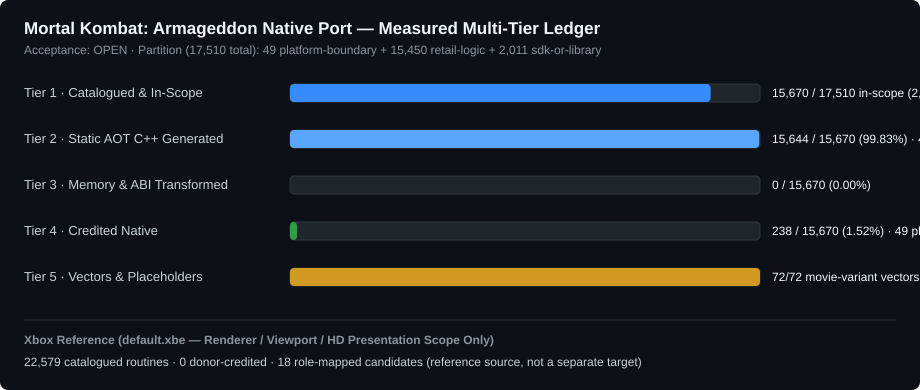

# Mortal Kombat: Armageddon retail native port

**Current status (2026-11-24): acceptance OPEN. Do not ask the owner to run the game.**
This project builds a native Windows port of retail *Mortal Kombat: Armageddon* (Sony PlayStation 2 `SLUS_214.10` and overlays).
Retail game logic outside platform boundaries comes from ahead-of-time (AOT) static C++ transformed to typed native memory and ABI (zero `g_ram`, zero `c.r`, zero `$gp`, zero guest vtables, zero runtime JIT or interpreter); hand-written C++ is restricted to platform boundaries and verified runtime services. Xbox investigation (`default.xbe`) is limited strictly to renderer, viewport, and HD presentation (`DECISION_OWNER_CORRECTIONS_20261124.json`). Whole-game native acceptance remains **OPEN** (`238 / 15,670` credited functions; headless 60-frame probe hits `13 / 26` registered placeholders; active fork build-time AOT regeneration pending Phase 3).
Neither the canonical playable oracle (`../../milestone_work_verified_playable_20261110/`, `ps2run.exe` `B9EEF7DA...`) nor its descendant Kombat Practice (`../../milestone_build_kombat_practice/`, `8B763DCC...`) satisfies the zero-emulation shipped-port acceptance contract.

<!-- PROGRESS:START -->
## Native Reimplementation Progress & Tracking

**Verified Fork Commit**: [`a546e18b`](https://github.com/nahshongraham97/ps2-native-recomp/commit/a546e18b4136a23952ac3ee4a8a165325bad184e) (pinned active fork)

### PlayStation 2 Retail Catalog (`SLUS_214.10` + Overlays)
- **In-Scope Completion**: **1.52%** (238 / 15,670 in-scope retail functions)
- **Total Function Catalog**: **17,510** functions (13,138 base `SLUS_214.10` + 4,372 dynamic overlays: 1 `GAMER.ovl`, 2,537 `MOVIER.ovl`, 1,834 `NETR.ovl`)

| Category / Tier | Status Breakdown | Count | In-Scope % |
|---|---|---|---|
| **Implemented** | `ported` (227) + `host-replaced` (11) + `implemented-via-donor` (0) | 238 | 1.52% |
| **Classified Non-Executable / Library** | `sdk-or-library` (2,011) + `pointer-scan-proven` (632) | 2,643 | 16.87% |
| **Open Frontier** | `open` (10,141: 9,038 `SLUS_214.10`, 1,102 `MOVIER.ovl`, 1 `GAMER.ovl`) + `no-direct-callers` (2,648 `SLUS_214.10`) | 12,789 | 81.61% |
| **In-Scope Subtotal** | *Active retail code path to implement/verify* | **15,670** | **100.00%** |
| **Excluded / Stubbed** | `out-of-scope-stubbed` (1,834 `NETR.ovl` overlay functions + 6 `SLUS_214.10` main-executable online functions) | 1,840 | — |
| **Total PS2 Catalog** | *Complete binary disassembly denominator* | **17,510** | — |

### Tier 2: Build-Time Static AOT Coverage (`research/ledger/aot_coverage_inventory.json`)
- **Reference Static AOT C++ Coverage**: **83.84%** (13,138 / 15,670 in-scope EE functions in reference `ps2-native-recomp-legacy-20261118/generated/mkarmageddon/table.cpp`; **0** generated `.cpp` units currently built in active fork `generated/` pending Phase 3 reproducible pipeline)

| Module / Artifact | Build-Time Static AOT Status | Static AOT / Catalog | Reference % |
|---|---|---|---|
| **Base `SLUS_214.10`** | `311` static `unit_*.cpp` files (`table.cpp`) | 13,138 / 13,138 | 100.00% |
| **`MOVIER.ovl` Overlay** | Build-time static overlay C++ NOT generated (`kModules` RAM slices excluded) | 0 / 2,537 | 0.00% |
| **`GAMER.ovl` Overlay** | Build-time static overlay C++ NOT generated (`kModules` RAM slices excluded) | 0 / 1 | 0.00% |
| **In-Scope AOT Subtotal** | *Measured build-time static C++ across `SLUS_214.10` + `MOVIER.ovl` + `GAMER.ovl`* | **13,138 / 15,670** | **83.84%** |
| **Excluded `NETR.ovl`** | Out of scope (`DECISION_ONLINE_OUT_OF_SCOPE.json`) | 0 / 1,834 | — |
| **Dynamic Overlay Windows (`kModules`)** | Runtime memory snapshots only (not full module AOT) | 4 captured windows | — |
| **VU1 Microprograms (Separate VU Domain)** | `vu1_table.cpp` keys vs `VU_CORPUS_STRICT.json` (211 `.bin` captures; 44 oracle `vu1-live/` DLLs) | 490 / 493 keys | — |

### Xbox Donor Catalog (`default.xbe`)
> [!NOTE]
> **Investigation Authority**: Xbox default.xbe serves as an authoritative secondary binary investigation source for recovering algorithm contracts and data structures; donor credit requires verified dual-platform vectors.
> **Donor Credit Policy**: 0% donor credit means no donor credit has been awarded pending verified dual-platform vectors, not that work has stalled.

- **In-Scope Donor Utilization**: **0.00%** (0 / 21,321 in-scope donor functions)
- **Total Donor Catalog**: **22,579** discovered functions in `default.xbe`

| Category / Tier | Status Breakdown | Count | In-Scope % |
|---|---|---|---|
| **Implemented Donors** | `implemented-via-donor` (0) | 0 | 0.00% |
| **Classified Non-Executable / SDK** | `sdk-or-library` (2,524) + `no-counterpart` (9) | 2,533 | 11.88% |
| **Open Donor Frontier** | `blocked-on-dual-platform-vectors` (17 candidates pending vectors) + `investigating` (10 active recovery) + `not-started` (18,761 unmapped) | 18,788 | 88.12% |
| **In-Scope Subtotal** | *Donor executable candidate surface* | **21,321** | **100.00%** |
| **Excluded / Stubbed** | `out-of-scope-stubbed` (XONLINE thunks and symbols) | 1,258 | — |
| **Total Xbox Catalog** | *Total default.xbe function inventory* | **22,579** | — |

### Cross-Platform Function Correspondence (`ps2_xbox_map.csv`)
- **Total Mapping Entries**: **17,511**
- **Exact Matches**: **0** (0 isomorphic CFG)
- **Structural Correspondence Matches**: **0** (verified non-vacuous multi-block CFG isomorphism and common mapped callees; simple offsets disregarded)
- **Composite 1-to-Many Matches**: **0** (modular donor splits)
- **Mapped-by-Role Candidates**: **18** (subsystem role correspondence pending dual-platform vectors)
- **Unmapped Retail Functions**: **17,493**

### Still Needed (Open Acceptance Frontier)
1. **No-Direct-Callers Indirect Dispatch Resolution**: **2,648** functions untargeted by direct calls but referenced by data pointers or immediate formations (indirect candidates across 5,400 computed call sites).
2. **Open Game Functions**: **10,141** retail game functions across modules: **9,038** in `SLUS_214.10`, **1,102** in `MOVIER.ovl`, and **1** in `GAMER.ovl`.
3. **Dynamic Overlay Frontends**: **1,102** movie playback frontend functions in `MOVIER.ovl` and **1** entry stub in `GAMER.ovl`.
4. **Acceptance Gates**: Full-game entry link, visible render target presentation, synchronized audio mixing, and physical controller input parity.
<!-- PROGRESS:END -->

## Documentation & Entry Points

Read in order:

1. [PORT_STATUS.md](PORT_STATUS.md) — audited checkout state, component receipts, and active blockers.
2. [NATIVE_PORT_ONLY.md](NATIVE_PORT_ONLY.md) — non-negotiable zero-emulation architecture rules.
3. [NATIVE_PORT_EXECUTION_CONTRACT.md](NATIVE_PORT_EXECUTION_CONTRACT.md) — acceptance gates and non-regression contract.
4. [ROADMAP.md](ROADMAP.md) — ordered implementation sequence and closure checks.
5. [TASK_BOARD.md](TASK_BOARD.md) — milestone status table and xemu trace exception.
6. [HANDOFF.md](HANDOFF.md) — active repository workflow and falsification checklist.
7. [REPO_LAYOUT.md](REPO_LAYOUT.md) — directory layout and parent/fork mechanics.
8. [AGENTS.md](AGENTS.md) — binding agent rules and transform-and-verify protocol.
9. [MODEL_COORDINATION.md](MODEL_COORDINATION.md) — local source-review model workflow.

The protected duplicate oracle game copy is `external/forks/ps2-native-recomp-backup-20261110/`. Preserve it along with all user saves, memory cards, key files, and model settings; noncompliant local commits and dirty files are discarded per `DECISION_OWNER_CORRECTIONS_20261124.json`.
Historical logs and experiments live in `research/runs/` and `research/history/`; they are evidence for dated builds, never live instructions. The consolidated status archive lives in `research/history/superseded-status-docs-20261124/`. Retail binary assets (`.ELF`, `.xbe`, `.bin`, `.ovl`, audio/video streams) remain local and untracked.
