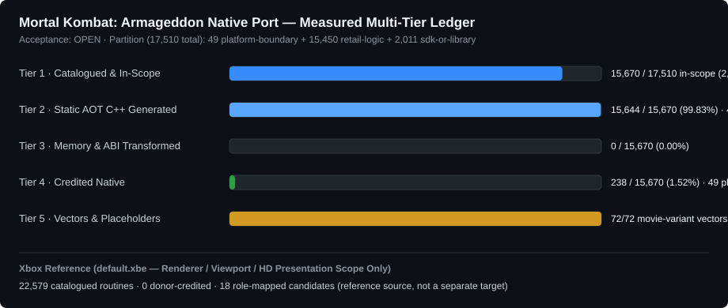

# Retail native-port task board

**Audited 2026-11-24. Whole-game native acceptance: OPEN.** The full instructions, order,
files, and closure evidence are in [ROADMAP.md](ROADMAP.md). This board indexes
each deliverable's verified component progress and whole-game acceptance state;
[PORT_STATUS.md](PORT_STATUS.md) is the live status. The previous baseline board is
archived at `research/history/native-port-docs-2026-11-18/TASK_BOARD.md`.

<!-- PROGRESS:START -->
## Native Reimplementation Progress & Tracking

**Verified Fork Commit**: [`a546e18b`](https://github.com/nahshongraham97/ps2-native-recomp/commit/a546e18b4136a23952ac3ee4a8a165325bad184e) (pinned active fork)

### PlayStation 2 Retail Catalog (`SLUS_214.10` + Overlays)
- **In-Scope Completion**: **1.52%** (238 / 15,670 in-scope retail functions)
- **Total Function Catalog**: **17,510** functions (13,138 base `SLUS_214.10` + 4,372 dynamic overlays: 1 `GAMER.ovl`, 2,537 `MOVIER.ovl`, 1,834 `NETR.ovl`)

| Category / Tier | Status Breakdown | Count | In-Scope % |
|---|---|---|---|
| **Implemented** | `ported` (227) + `host-replaced` (11) + `implemented-via-donor` (0) | 238 | 1.52% |
| **Classified Non-Executable / Library** | `sdk-or-library` (2,011) + `pointer-scan-proven` (632) | 2,643 | 16.87% |
| **Open Frontier** | `open` (10,141: 9,038 `SLUS_214.10`, 1,102 `MOVIER.ovl`, 1 `GAMER.ovl`) + `no-direct-callers` (2,648 `SLUS_214.10`) | 12,789 | 81.61% |
| **In-Scope Subtotal** | *Active retail code path to implement/verify* | **15,670** | **100.00%** |
| **Excluded / Stubbed** | `out-of-scope-stubbed` (1,834 `NETR.ovl` overlay functions + 6 `SLUS_214.10` main-executable online functions) | 1,840 | — |
| **Total PS2 Catalog** | *Complete binary disassembly denominator* | **17,510** | — |

### Tier 2: Build-Time Static AOT Coverage (`research/ledger/aot_coverage_inventory.json`)
- **Reference Static AOT C++ Coverage**: **83.84%** (13,138 / 15,670 in-scope EE functions in reference `ps2-native-recomp-legacy-20261118/generated/mkarmageddon/table.cpp`; **0** generated `.cpp` units currently built in active fork `generated/` pending Phase 3 reproducible pipeline)

| Module / Artifact | Build-Time Static AOT Status | Static AOT / Catalog | Reference % |
|---|---|---|---|
| **Base `SLUS_214.10`** | `311` static `unit_*.cpp` files (`table.cpp`) | 13,138 / 13,138 | 100.00% |
| **`MOVIER.ovl` Overlay** | Build-time static overlay C++ NOT generated (`kModules` RAM slices excluded) | 0 / 2,537 | 0.00% |
| **`GAMER.ovl` Overlay** | Build-time static overlay C++ NOT generated (`kModules` RAM slices excluded) | 0 / 1 | 0.00% |
| **In-Scope AOT Subtotal** | *Measured build-time static C++ across `SLUS_214.10` + `MOVIER.ovl` + `GAMER.ovl`* | **13,138 / 15,670** | **83.84%** |
| **Excluded `NETR.ovl`** | Out of scope (`DECISION_ONLINE_OUT_OF_SCOPE.json`) | 0 / 1,834 | — |
| **Dynamic Overlay Windows (`kModules`)** | Runtime memory snapshots only (not full module AOT) | 4 captured windows | — |
| **VU1 Microprograms (Separate VU Domain)** | `vu1_table.cpp` keys vs `VU_CORPUS_STRICT.json` (211 `.bin` captures; 44 oracle `vu1-live/` DLLs) | 490 / 493 keys | — |

### Xbox Donor Catalog (`default.xbe`)
> [!NOTE]
> **Investigation Authority**: Xbox default.xbe serves as an authoritative secondary binary investigation source for recovering algorithm contracts and data structures; donor credit requires verified dual-platform vectors.
> **Donor Credit Policy**: 0% donor credit means no donor credit has been awarded pending verified dual-platform vectors, not that work has stalled.

- **In-Scope Donor Utilization**: **0.00%** (0 / 21,321 in-scope donor functions)
- **Total Donor Catalog**: **22,579** discovered functions in `default.xbe`

| Category / Tier | Status Breakdown | Count | In-Scope % |
|---|---|---|---|
| **Implemented Donors** | `implemented-via-donor` (0) | 0 | 0.00% |
| **Classified Non-Executable / SDK** | `sdk-or-library` (2,524) + `no-counterpart` (9) | 2,533 | 11.88% |
| **Open Donor Frontier** | `blocked-on-dual-platform-vectors` (17 candidates pending vectors) + `investigating` (10 active recovery) + `not-started` (18,761 unmapped) | 18,788 | 88.12% |
| **In-Scope Subtotal** | *Donor executable candidate surface* | **21,321** | **100.00%** |
| **Excluded / Stubbed** | `out-of-scope-stubbed` (XONLINE thunks and symbols) | 1,258 | — |
| **Total Xbox Catalog** | *Total default.xbe function inventory* | **22,579** | — |

### Cross-Platform Function Correspondence (`ps2_xbox_map.csv`)
- **Total Mapping Entries**: **17,511**
- **Exact Matches**: **0** (0 isomorphic CFG)
- **Structural Correspondence Matches**: **0** (verified non-vacuous multi-block CFG isomorphism and common mapped callees; simple offsets disregarded)
- **Composite 1-to-Many Matches**: **0** (modular donor splits)
- **Mapped-by-Role Candidates**: **18** (subsystem role correspondence pending dual-platform vectors)
- **Unmapped Retail Functions**: **17,493**

### Still Needed (Open Acceptance Frontier)
1. **No-Direct-Callers Indirect Dispatch Resolution**: **2,648** functions untargeted by direct calls but referenced by data pointers or immediate formations (indirect candidates across 5,400 computed call sites).
2. **Open Game Functions**: **10,141** retail game functions across modules: **9,038** in `SLUS_214.10`, **1,102** in `MOVIER.ovl`, and **1** in `GAMER.ovl`.
3. **Dynamic Overlay Frontends**: **1,102** movie playback frontend functions in `MOVIER.ovl` and **1** entry stub in `GAMER.ovl`.
4. **Acceptance Gates**: Full-game entry link, visible render target presentation, synchronized audio mixing, and physical controller input parity.
<!-- PROGRESS:END -->

| Order | Deliverable | State | Verified progress & open frontier |
| --- | --- | --- | --- |
| 0 | Preserve and hash playable/card oracles, assets, saves, checkout | **Verified / Preserved** | 2026-11-10 playable oracle safety copy (SHA-256 `B9EEF7DAD3CFA0E1216493CF12301F14AA4B3A8B1456FCDC60D9C39502A0D860`), 61 states, 72 input sidecars, disc files, and original cards preserved and hashed. Clean isolated worktrees and private Ghidra sessions (`a92b59f4`) maintained. |
| 1 | Manifest validator and isolated packager tested; counter check remains diagnostic | **Verified / Tested** | Manifest validator and isolated packager pass (32 tests in `tools/acceptance/TEST_RUN_2026-11-18.txt`, packaging pipelines in `research/runs/parallel-agent-preparation-20261122/`). Staging enforced; counter checks remain diagnostic. |
| 2 | Offline executable/platform/asset inventory with evidence for every entry | **Offline Complete (Dynamic Reachability Open)** | Offline inventories complete with exact counts: 13,138 base functions in `SLUS_214.10` ([INSTRUCTION_COVERAGE.md](research/runs/ghidra-function-coverage-20261118/INSTRUCTION_COVERAGE.md)), 4,372 dynamic overlay functions (1 in `GAMER.ovl`, 2,537 in `MOVIER.ovl`, 1,834 in `NETR.ovl` in [OVERLAY-MAP-MANIFEST.json](recomp/overlays/OVERLAY-MAP-MANIFEST.json)), yielding 17,510 total catalog functions; 1,840 functions excluded out-of-scope per Owner Decision ([DECISION_ONLINE_OUT_OF_SCOPE.json](research/decisions/DECISION_ONLINE_OUT_OF_SCOPE.json): 1,834 in `NETR.ovl` + 6 in `SLUS_214.10`), leaving 15,670 active in-scope retail functions; 22,579 donor functions in `default.xbe` ([xbox-donor-20261121](research/runs/xbox-donor-20261121/)); 245 extracted PS2 art files / 1,408,827,392 bytes ([loose-assets SUMMARY.md](research/runs/native-retail-loose-assets-20261121/SUMMARY.md)); 38 actual `.SFD` movie files ([movie provenance.json](research/runs/native-movie-inventory-20261119/provenance.json)); 69,440 pinned PCM bytes / 344 catalog entries ([audio SOURCE.md](research/runs/native-audio-codec-contract-20261118/SOURCE.md)). Dynamic runtime reachability and indirect call graph expansion remain open. |
| 3 | Native host memory objects/handles; remove fixed guest map and ABI | **Verified in Prefix** (Whole-game open) | Fixed guest map (`g_ram`, `g_spr`, `g_memory`) completely removed from all implemented native components. Real host memory ownership: `NativeRetailRendererAllocatorService` (allocator 220900 passing `test_native_retail_renderer_allocator`), typed `NativeRetailGameSession`, `NativeRetailRasterRecord`, `NativeRetailCameraRecord`, `NativeRetailFrameNode`, and memory owners (`libmka_native_retail_memory_owners.a`, `libmka_native_heap.a`). Whole-game acceptance remains Open. |
| 4 | EE/VU0/VU1 linked AOT coverage; remove interpreters/runtime compilers | **In-Progress: Function Coverage** | 238/15,670 in-scope retail functions implemented (1.52% per research/ledger/functions.csv). Complete accounting across all 17,510 catalog functions indexed in [progress.svg](progress.svg) and [functions.csv](research/ledger/functions.csv). Diagnostic count: 33 remaining unresolved link symbols in full-entry link diagnostic. Pure native C++ AOT compilation with zero runtime interpreter or JIT recompiler on native path. |
| 5 | Extracted-file VFS, native saves, IOP services; remove CDVD/SIF/guest IRX | **Verified in Prefix** (Whole-game open) | Extracted loose-file native VFS implemented (`NativeFile`, `NativeContentVolume`, `NativeRetailPackage` in `libmka_native_retail_file_paths.a`), eliminating runtime ISO/CDVD/archive dependencies. Native read streams tested (`test_native_retail_renderer_streams`). Native save store implemented (`libmka_native_save_store.a`, profile startup `171B10`, child resets `246070`/`245DD0`). Guest IRX and SIF RPC modules excised from native prefix. |
| 6 | Physical keyboard and controller input with retail action parity | **In-Progress: Mapped** (Action parity open) | Native keyboard and controller mapping implemented (`libmka_native_retail_keyboard.a`, SDL2 input hooks, LOGON input tasks, `NativeRetailInputParticipant`). Binding `poll_retail_controller_roles` and action tasks identified. Physical action parity against playable oracle remains Open until runtime game loop execution. |
| 7 | Correct bank/sample identity and native sound output | **In-Progress: 25 Clients Pass** (Playback open) | Native sound programs, ADX streaming decoder, sample payload readers, gain/pan curve corrections, bank loaders, and held audio playback/resume checkpoint verified across 25 audio component clients (`research/runs/native-sound-program-20261118/`, `research/runs/native-audio-codec-contract-20261118/`). Live sound mixing, streaming music playback, and whole-game audio output remain Open. |
| 8 | Native video decode, presentation, and synchronized audio | **In-Progress: Offline Passes** (In-game presentation open) | Offline native movie ingress, MPEG2 video demuxing/decoding, ADX audio decoding, and movie clock filter arithmetic pass on retail movie corpus (`LOGON.SFD`, `TITLEN.SFD`, `OPENINGN.SFD` in `research/runs/native-movie-decode-20261119/`). Real offscreen GL device (`NativeMovieGlDevice`) verified. In-game synchronized presentation in active game loop remains Open. |
| 9 | GPU-owned GS packet rendering; remove host VRAM/CPU raster/state model | **In-Progress: 0402–040b Verified** (Draw path open) | no draw path exists yet; absence of CPU raster is untested. Enforceable build-failing acceptance gates active: (1) Source audit failing on per-pixel framebuffer/depth writes, scanline/edge fill loops, barycentric code, CPU color/depth arrays, and structural frame-sized buffers across entire native and host trees (1,141 sources/build files verified); (2) Readback ban with hash-pinned allowlist `ALLOWLIST_DIAGNOSTIC_READBACK` (`capture_display_rgba` body pinned to SHA-256 `8fef861dad0017b9a53e30f47ece56f8cad3213548022831d3999b070a1983d4`) strictly forbidding frame-path glReadPixels/glGetTexImage, modified function bodies, and comment-marker bypasses; (3) Runtime proof requiring mandatory telemetry counters (GL draw calls > 0, CPU composited pixels = 0, frame readbacks = 0, diagnostic readbacks = 0 in release runs, software rasterizer fallbacks = 0) with external frame capture requirement; (4) Reference raster fence (`audit_reference_raster_fence`) ensuring `MKA_REFERENCE_RASTER` is defined exclusively for verified test targets; (5) 0406 image output restricted exclusively to NativeGlTextureUpload; (6) Binary/link-map symbol scan for forbidden rasterizer symbols; (7) Online scenario guard requiring authenticated `DECISION_ONLINE_OUT_OF_SCOPE.json` to skip decommissioned online tests. Native renderer architecture avoids host VRAM emulation, backing textures directly to host OpenGL via `NativeGlTextureUpload` / offscreen `HiddenGl` fixture. Verified core plugins: 0402 (matrix), 0403 (frames), 0404 (streams), 0405 (cameras), 0406 (CPU images), 0407 (rasters with real offscreen `HiddenGl` WGL context and `glIsTexture`), 0408 (textures with sentinel dummy texture support matching binary disassembly 0x002b8500), 0409 (texture dictionaries with freelist-backed 96-byte container allocation, circular list membership, module open/close, and current dictionary tracking matching binary disassembly 0x002c9840/0x002c9860), 0412 (world module scoped strictly to recovered source: container allocation via plugin registry extension helpers, generational handles, module open/close, and module refcounting matching binary disassembly 0x002cd7d0/0x002cd820), 040a (materials with typed native material ownership, generational handles, RGBA colors, surface properties, refcounting, and module refcounting matching binary disassembly 0x002c0cf0/0x002c0cb0), 040b (geometry with typed native geometry ownership, generational handles, vertex/triangle descriptions, refcounting, explicit destruction, and module count tracking matching binary disassembly 0x002c2d40/0x002c30a0 in default.xbe and 0x001a1b30/0x001a1b90 in SLUS_214.10). All 15 renderer and presentation component clients pass. Render targets, depth buffers, draw calls, and whole-scene rendering remain Open. |
| 10 | One clean whole-game non-regression and no-emulation acceptance build | **Open** | Acceptance remains strictly Open (238/15,670 in-scope implemented per research/ledger/functions.csv, 1.52%). Full breakdown, open frontier tiers, and donor mappings tracked in [progress.svg](progress.svg) and the progress summary above. Full entry link and whole-game acceptance remain open; no visible window, no audible endpoint, no owner launch authorized until all remaining functions and link effects pass the clean non-regression acceptance matrix. |

> [!NOTE]
> **2026-11-24 Exception (User Authorized - xemu Guest Trace Verification)**:
> An explicit dated exception is granted by the user for offline xemu emulator runs (`<xemu-install>/xemu.exe`) to execute guest-debugging trace capture (`-s -S` on `localhost:1234`) and snapshot evaluation against authentic Xbox `default.xbe`. While xemu opens an OS window and initializes an audio device, runs are configured to minimize host impact: audio volume is clamped to 0.0 (`volume_limit = 0.0`, `background = "mute"` in `xemu.toml`), the window is minimized, and execution is automated headlessly via socket and redirected stdout/stderr. All retail assets (BIOS, MCPX, HDD, ISO) remain strictly local and untracked. Whole-game native port acceptance remains strictly **OPEN**.

> [!NOTE]
> **2026-11-24 Phase 0 Preflight, Oracle Restoration & Baseline Gate**:
> Unpushed noncompliant commits discarded (`44ab7b37`, `e8dc7173`, `6bebd90b`, `07d5827b` in fork; `6752e59e`, `1b4b25b0`, `3972b16f` in parent; plus superseded dirty edits in legacy `external/forks/ps2-native-recomp`). Canonical oracle `../../milestone_work_verified_playable_20261110` (`ps2run.exe` `b9eef7da...`) restored cleanly (`3,250` -> `3,256` files, 0 existing files modified/deleted; duplicate backup `external/forks/ps2-native-recomp-backup-20261110/games/mkarmageddon` verified 100% identical across `3,249` shared files). Git ancestry and binary audit established `../../milestone_build_kombat_practice` (`8b763dcc...`) as a direct descendant of the oracle (`cd33a7f`..`67612aa`, 33 hook commits); clean parity requires `--no-hooks`/`--parity` + hook env vars `=0`, and assist hooks stay out of shipped native builds (`research/decisions/DECISION_OWNER_CORRECTIONS_20261124.json`). Recorded checkout inventory (110 dirs across `external/forks/` & `Armageddon-backup/forks/`) and oracle manifests under git-ignored `external/forks/ps2-native-recomp/build/oracle-telemetry/`. Phase 0 baselines pass (`sync_verify`, `test_check_acceptance` 25/25, CPU-raster ban 1,158 sources, `test_full_existence_validation` 249 entries + 12 planted failures, `test_manifest` 21/21 + 1 skip, `test_native_headless_entry_run`, `test_native_startup_missing_bindings`, `test_native_retail_movie_variant_oracle` 72/72, and all 15 renderer/presentation component clients).

Close a row only with the ROADMAP evidence and a same-build run record.
No owner launch is a task while any row remains open.
